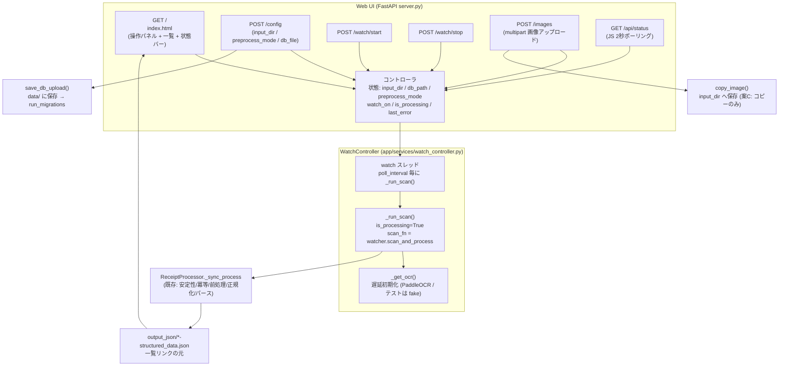

# Architecture snapshot: Web UI からの watch・設定操作 (Issue #56)

Date: 2026-11-16

## 全体データフロー

## スレッドモデル

- **FastAPI（メインスレッド）**: リクエスト処理。`/images` はコピーのみで即時処理しない（案C）
- **watch スレッド**（daemon）: `_watch_loop()` が `stop_event.wait(poll_interval)` で間欠起動。停止は `stop_watch()` が `stop_event.set()` + `join(timeout)`
- **多重スキャン防止**: `_scan_lock` を非ブロッキング acquire。処理中なら次サイクルへスキップ
- **OCR 遅延初期化**: `_ocr_lock` で二重生成防止。初回スキャン時に生成

## モジュール構成

### 新規: `app/services/watch_controller.py`

- `WatchController.__init__` — ディレクトリ4点・`db_path`・`preprocess_mode`・`poll_interval`・`model`・`scan_fn`（DI）・`ocr_factory`（DI）・`schema_path`
- 設定系: `set_input_dir()` / `set_db_path()`（migration 実行）/ `set_preprocess_mode()`（4値検証）
- アップロード系: `save_db_upload(content, filename)`（`data/` 保存 + migration）/ `copy_image(filename, content)`（input_dir 保存 + 拡張子検証）
- watch 系: `start_watch()`（DB 未選択は `ValueError`）/ `stop_watch()` / `watch_on` / `_watch_loop()` / `_run_scan()`
- 状態系: `is_processing` / `has_db` / `db_path` / `get_status()`（JSON dict）

### 修正: `app/web/server.py`

- `create_app(output_dir, db_path, input_dir, processed_dir, failed_dir, controller)` — `controller` 未指定なら内部生成（既存テスト互換）
- `get_db_path()` を**コントローラの現在値**から解決（実行中の DB 差し替えに追従）
- 新ルート:

| ルート | メソッド | 動作 |
|--------|---------|------|
| `/config` | POST | `input_dir` / `preprocess_mode` / `db_file`（UploadFile）を設定。303 → `/` |
| `/watch/start` | POST | DB 未選択なら 400。スレッド開始。303 → `/` |
| `/watch/stop` | POST | スレッド停止。303 → `/` |
| `/images` | POST | DB 未選択 400 / 処理中 409 / 非画像 400。input_dir へコピーのみ。303 → `/` |
| `/api/status` | GET | `get_status()` の JSON を返す（JS ポーリング用） |

- `GET /` は `{"items": ..., "ctl": controller.get_status()}` を index.html へ

### 修正: `app/web/templates/index.html`

一覧テーブル上部に操作パネル + 状態バー + インライン JS（約 25 行）:

- `/config` フォーム（指定フォルダ / 前処理 / DB file）
- `/watch/start`・`/watch/stop` フォーム（watch 状態で出し分け）
- `/images` フォーム（画像 file input + 注意書き）
- `#status-bar`（横いっぱい）: watch: ON/OFF / process: 実行中/待機中
- `pollStatus()` 2秒間隔ポーリング → 状態更新・disabled 制御・完了時 `location.reload()`

htmx は使わない（プレーン POST + 303 は `admin_templates` の既存パターンと同一。非同期は fetch ポーリング）。

### 修正: `main.py`

`--serve` 分岐を **PaddleOCR 初期化より前** に移動し、OCR を初期化しない（コントローラが遅延初期化）。CLI 系（watch / input_json / image_name）の挙動は不変。

## 状態遷移

| 状態 | watch_on | is_processing | file input |
|------|----------|---------------|------------|
| 起動直後 | False | False | 有効 |
| DB 未選択で操作 | False | False | 有効（watch start / upload は 400 エラー） |
| watch ON（スキャン待ち） | True | False | 有効 |
| スキャン中（処理中） | True | True | **disabled** |
| スキャン完了 | True | False | 有効（JS がページリロード → 一覧に新リンク） |

## 受け入れ要件との対応

| 受け入れ要件 | 実装 |
|-------------|------|
| 1. Web ページから watch が動作 | `POST /watch/start` → ポーリングスレッド。`/api/status` の `watch_on` で確認 |
| 2. DB なし + watch/画像指定でエラー | `start_watch()` と `POST /images` 両方で `has_db` ガード → HTTP 400 |
| 3. 生成中は file input 操作不能、生成後解除（watch 継続） | JS が `is_processing` に応じて `disabled` 制御。watch スレッドは独立に継続 |

## 非目標（YAGNI）

- 設定の永続化（Q3 案A: メモリのみ・ユーザー確認済み）
- 即時処理（Q1 案C: コピーのみ、watch のポーリングが処理）
- watchdog（inotify）利用 / `--preprocess-force` の UI 化 / structured データの Web 削除
