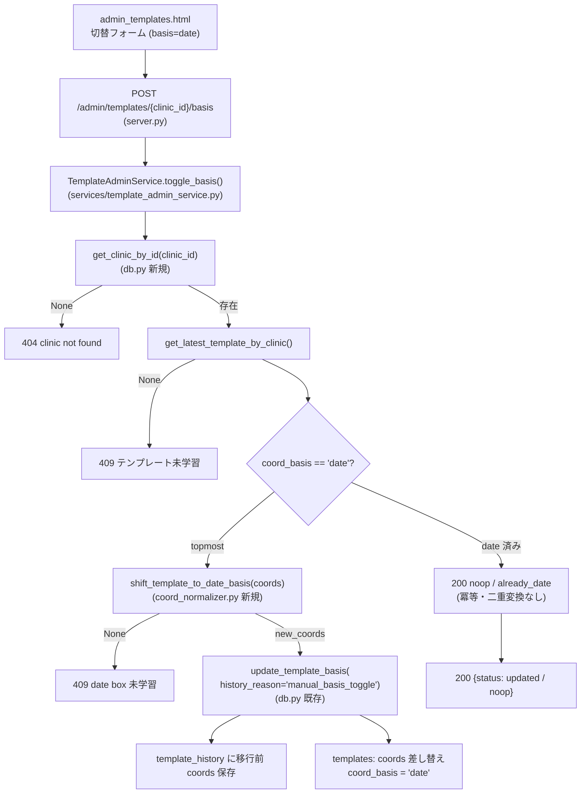

# Issue #42: アーキテクチャ設計 — coord_basis 手動切替の Web UI 追加

## 全体データフロー（POST /admin/templates/{clinic_id}/basis）



一覧（GET /admin/templates）は `get_all_templates_with_names()` をそのまま整形して表示する
（clinic 名 join・最新版のみ・coords デコード済み）。シフト計算ロジックは
`apply_date_anchor_normalization()`（date_anchor.py 行 226-236）と**同一の式**を
`shift_template_to_date_basis()` に集約し、自動遷移・手動切替の両方で共用する。

## 修正対象モジュール

| モジュール | 変更内容 | 備考 |
|-----------|---------|------|
| `app/coord_normalizer.py` | `shift_template_to_date_basis(coords)` を追加 | シフト計算の共通化（Q2・案A） |
| `app/date_anchor.py` | 自動移行ブロック（行 226-236）を `shift_template_to_date_basis()` 呼び出しに置換 | 同値リファクタ・動作不変 |
| `app/db.py` | `get_clinic_by_id(db_path, clinic_id)` を追加 | 404 判定用（tenplates 未取得の clinic を区別） |
| `app/services/receipt_database_repository.py` | `get_clinic_by_id()` を追加 | repository 経由で `TemplateAdminService` から使う |
| `app/services/template_admin_service.py` | **新規** `TemplateAdminService`（list_templates / toggle_basis） | ビジネスロジック（Q1・案A） |
| `app/web/server.py` | `GET /admin/templates`・`POST /admin/templates/{clinic_id}/basis` を追加 | 薄いルーティングのみ |
| `app/web/templates/admin_templates.html` | **新規** 管理画面ページ | coord_basis / date box 学習有無 / 切替フォーム |
| `app/web/templates/index.html` | 管理画面へのリンク追加 | |
| `tests/test_coord_normalizer.py` | `shift_template_to_date_basis()` の単体テスト追加 | tracked ファイル |
| `tests/test_db.py` | `get_clinic_by_id()` のテスト追加 | tracked ファイル |
| `tests/test_web.py` | admin ルート群の統合テスト追加 | tracked ファイル |

## 変更しないモジュール

| モジュール | 理由 |
|-----------|------|
| `app/db.update_template_basis()` | 既存の一括移行関数（history + coords + basis）をそのまま再利用 |
| `app/coord_normalizer.shift_template_coords()` | 既存シフト関数を再利用（変更なし） |
| `app/date_anchor.resolve_date_anchor()` | 曖昧性判定の緩和は対象外（後続 TODO） |
| `app/db_migrations.py` / `docs/schema.sql` | schema 変更なし（coord_basis は #39 で存在） |
| `app/structural_parser.py` | 前方補正の coord_basis ガードは #40 で対応済み |
| CLI / watcher 経路 | Web 管理機能の追加のみで処理経路は不変 |

## 修正詳細

### 1. `shift_template_to_date_basis()`（coord_normalizer.py に追加）

`apply_date_anchor_normalization()` の行 229-235 と同一のオフセット導出を関数化する。
テンプレート自身の date box の min-x / min-y をオフセットとし、`shift_template_coords` で全
box をシフトする。date box 未学習 / 不正（2D 点が無い）は None を返す。

```python
def shift_template_to_date_basis(coords: Dict[str, Any]) -> Optional[Dict[str, Any]]:
    """Shift template coords so the template's own date box becomes the origin.

    Shared by apply_date_anchor_normalization (auto migration, Issue #39) and
    the Web admin manual toggle (Issue #42). Returns None when the date box is
    unlearned or malformed.

    Args:
        coords: Template coords_corrections dict.

    Returns:
        A new dict shifted by the date box's (min-x, min-y), or None.
    """
    date_box = coords.get("date")
    if not isinstance(date_box, (list, tuple)) or not date_box:
        return None
    valid_points = [p for p in date_box if isinstance(p, (list, tuple)) and len(p) >= 2]
    if not valid_points:
        return None
    offset_x = min(p[0] for p in valid_points)
    offset_y = min(p[1] for p in valid_points)
    return shift_template_coords(coords, offset_x, offset_y)
```

### 2. `date_anchor.py` の置換（同値リファクタ）

`apply_date_anchor_normalization()` 内の「一度だけ topmost → date 基準へ移行」ブロック
（現行 218-244 行）のうち、`template_date_box` 再取得〜`shift_template_coords` 呼び出し部分を
新関数へ置換する。ログ出力は raw offset のみに簡略化する（動作には無影響。テストは
`tests/test_date_anchor.py` で回帰確認）。

```python
    # 一度だけ topmost → date 基準へ移行（既に date なら no-op）
    if template_basis == "topmost":
        from app.db import update_template_basis as _utb
        from app.coord_normalizer import shift_template_to_date_basis

        # template は topmost 基準で学習されているため、date 基準へ変換するには
        # template 自身の date box 位置（topmost 座標系）でシフトする（Issue #39-4）。
        new_coords = shift_template_to_date_basis(coords)
        if new_coords is None:
            return None  # date 未学習 → 従来方式
        _utb(db_path, clinic_id, new_coords, changed_fields=list(coords.keys()))
        logger.info(
            "Migrated template for clinic %s to date basis (raw_offset=(%d, %d))",
            clinic_id,
            offset_x,
            offset_y,
        )
```

### 3. `get_clinic_by_id()`（db.py + repository に追加）

clinic_id の存在確認用（404 と「clinic 存在・template 未学習」(409) を区別するため）。

```python
def get_clinic_by_id(db_path: str | Path, clinic_id: str) -> Optional[Dict[str, Any]]:
    """Retrieve a clinic by its ID.

    Args:
        db_path: Path to the SQLite database.
        clinic_id: The clinic ID.

    Returns:
        Optional[Dict[str, Any]]: The clinic dict with keys id, name, created_at,
                                  or None if no such clinic exists.
    """
    conn = get_db_connection(db_path)
    try:
        cursor = conn.execute(
            "SELECT id, name, created_at FROM clinics WHERE id = ?",
            (clinic_id,),
        )
        row = cursor.fetchone()
        return dict(row) if row else None
    finally:
        conn.close()
```

`ReceiptDatabaseRepository` にも同様の薄いメソッドを追加する（`is_available()` ガード付き）。

### 4. `TemplateAdminService`（services/template_admin_service.py 新規）

```python
"""Template admin service: manual coord_basis toggle (topmost -> date)."""

from __future__ import annotations

from pathlib import Path
from typing import Any, Dict, List, Optional

from app.coord_normalizer import shift_template_to_date_basis
from app.db import (
    get_all_templates_with_names,
    get_clinic_by_id,
    get_latest_template_by_clinic,
    update_template_basis,
)


class ClinicNotFoundError(Exception):
    """Raised when the target clinic_id does not exist (-> 404)."""


class TemplateBasisConflictError(Exception):
    """Raised when the template cannot be migrated to date basis (-> 409)."""


class InvalidBasisError(ValueError):
    """Raised when the requested basis value is unsupported (-> 400)."""


class TemplateAdminService:
    """Manage clinic templates via the Web admin UI (Issue #42)."""

    def __init__(self, db_path: Optional[str | Path] = None) -> None:
        self.db_path = Path(db_path) if db_path else None

    def list_templates(self) -> List[Dict[str, Any]]:
        """Return the latest template per clinic with admin display fields."""
        if not self.db_path:
            raise RuntimeError("DB が設定されていません")
        templates = get_all_templates_with_names(self.db_path)
        for t in templates:
            coords = t.get("coords_corrections") or {}
            t["date_box_learned"] = coords.get("date") is not None
            t["basis"] = t.get("coord_basis") or "topmost"
        return templates

    def toggle_basis(self, clinic_id: str, basis: str) -> Dict[str, Any]:
        """Manually migrate the clinic's latest template to date basis.

        Raises:
            InvalidBasisError: basis is not 'date'.
            ClinicNotFoundError: clinic_id does not exist.
            TemplateBasisConflictError: no template / date box unlearned.
            RuntimeError: DB not configured.
        """
        if not self.db_path:
            raise RuntimeError("DB が設定されていません")
        if basis != "date":
            raise InvalidBasisError(f"未対応の basis: {basis!r} (サポート: 'date')")

        if get_clinic_by_id(self.db_path, clinic_id) is None:
            raise ClinicNotFoundError(f"clinic not found: {clinic_id}")

        template = get_latest_template_by_clinic(self.db_path, clinic_id)
        if template is None:
            raise TemplateBasisConflictError("テンプレート未学習のため切替できません")
        if (template.get("coord_basis") or "topmost") == "date":
            return {"status": "noop", "reason": "already_date"}

        coords = template.get("coords_corrections") or {}
        new_coords = shift_template_to_date_basis(coords)
        if new_coords is None:
            raise TemplateBasisConflictError("date box 未学習のため切替できません")

        migrated = update_template_basis(
            self.db_path,
            clinic_id,
            new_coords,
            changed_fields=list(coords.keys()),
            history_reason="manual_basis_toggle",
        )
        if not migrated:
            # 競合: 直前に他経路で移行済みの場合（冪等に扱う）
            return {"status": "noop", "reason": "already_date"}
        return {"status": "updated", "coord_basis": "date"}
```

### 5. server.py ルート追加（薄いハンドラのみ）

`get_db_path` 依存を流用した `get_template_admin_service` を追加し、2 ルートを実装する。
POST ボディは既存 `PUT /{file_stem}` と同様に JSON / Form の両対応とする。

```python
from app.services.template_admin_service import (
    ClinicNotFoundError,
    InvalidBasisError,
    TemplateAdminService,
    TemplateBasisConflictError,
)

    def get_template_admin_service(
        db_path: Path | None = Depends(get_db_path),
    ) -> TemplateAdminService:
        return TemplateAdminService(db_path)

    @app.get("/admin/templates", response_class=HTMLResponse)
    async def admin_template_list(
        request: Request,
        service: TemplateAdminService = Depends(get_template_admin_service),
    ):
        """管理画面: clinic と最新 template の一覧（coord_basis / date box 学習有無）"""
        try:
            template_rows = service.list_templates()
        except RuntimeError as e:
            raise HTTPException(status_code=503, detail=str(e))
        return templates.TemplateResponse(
            request=request,
            name="admin_templates.html",
            context={"templates": template_rows},
        )

    @app.post("/admin/templates/{clinic_id}/basis")
    async def admin_toggle_basis(
        clinic_id: str,
        request: Request,
        service: TemplateAdminService = Depends(get_template_admin_service),
    ):
        """coord_basis を date へ手動切替（date box 学習済みのみ許可・冪等）"""
        basis = None
        if "application/json" in request.headers.get("content-type", ""):
            try:
                basis = (await request.json()).get("basis")
            except Exception:
                basis = None
        else:
            basis = (await request.form()).get("basis")
        try:
            result = service.toggle_basis(clinic_id, str(basis) if basis is not None else "")
        except ClinicNotFoundError:
            raise HTTPException(status_code=404, detail="clinic not found")
        except TemplateBasisConflictError as e:
            raise HTTPException(status_code=409, detail=str(e))
        except InvalidBasisError as e:
            raise HTTPException(status_code=400, detail=str(e))
        except RuntimeError as e:
            raise HTTPException(status_code=503, detail=str(e))
        return result
```

### 6. admin_templates.html（新規）と index.html リンク

一覧は「クリニック名 / 版 / coord_basis / date box 学習 / 操作」の表。操作列は
「移行済み」表示、または date box 学習済みならフォーム POST（hidden `basis=date`）、
未学習なら「切替不可」文言。`index.html` の `<h1>` 直下に
`<p><a href="/admin/templates">テンプレート管理</a></p>` を追加。

## エラーハンドリング

| シナリオ | HTTP | 対応 |
|---------|------|------|
| `db_path` 未設定 | 503 | `RuntimeError("DB が設定されていません")` を server で 503 に変換 |
| `basis != 'date'`（未対応値 / 欠落） | 400 | `InvalidBasisError` |
| clinic_id が存在しない | 404 | `ClinicNotFoundError` |
| template 未学習（clinic のみ存在） | 409 | `TemplateBasisConflictError`「テンプレート未学習」 |
| date box 未学習 / coords 不正 | 409 | `TemplateBasisConflictError`「date box 未学習」 |
| 既に date | 200 | `{"status": "noop", "reason": "already_date"}`（冪等、history 追加なし） |
| 移行成功 | 200 | `{"status": "updated", "coord_basis": "date"}`（history 追加あり） |
| 直前に他経路で移行された競合 | 200 | `update_template_basis()` が False → no-op として返す |

## 冪等性と二重変換ガード

- `update_template_basis()` は function 内で「既に date なら False（no-op）」を判定する（#39 実装済み）。
- service はその前に template を読み、既に date なら要求自体を `noop` として早期に返す。
- どちらの経路でも `template_history` への追記は **topmost のとき 1 回のみ**（受入条件 2・4）。
