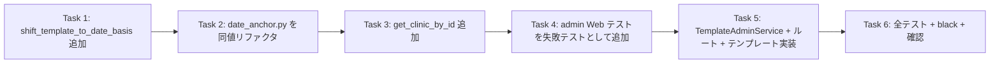

# Issue #42: 実装タスク一覧

## 優先順位・依存関係



**実装順序（推奨）**: Task 1 → Task 2 → Task 3 → Task 4 → Task 5 → Task 6

**ブランチ**: 現行 `feature/converts-coord-basis/42` を使用（origin/main より分岐済み）。

**注意（コミット方針）**: 本リポジトリの運用として、コミットは実行前にユーザーへ
確認を取ること。各 Task 末尾のコミット例は「ユーザー確認後」に実行する。

---

## Task 1: `shift_template_to_date_basis()` を coord_normalizer に追加

**優先度: 高** — シフト計算の共通化（Q2・案A）の中核

### Step 1: 失敗テストを追加

`tests/test_coord_normalizer.py`（tracked）に追記。

```python
class TestShiftTemplateToDateBasis:
    """Tests for shift_template_to_date_basis helper (Issue #42)."""

    def test_shifts_by_date_box_min_point(self):
        coords = {
            "date": [[43, 234], [400, 238], [400, 269], [43, 265]],
            "amount": [[443, 300], [523, 300], [523, 340], [443, 340]],
        }
        result = shift_template_to_date_basis(coords)
        assert result is not None
        # date box の min-x/min-y = (43, 234) が原点になる
        assert result["date"] == [[0, 0], [357, 4], [357, 35], [0, 31]]
        # amount も同じオフセットでシフトされる
        assert result["amount"] == [[400, 66], [480, 66], [480, 106], [400, 106]]

    def test_no_date_box_returns_none(self):
        assert shift_template_to_date_basis({"amount": [[1, 2], [3, 2], [3, 4], [1, 4]]}) is None

    def test_malformed_date_box_returns_none(self):
        assert shift_template_to_date_basis({"date": []}) is None
        assert shift_template_to_date_basis({"date": [["x", "y"]]}) is None
```

import に追記: `from app.coord_normalizer import (..., shift_template_to_date_basis)`

### Step 2: 失敗確認

Run: `uv run pytest tests/test_coord_normalizer.py -k ShiftTemplateToDateBasis -v`
Expected: FAIL — `ImportError: cannot import name 'shift_template_to_date_basis'`

### Step 3: 実装

`app/coord_normalizer.py` の末尾（`_is_multi_box` の後）に追加。

```python
def shift_template_to_date_basis(coords: Dict[str, Any]) -> Optional[Dict[str, Any]]:
    """Shift template coords so the template's own date box becomes the origin.

    Shared by apply_date_anchor_normalization (auto migration, Issue #39) and
    the Web admin manual toggle (Issue #42). Returns None when the date box is
    unlearned or malformed.

    Args:
        coords: Template coords_corrections dict.

    Returns:
        A new dict shifted by the date box's (min-x, min-y), or None.
    """
    date_box = coords.get("date")
    if not isinstance(date_box, (list, tuple)) or not date_box:
        return None
    valid_points = [p for p in date_box if isinstance(p, (list, tuple)) and len(p) >= 2]
    if not valid_points:
        return None
    offset_x = min(p[0] for p in valid_points)
    offset_y = min(p[1] for p in valid_points)
    return shift_template_coords(coords, offset_x, offset_y)
```

（`Dict` / `Optional` は既に import 済みであることを確認。無ければ `from typing import Any, Dict, Optional` を確認・追加。）

### Step 4: 成功確認

Run: `uv run pytest tests/test_coord_normalizer.py -k ShiftTemplateToDateBasis -v`
Expected: PASS（3 passed）

### Step 5: コミット（ユーザー確認後）

```bash
git add app/coord_normalizer.py tests/test_coord_normalizer.py
git commit -m "feat #42: date box 起点の template シフト処理を共通関数化"
```

**変更ファイル**: `app/coord_normalizer.py`, `tests/test_coord_normalizer.py`

---

## Task 2: `date_anchor.py` を同値リファクタ（新 helper へ置換）

**優先度: 中** — 動作不変の置換。回帰は `tests/test_date_anchor.py` で確認

### Step 1: 置換

`app/date_anchor.py` の `apply_date_anchor_normalization()` 内、
「一度だけ topmost → date 基準へ移行」ブロック（現行 218-244 行）を以下に置換する。

```python
    # 一度だけ topmost → date 基準へ移行（既に date なら no-op）
    if template_basis == "topmost":
        from app.db import update_template_basis as _utb
        from app.coord_normalizer import shift_template_to_date_basis

        # template は topmost 基準で学習されているため、date 基準へ変換するには
        # template 自身の date box 位置（topmost 座標系）でシフトする（Issue #39-4）。
        new_coords = shift_template_to_date_basis(coords)
        if new_coords is None:
            return None  # date 未学習 → 従来方式
        _utb(db_path, clinic_id, new_coords, changed_fields=list(coords.keys()))
        logger.info(
            "Migrated template for clinic %s to date basis (raw_offset=(%d, %d))",
            clinic_id,
            offset_x,
            offset_y,
        )
```

### Step 2: 回帰確認

Run: `uv run pytest tests/test_date_anchor.py -v`
Expected: 既存テストが全て PASS（移行・シフト系テストが新 helper 経由でも同値であること）。
※ `tests/test_date_anchor.py` は gitignore 対象のため `git add -f` が必要（変更しない限り commit 対象外）。

### Step 3: コミット（ユーザー確認後）

```bash
git add app/date_anchor.py
git commit -m "refactor #42: template シフト計算を shift_template_to_date_basis に統一"
```

**変更ファイル**: `app/date_anchor.py`

---

## Task 3: `get_clinic_by_id` を追加（db.py + repository）

**優先度: 中** — 404 と 409 の区別に必要

### Step 1: 失敗テストを追加

`tests/test_db.py`（tracked）に追記。

```python
class TestGetClinicById:
    def test_returns_clinic_dict(self, temp_db: Path):
        clinic_id = get_or_create_clinic(temp_db, "あおばクリニック")
        row = get_clinic_by_id(temp_db, clinic_id)
        assert row is not None
        assert row["id"] == clinic_id
        assert row["name"] == "あおばクリニック"

    def test_returns_none_for_unknown_id(self, temp_db: Path):
        assert get_clinic_by_id(temp_db, "no-such-id") is None
```

（import に `get_clinic_by_id` を追記。fixture 名は `tests/test_db.py` の既存流儀に合わせる。）

### Step 2: 失敗確認

Run: `uv run pytest tests/test_db.py -k GetClinicById -v`
Expected: FAIL — `ImportError: cannot import name 'get_clinic_by_id'`

### Step 3: 実装

`app/db.py` の `get_clinic_by_name()` の近くに追加。

```python
def get_clinic_by_id(db_path: str | Path, clinic_id: str) -> Optional[Dict[str, Any]]:
    """Retrieve a clinic by its ID.

    Args:
        db_path: Path to the SQLite database.
        clinic_id: The clinic ID.

    Returns:
        Optional[Dict[str, Any]]: The clinic dict with keys id, name, created_at,
                                  or None if no such clinic exists.
    """
    conn = get_db_connection(db_path)
    try:
        cursor = conn.execute(
            "SELECT id, name, created_at FROM clinics WHERE id = ?",
            (clinic_id,),
        )
        row = cursor.fetchone()
        return dict(row) if row else None
    finally:
        conn.close()
```

`app/services/receipt_database_repository.py` にも同様のメソッドを追加
（`get_or_create_clinic` の近く、`is_available()` ガード付き）。

```python
    def get_clinic_by_id(self, clinic_id: str) -> Optional[Dict[str, Any]]:
        """Get a clinic by its ID, or None if it does not exist."""
        if not self.is_available():
            return None
        return get_clinic_by_id(self.db_path, clinic_id)
```

（ファイル先頭の `from app.db import ...` に `get_clinic_by_id` を追記。）

### Step 4: 成功確認

Run: `uv run pytest tests/test_db.py -k GetClinicById -v`
Expected: PASS（2 passed）

### Step 5: コミット（ユーザー確認後）

```bash
git add app/db.py app/services/receipt_database_repository.py tests/test_db.py
git commit -m "feat #42: clinic ID 検索用 get_clinic_by_id を追加"
```

**変更ファイル**: `app/db.py`, `app/services/receipt_database_repository.py`, `tests/test_db.py`

---

## Task 4: admin Web テストを失敗テストとして追加

**優先度: 高** — 受入条件 1〜4 の検証

### Step 1: テストを追加

`tests/test_web.py`（tracked）に追記。fixture は `client` / `temp_db` を流用する。

```python
def _seed_template_clinic(temp_db: Path, name: str = "なの花薬局", with_date_box: bool = True) -> str:
    """clinic + template を作成し clinic_id を返す（date box 有無は引数で制御）。"""
    from app.db import get_or_create_clinic, upsert_template

    clinic_id = get_or_create_clinic(temp_db, name)
    coords = {"amount": [[443, 300], [523, 300], [523, 340], [443, 340]]}
    if with_date_box:
        coords["date"] = [[43, 234], [400, 238], [400, 269], [43, 265]]
    upsert_template(
        temp_db,
        f"tpl-{clinic_id}",
        clinic_id,
        version=1,
        coords_corrections=coords,
    )
    return clinic_id


def test_admin_index_lists_clinic_and_basis(client, temp_db):
    """GET /admin/templates が clinic・coord_basis・date box 学習有無を表示する"""
    _seed_template_clinic(temp_db, "なの花薬局札幌二十四軒店")
    response = client.get("/admin/templates")
    assert response.status_code == 200
    assert "なの花薬局札幌二十四軒店" in response.text
    assert "topmost" in response.text


def test_index_links_to_admin(client):
    """index.html から管理画面へのリンクが存在する"""
    response = client.get("/")
    assert response.status_code == 200
    assert "/admin/templates" in response.text


def test_admin_toggle_success(client, temp_db):
    """POST で coord_basis が date になり template_history に記録される（受入条件 1・2）"""
    clinic_id = _seed_template_clinic(temp_db)
    response = client.post(f"/admin/templates/{clinic_id}/basis", json={"basis": "date"})
    assert response.status_code == 200
    assert response.json()["status"] == "updated"

    import sqlite3
    from app.db import get_latest_template_by_clinic

    conn = sqlite3.connect(str(temp_db))
    template = get_latest_template_by_clinic(temp_db, clinic_id)
    assert (template or {}).get("coord_basis") == "date"
    # シフト後: date box の min が原点 (0,0)
    assert template["coords_corrections"]["date"] == [[0, 0], [357, 4], [357, 35], [0, 31]]
    row = conn.execute(
        "SELECT change_reason, coords_corrections FROM template_history ORDER BY created_at DESC LIMIT 1"
    ).fetchone()
    conn.close()
    assert row is not None and row[0] == "manual_basis_toggle"
    assert row[1] is not None  # 移行前 coords が保存されている


def test_admin_toggle_idempotent(client, temp_db):
    """既に date なら no-op（受入条件 4: 二重変換しない）"""
    clinic_id = _seed_template_clinic(temp_db)
    client.post(f"/admin/templates/{clinic_id}/basis", json={"basis": "date"})
    response = client.post(f"/admin/templates/{clinic_id}/basis", json={"basis": "date"})
    assert response.status_code == 200
    assert response.json()["status"] == "noop"

    import sqlite3
    conn = sqlite3.connect(str(temp_db))
    count = conn.execute("SELECT COUNT(*) FROM template_history").fetchone()[0]
    conn.close()
    assert count == 1  # history は 1 件のまま


def test_admin_toggle_requires_date_box(client, temp_db):
    """date box 未学習の clinic は 409（受入条件 3: 誤書き換えしない）"""
    clinic_id = _seed_template_clinic(temp_db, with_date_box=False)
    response = client.post(f"/admin/templates/{clinic_id}/basis", json={"basis": "date"})
    assert response.status_code == 409
    assert response.json()["detail"] == "date box 未学習のため切替できません"


def test_admin_toggle_unknown_clinic(client, temp_db):
    """存在しない clinic_id は 404"""
    response = client.post("/admin/templates/no-such-id/basis", json={"basis": "date"})
    assert response.status_code == 404


def test_admin_toggle_invalid_basis(client, temp_db):
    """不対応の basis 値は 400"""
    clinic_id = _seed_template_clinic(temp_db)
    response = client.post(f"/admin/templates/{clinic_id}/basis", json={"basis": "topmost"})
    assert response.status_code == 400


def test_admin_db_not_configured(tmp_path):
    """db_path 未設定なら管理 API は 503"""
    out_dir = tmp_path / "output_json"
    out_dir.mkdir()
    app = create_app(output_dir=str(out_dir), db_path=None)
    with TestClient(app) as c:
        assert c.get("/admin/templates").status_code == 503
        assert c.post("/admin/templates/x/basis", json={"basis": "date"}).status_code == 503
```

### Step 2: 失敗確認

Run: `uv run pytest tests/test_web.py -k "admin" -v`
Expected: FAIL — ルート未定義により `404`（各テストが失敗する）

### Step 3: コミット（ユーザー確認後）

```bash
git add tests/test_web.py
git commit -m "feat #42: coord_basis 手動切替の Web テストを追加（失敗テスト）"
```

**変更ファイル**: `tests/test_web.py`

---

## Task 5: `TemplateAdminService` + ルート + テンプレート実装

**優先度: 高** — Task 4 のテストを PASS にする

### Step 1: 新規サービスの作成

`app/services/template_admin_service.py` を新規作成（architecture.md のコードをそのまま使用）。

### Step 2: server.py にルート追加

`app/web/server.py` に architecture.md のルート（`get_template_admin_service` 依存、
`GET /admin/templates`、`POST /admin/templates/{clinic_id}/basis`）を追加。
既存 `PUT /{file_stem}` より**前**に登録する（安全側の順序）。

### Step 3: テンプレート追加

`app/web/templates/admin_templates.html` を新規作成。

```html
<!DOCTYPE html>
<html>
<head>
    <title>テンプレート管理</title>
</head>
<body>
    <h1>テンプレート管理</h1>
    <p><a href="/">← 一覧に戻る</a></p>
    
        <table border="1">
            <thead>
                <tr>
                    <th>クリニック名</th>
                    <th>版</th>
                    <th>coord_basis</th>
                    <th>date box 学習</th>
                    <th>操作</th>
                </tr>
            </thead>
            <tbody>
                
                <tr>
                    <td>{{ t.clinic_name }}</td>
                    <td>{{ t.version }}</td>
                    <td>{{ t.basis }}</td>
                    <td>{{ "○" if t.date_box_learned else "×" }}</td>
                    <td>
                        
                            移行済み
                        
                            <form method="post" action="/admin/templates/{{ t.clinic_id }}/basis">
                                <input type="hidden" name="basis" value="date" />
                                <button type="submit">topmost → date へ切替</button>
                            </form>
                        
                            date box 未学習のため切替不可
                        
                    </td>
                </tr>
                
            </tbody>
        </table>
    
        <p>テンプレートがありません</p>
    
</body>
</html>
```

`app/web/templates/index.html` の `<h1>抽出データ一覧</h1>` 直下にリンクを追加。

```html
<p><a href="/admin/templates">テンプレート管理</a></p>
```

### Step 4: 成功確認

Run: `uv run pytest tests/test_web.py -k "admin" -v`
Expected: PASS（8 passed）
追加で index リンク・`/` の既存テストも通ること。

Run: `uv run pytest tests/test_web.py -v`
Expected: 既存 + 新規が全て PASS

### Step 5: コミット（ユーザー確認後）

```bash
git add app/services/template_admin_service.py app/web/server.py \
        app/web/templates/admin_templates.html app/web/templates/index.html
git commit -m "feat #42: Web UI に coord_basis 手動切替（topmost -> date）を追加"
```

**変更ファイル**: `app/services/template_admin_service.py`（新規）, `app/web/server.py`,
`app/web/templates/admin_templates.html`（新規）, `app/web/templates/index.html`

---

## Task 6: 全テスト + black 整形 + 確認

**優先度: 中** — 受入条件 5

### 実行手順

```bash
# 変更対象の単体（失敗しないこと）
uv run pytest tests/test_coord_normalizer.py tests/test_db.py tests/test_web.py tests/test_date_anchor.py -q

# 全テスト（既存 + 追加）
uv run pytest tests/ -q

# 整形
uv run black --check app/coord_normalizer.py app/date_anchor.py app/db.py \
    app/services/receipt_database_repository.py app/services/template_admin_service.py \
    app/web/server.py tests/test_coord_normalizer.py tests/test_db.py tests/test_web.py
uv run black app/coord_normalizer.py app/date_anchor.py app/db.py \
    app/services/receipt_database_repository.py app/services/template_admin_service.py \
    app/web/server.py tests/test_coord_normalizer.py tests/test_db.py tests/test_web.py
```

### 期待結果

- 追加テストが全て PASS。
- 全テストで**新規の失敗が増えない**こと（下記「既知の事前テスト失敗」のみ失敗可）。
- black チェックがクリーン（既知: Python 3.11 環境の black は pyproject 設定に従う）。

### 手動検証（実データ / verify-01.db 利用 ※任意）

```bash
uv run python main.py --serve --port 8000 --db-path data/verify-01.db
```

- `/admin/templates` で「なの花薬局札幌二十四軒店」が「date box 学習 ○ / basis topmost」で表示されること。
- 切替ボタン押下 → `/admin/templates/{clinic_id}/basis` が 200 を返し、一覧の basis が `date` になること。
- `data/verify-01.db` のコピーで実施し、元 DB を汚さないこと（template が upsert されるため）。

### コミット（実装時・ユーザー確認後）

```bash
git add -A
git commit -m "feat #42: coord_basis 手動切替の実装とテスト一式"
```

※ コミット粒度はユーザーと確認のうえ調整（Task 単位 or 一括）。

---

## ファイル変更サマリ

| ファイル | Task | 変更種別 | 変更規模 |
|---------|------|---------|---------|
| `app/coord_normalizer.py` | 1 | 追加（helper 新設）| ~22行 |
| `app/date_anchor.py` | 2 | 修正（同値リファクタ）| ~-13/+11行 |
| `app/db.py` | 3 | 追加（`get_clinic_by_id`）| ~18行 |
| `app/services/receipt_database_repository.py` | 3 | 追加（repository メソッド）| ~7行 |
| `app/services/template_admin_service.py` | 5 | 新規 | ~90行 |
| `app/web/server.py` | 5 | 修正（ルート 2 本追加）| ~60行 |
| `app/web/templates/admin_templates.html` | 5 | 新規 | ~40行 |
| `app/web/templates/index.html` | 5 | 修正（リンク追加）| 1行 |
| `tests/test_coord_normalizer.py` | 1 | 修正（テスト追加）| ~30行 |
| `tests/test_db.py` | 3 | 修正（テスト追加）| ~15行 |
| `tests/test_web.py` | 4 | 修正（テスト追加）| ~120行 |
