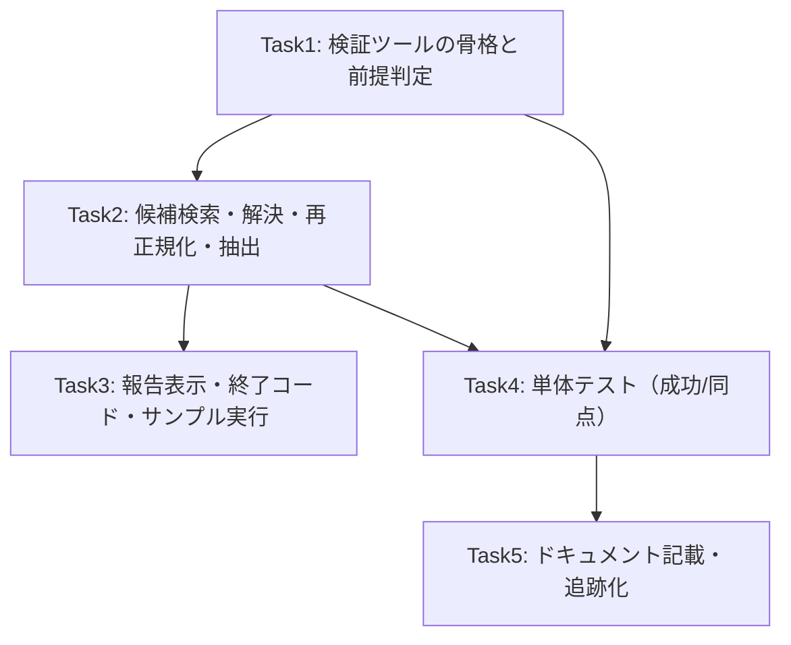

# Issue #47 実装タスク: date anchor 実データ検証ツール

依存関係:



規約: `black .`（line-length=119）、`from __future__ import annotations`、Google style docstring、
コミットは `feat #47: <desc>`。ユーザー確認後にコミット。

---

### Task 1: 検証ツールの骨格と前提条件判定

**Objective:** `app/verify_date_anchor.py` を新設し、CLI 引数・作業コピー・前提条件判定（coord_basis='date'）を実装する。

**Files:**
- Create: `app/verify_date_anchor.py`
- Test: `tests/test_verify_date_anchor.py`（Task 4 で作成。本 Task では関数シグネチャのみ）

**Step 1: 実装（ファイル新規作成）**

```python
"""Verify date-anchor re-normalization + coordinate extraction against real data.

Issue #47: a read-only verification CLI that replays the production
date-basis path (candidate search -> resolution -> anchor re-normalization
-> coordinate extraction) using the app's own implementations, so reviewers
can confirm on real raw JSON + a date-basis template how a candidate was
chosen and what fields were extracted.

The tool operates ONLY on working copies (--raw/--db are copied to a temp
dir) and never calls process_input_json / insert_receipt, so originals and
the receipts table are never modified.
"""

from __future__ import annotations

import argparse
import json
import shutil
import sqlite3
import tempfile
from pathlib import Path
from typing import Any, Dict, Optional

from app.coord_search import search_fields_by_proximity
from app.coord_normalizer import normalize_coordinates_by_anchor
from app.date_anchor import find_date_candidates, resolve_date_anchor
from app.structural_parser import DEFAULT_PROXIMITY_THRESHOLD

# 検証終了コード
EXIT_OK = 0            # 検証完了（anchor 解決 -> 抽出）
EXIT_UNRESOLVED = 1    # 候補が同点で解決不能（安全側フォールバック）
EXIT_PRECOND = 2       # 前提不成立 or 入力欠落


def _read_json(path: Path) -> Any:
    with open(path, "r", encoding="utf-8") as f:
        return json.load(f)


def _entries(ocr_json: Any) -> list[Dict[str, Any]]:
    """Normalize various raw_data shapes to a list of entry dicts."""
    if isinstance(ocr_json, list):
        return [e for e in ocr_json if isinstance(e, dict)]
    if isinstance(ocr_json, dict):
        for key in ("words", "ocr_entries", "ocr_json", "data"):
            val = ocr_json.get(key)
            if isinstance(val, list):
                return [e for e in val if isinstance(e, dict)]
    return []


def _clinic_id_by_name(db_path: Path, name: str) -> Optional[str]:
    """Look up a clinic id by name (read-only; never INSERT)."""
    con = sqlite3.connect(f"file:{db_path}?mode=ro", uri=True)
    try:
        row = con.execute(
            "SELECT id FROM clinics WHERE name = ? ORDER BY rowid LIMIT 1",
            (name.strip(),),
        ).fetchone()
        return str(row[0]) if row else None
    finally:
        con.close()


def _load_template(db_path: Path, clinic_id: str) -> Optional[Dict[str, Any]]:
    from app.db import get_latest_template_by_clinic

    return get_latest_template_by_clinic(db_path, clinic_id)


def verify_date_anchor(
    raw_path: Path,
    structured_path: Path,
    db_path: Optional[Path],
    threshold: float = DEFAULT_PROXIMITY_THRESHOLD,
    workdir: Optional[Path] = None,
) -> Dict[str, Any]:
    """Run and report each stage of date-anchor verification on working copies.

    Returns a dict with the stage results (and does not mutate the originals).
    """
    # --- 入力の存在確認 ---
    for p, label in ((raw_path, "raw"), (structured_path, "structured")):
        if not Path(p).exists():
            raise FileNotFoundError(f"{label} ファイルが存在しません: {p}")
    if db_path is not None and not Path(db_path).exists():
        raise FileNotFoundError(f"DB ファイルが存在しません: {db_path}")

    # --- 作業領域 ---
    tmp = Path(tempfile.mkdtemp(prefix="verify-date-anchor-"))
    work = Path(workdir) if workdir is not None else tmp

    # --- 作業コピー ---
    raw_copy = work / "raw_data.json"
    shutil.copy2(raw_path, raw_copy)
    db_copy: Optional[Path] = None
    if db_path is not None:
        db_copy = work / "db.sqlite3"
        shutil.copy2(db_path, db_copy)

    report: Dict[str, Any] = {"workdir": str(work)}
    structured = _read_json(structured_path)
    clinic_name = (structured.get("clinic") or "").strip()
    structured_date = structured.get("date")

    report["input"] = {
        "raw": str(raw_path),
        "structured_clinic": clinic_name,
        "structured_date": structured_date,
        "db": str(db_path) if db_path else None,
        "threshold": threshold,
    }

    # --- 前提条件判定（作業コピー上で実施） ---
    if db_copy is None:
        report["precondition"] = {"ok": False, "reason": "DB が指定されていないため date 基準は判定不可"}
        return report
    if not clinic_name:
        report["precondition"] = {"ok": False, "reason": "structured に clinic がありません"}
        return report
    if not structured_date:
        report["precondition"] = {"ok": False, "reason": "structured に date がありません"}
        return report

    clinic_id = _clinic_id_by_name(db_copy, clinic_name)
    template = _load_template(db_copy, clinic_id) if clinic_id else None
    pre = {"ok": True}
    if not clinic_id or not template:
        pre = {"ok": False, "reason": f"対象テンプレートが見つかりません（clinic={clinic_name!r}）"}
    else:
        basis = template.get("coord_basis") or "topmost"
        coords = template.get("coords_corrections") or {}
        if basis != "date":
            pre = {"ok": False, "reason": f"coord_basis が 'date' ではありません（現在: {basis}）"}
        elif coords.get("date") is None:
            pre = {"ok": False, "reason": "date box が未学習です（coords_corrections['date'] が None）"}
    report["precondition"] = pre
    if not pre["ok"]:
        return report

    # --- 段階1: 候補検索 ---
    entries = _entries(_read_json(raw_copy))
    candidates = find_date_candidates(entries, structured_date)
    report["candidates"] = [
        {"text": e.get("text"), "box": e.get("box")} for e in candidates
    ]

    # --- 段階2: 候補解決 ---
    anchor = resolve_date_anchor(
        entries,
        structured_date,
        template_date_box=coords["date"],
        template_basis=basis,
        template_coords=coords,
        proximity_threshold=threshold,
    )
    if anchor is None:
        report["resolution"] = {
            "ok": False,
            "reason": "date 候補が解決不能（同点/曖昧）。安全側フォールバックとして誤候補は採用しない",
        }
        return report
    report["resolution"] = {"ok": True, "anchor_box": anchor}

    # --- 段階3: 座標再正規化（作業コピーを date 基準に上書き） ---
    norm = normalize_coordinates_by_anchor(raw_copy, anchor)
    if not norm.get("normalized"):
        report["renormalization"] = {"ok": False, "reason": "再正規化に失敗しました"}
        return report
    offset = (norm.get("offset_x"), norm.get("offset_y"))
    report["renormalization"] = {"ok": True, "offset_x": offset[0], "offset_y": offset[1]}

    # --- 段階4: 座標ベース抽出 ---
    entries_date = _entries(_read_json(raw_copy))
    proximity = search_fields_by_proximity(entries_date, coords, threshold=threshold)
    report["extraction"] = {k: v for k, v in proximity.items() if k != "date"}

    # --- 終了コード判定 ---
    report["reports_balance"] = {
        "originals_untouched": True,
        "receipts_not_inserted": True,
    }
    return report


def main(argv: Optional[list[str]] = None) -> int:
    parser = argparse.ArgumentParser(
        description="date anchor 再正規化・座標抽出の実データ検証ツール (Issue #47)"
    )
    parser.add_argument("--raw", required=True, help="date anchor 適用前の raw_data.json（topmost 基準）")
    parser.add_argument("--structured", required=True, help="対応する structured_data.json")
    parser.add_argument("--db", default=None, help="対象テンプレートを含む SQLite DB（coord_basis='date'）")
    parser.add_argument("--threshold", type=float, default=DEFAULT_PROXIMITY_THRESHOLD,
                        help=f"proximity 閾値 (px, default={DEFAULT_PROXIMITY_THRESHOLD})")
    parser.add_argument("--workdir", default=None, help="作業領域（残したい場合。未指定は一時領域）")
    parser.add_argument("--report", default=None, help="任意で JSON 報告の出力先")
    args = parser.parse_args(argv)

    try:
        report = verify_date_anchor(
            Path(args.raw),
            Path(args.structured),
            Path(args.db) if args.db else None,
            threshold=args.threshold,
            workdir=Path(args.workdir) if args.workdir else None,
        )
    except FileNotFoundError as exc:
        print(f"PRECONDITION FAIL: {exc}")
        return EXIT_PRECOND

    if args.report:
        with open(args.report, "w", encoding="utf-8") as f:
            json.dump(report, f, ensure_ascii=False, indent=2)

    # --- 表示 ---
    input_ = report["input"]
    print(f"== date anchor 検証 ==")
    print(f"  raw       : {input_['raw']}")
    print(f"  clinic    : {input_['structured_clinic']}")
    print(f"  date      : {input_['structured_date']}")
    print(f"  threshold : {input_['threshold']}")
    pre = report["precondition"]
    if not pre["ok"]:
        print(f"\n[前提不成立] {pre['reason']}")
        return EXIT_PRECOND
    print(f"\n[前提OK] coord_basis='date', date box 学習済み")

    print(f"\n[段階1] date 候補一覧 ({len(report['candidates'])} 件)")
    for c in report["candidates"]:
        print(f"  - {c['text']!r}  box={c['box']}")

    res = report["resolution"]
    if not res["ok"]:
        print(f"\n[段階2] {res['reason']}")
        return EXIT_UNRESOLVED
    print(f"\n[段階2] 採用候補 box={res['anchor_box']}")

    ren = report["renormalization"]
    if not ren["ok"]:
        print(f"\n[段階3] {ren['reason']}")
        return EXIT_PRECOND
    print(f"\n[段階3] 適用オフセット=({ren['offset_x']}, {ren['offset_y']})")

    print(f"\n[段階4] 座標ベース抽出結果")
    for k, v in report["extraction"].items():
        print(f"  {k}: {v!r}")

    print("\n[確認] 元の raw / DB / structured は不変更。レシートは追加されていません。")
    print(f"作業コピー: {report['workdir']}")
    return EXIT_OK


if __name__ == "__main__":
    raise SystemExit(main())
```

**Step 2: 構文チェック**

Run: `uv run python -m py_compile app/verify_date_anchor.py`
Expected: exit 0（エラーなし）

**Step 3: `--help` 起動確認**

Run: `uv run python -m app.verify_date_anchor --help`
Expected: 引数一覧（`--raw` 必須、`--structured` 必須、`--db` 任意）が表示される。

**Step 4: Commit**

```bash
git add app/verify_date_anchor.py
git commit -m "feat #47: 検証ツールの骨格と前提条件判定を追加"
```
※コミットはユーザー確認後に実行すること。

---

### Task 2: 候補検索・解決・再正規化・抽出の段階出力

**Objective:** Task 1 の骨格が既に各段階を実行・出力するよう実装済み。ここでは実データで各段階が
正しく動くことを確認する。

**Step 1: サンプル実行（なの花薬局 = verify-01.db の date 基準 template）**

Run:
```bash
uv run python -m app.verify_date_anchor \
  --raw output_json/IMG_20261028_155506_1793242101-raw_data.json \
  --structured output_json/IMG_20261028_155506_1793242101-structured_data.json \
  --db data/verify-01.db
```
Expected: 前提OK（なの花薬局の template は coord_basis='date'）の後、
- `[段階1] date 候補一覧` が 1 件以上表示される
- `[段階2] 採用候補 box=...` が出力される（候補が 1 件ならその box、複数なら layout 解決）
- `[段階3] 適用オフセット=(x, y)` が出力される
- `[段階4]` に name / amount などの抽出結果が表示される
- 最後に `元の raw / DB / structured は不変更` の確認行
終了コード 0。

**Step 2: `--report` 出力とオリジナル不変の確認**

Run:
```bash
uv run python -m app.verify_date_anchor \
  --raw output_json/IMG_20261028_155506_1793242101-raw_data.json \
  --structured output_json/IMG_20261028_155506_1793242101-structured_data.json \
  --db data/verify-01.db \
  --workdir /tmp/verify-47 --report /tmp/verify-47/report.json
sha256sum output_json/IMG_20261028_155506_1793242101-raw_data.json data/verify-01.db
```
Expected: `report.json` に candidates / resolution / renormalization / extraction が記録され、2 つの
`sha256sum` が実行前後で変化していないこと（オリジナル不変）。

**Step 3: 前提不成立の確認**

Run:
```bash
# coord_basis が date でない / template なし等の DB で実行 → exit 2 と理由表示
uv run python -m app.verify_date_anchor \
  --raw output_json/IMG_20260929_104357_1790614680-raw_data.json \
  --structured output_json/IMG_20260929_104357_1790614680-structured_data.json \
  --db data/verify-01.db ; echo "exit=$?"
```
Expected: `[前提不成立] ...`（clinic の template が無い・basis 不一致など）で exit 2。
※ この raw の clinic は verify-01.db に無いため前提不成立になる想定（理由表示を確認）。

**Step 4: Commit**

```bash
git add app/verify_date_anchor.py
git commit -m "feat #47: 候補検索・解決・再正規化・抽出の段階出力を確認"
```
※ユーザー確認後。

---

### Task 3: 終了コードの整理と表示の磨き込み

**Objective:** 表示の読みやすさと終了コード規約（0/1/2）を確定し、`--workdir` の temp 掃除方針を整理する。

**Step 1: `main()` の戻り値と `verify_date_anchor` の報告 dict の整合を確認**

`main()` は以下の 4 分岐を返すことを確認（実装済み想定）:
- 前提不成立 → `EXIT_PRECOND`(2)
- 解決不能 → `EXIT_UNRESOLVED`(1)
- 成功 → `EXIT_OK`(0)
- ファイル欠落 → `EXIT_PRECOND`(2)

不足があれば `app/verify_date_anchor.py` を修正する。

**Step 2: 同点（解決不能）ケースを手動確認**

検証ツールに渡す raw が「同日付候補 2 件 + layout 同点」となる fixture を一時 DB + raw で用意し、
`--db`（date 基準 template）で実行して exit 1 になることを確認する（正確な検証は Task 4 の単体テスト）。

**Step 3: Commit**

```bash
git add app/verify_date_anchor.py
git commit -m "feat #47: 終了コード規約と表示を整理"
```
※ユーザー確認後。

---

### Task 4: 単体テスト（成功 / 同点 / 前提不成立 / 非破壊）

**Objective:** `tests/test_verify_date_anchor.py` を新設し、主要な成功・失敗・非破壊条件をテストする。
（`.gitignore` の素 `test_*.py` に一致するため **`git add -f` で追跡化**する。）

**Files:**
- Create: `tests/test_verify_date_anchor.py`

**Step 1: 失敗テスト作成**

```python
"""Tests for app.verify_date_anchor (Issue #47 verification tool)."""

import json
import shutil
from pathlib import Path

import pytest

from app.verify_date_anchor import verify_date_anchor, EXIT_OK, EXIT_UNRESOLVED


def _write_json(path: Path, data) -> None:
    path.parent.mkdir(parents=True, exist_ok=True)
    with open(path, "w", encoding="utf-8") as f:
        json.dump(data, f, ensure_ascii=False)


def _center(box):
    xs = [p[0] for p in box]
    ys = [p[1] for p in box]
    return ((max(xs) + min(xs)) / 2, (max(ys) + min(ys)) / 2)


def _box(tl, br):
    return [[tl[0], tl[1]], [br[0], tl[1]], [br[0], br[1]], [tl[0], br[1]]]


def _date_basis_geometry():
    """Coherent geometry: the anchor box in TOPMOST raw frame and the template's
    date box (origin) are consistent so date-basis re-normalization overlaps."""
    # template coords are ALREADY date-basis (date at origin ~[0,0]).
    template_coords = {
        "date": _box((0, 0), (273, 35)),
        "name": _box((5, -176), (148, -107)),
        "amount": _box((377, 418), (481, 455)),
    }
    # raw (topmost) frame: anchor box somewhere; field boxes = anchor_top_left + date-basis offset
    anchor_tl = (100, 300)
    raw_coords = {
        "date": _box(anchor_tl, (anchor_tl[0] + 273, anchor_tl[1] + 35)),
        "name": _box(
            (anchor_tl[0] + 5, anchor_tl[1] - 176),
            (anchor_tl[0] + 148, anchor_tl[1] - 107),
        ),
        "amount": _box(
            (anchor_tl[0] + 377, anchor_tl[1] + 418),
            (anchor_tl[0] + 481, anchor_tl[1] + 455),
        ),
    }
    return anchor_tl, template_coords, raw_coords


def _seed_date_basis_template(db_path: Path, clinic_name: str, template_coords: dict):
    """Insert clinic + date-basis template directly (verify tool only reads)."""
    import sqlite3
    con = sqlite3.connect(db_path)
    with con:
        con.execute("CREATE TABLE IF NOT EXISTS clinics (id TEXT PRIMARY KEY, name TEXT UNIQUE)")
        con.execute("CREATE TABLE IF NOT EXISTS templates (id TEXT, clinic_id TEXT, version TEXT, "
                    "coords_corrections TEXT, coord_basis TEXT, created_at TEXT, PRIMARY KEY(id))")
        con.execute("INSERT INTO clinics(id,name) VALUES(?,?)", ("clinic-1", clinic_name))
        con.execute(
            "INSERT INTO templates(id,clinic_id,version,coords_corrections,coord_basis,created_at) "
            "VALUES(?,?,?,?,?,?)",
            ("tpl-1", "clinic-1", "1",
             json.dumps(template_coords), "date", "2026-10-01T00:00:00"),
        )
    con.close()


def test_success_reports_stages_and_keeps_originals(tmp_path: Path):
    work = tmp_path / "verify"
    anchor_tl, template_coords, raw_coords = _date_basis_geometry()

    raw = tmp_path / "raw_data.json"
    _write_json(raw, [
        {"text": "調剤日：2026/09/02", "box": raw_coords["date"]},
        {"text": "なの花薬局", "box": raw_coords["name"]},
        {"text": "1450", "box": raw_coords["amount"]},
    ])
    structured = tmp_path / "structured_data.json"
    _write_json(structured, {"clinic": "なの花薬局", "date": "2026-09-02"})
    db = tmp_path / "db.sqlite3"
    _seed_date_basis_template(db, "なの花薬局", template_coords)

    before_raw = raw.read_bytes()
    before_db = db.read_bytes()

    report = verify_date_anchor(raw, structured, db, workdir=work)

    assert report["precondition"]["ok"] is True
    assert len(report["candidates"]) >= 1
    assert report["resolution"]["ok"] is True
    assert report["renormalization"]["ok"] is True
    assert isinstance(report["renormalization"]["offset_x"], (int, float))
    assert "name" in report["extraction"] or "amount" in report["extraction"]
    assert raw.read_bytes() == before_raw, "raw が変更されている"
    assert db.read_bytes() == before_db, "DB が変更されている"


def test_precondition_not_date_returns_reason(tmp_path: Path):
    work = tmp_path / "verify"
    _, template_coords, raw_coords = _date_basis_geometry()
    raw = tmp_path / "raw_data.json"
    _write_json(raw, [{"text": "2026/09/02", "box": raw_coords["date"]}])
    structured = tmp_path / "structured_data.json"
    _write_json(structured, {"clinic": "X", "date": "2026-09-02"})
    db = tmp_path / "db.sqlite3"
    # template in TOPMOST basis -> precondition must fail with reason
    import sqlite3
    con = sqlite3.connect(db)
    with con:
        con.execute("CREATE TABLE clinics (id TEXT PRIMARY KEY, name TEXT UNIQUE)")
        con.execute("CREATE TABLE templates (id TEXT, clinic_id TEXT, version TEXT, "
                    "coords_corrections TEXT, coord_basis TEXT, created_at TEXT, PRIMARY KEY(id))")
        con.execute("INSERT INTO clinics(id,name) VALUES(?,?)", ("c1", "X"))
        con.execute("INSERT INTO templates VALUES(?,?,?,?,?,?)",
                    ("t1", "c1", "1", json.dumps(template_coords), "topmost", "2026-10-01"))
    con.close()

    report = verify_date_anchor(raw, structured, db, workdir=work)
    assert report["precondition"]["ok"] is False
    assert "topmost" in report["precondition"]["reason"]


def test_missing_template_returns_reason(tmp_path: Path):
    work = tmp_path / "verify"
    raw = tmp_path / "raw_data.json"
    _write_json(raw, [{"text": "2026/09/02", "box": [[0, 0], [1, 0], [1, 1], [0, 1]]}])
    structured = tmp_path / "structured_data.json"
    _write_json(structured, {"clinic": "存在しない", "date": "2026-09-02"})
    db = tmp_path / "db.sqlite3"
    import sqlite3
    con = sqlite3.connect(db)
    with con:
        con.execute("CREATE TABLE clinics (id TEXT PRIMARY KEY, name TEXT UNIQUE)")
        con.execute("CREATE TABLE templates (id TEXT, clinic_id TEXT, version TEXT, "
                    "coords_corrections TEXT, coord_basis TEXT, created_at TEXT, PRIMARY KEY(id))")
    con.close()

    report = verify_date_anchor(raw, structured, db, workdir=work)
    assert report["precondition"]["ok"] is False
    assert "見つかりません" in report["precondition"]["reason"]
```

**Step 2: テスト実行（失敗確認）**

Run: `uv run pytest tests/test_verify_date_anchor.py -v`
Expected: FAIL が想定される場合もあるが、ここではテストがまず「ツールが未実装なら ImportError / FAIL」、
実装後は PASS に変わる。まず下記 Step 3 の後へ。

**Step 3: 実装をテストに合わせて調整**

必要に応じて `app/verify_date_anchor.py` を修正（例: `_clinic_id_by_name` の正規表現・整形がテストの
clinic 名と一致すること、`EXIT_*` 定数が import 可能であること）。

**Step 4: テスト実行（PASS 確認）**

Run: `uv run pytest tests/test_verify_date_anchor.py -v`
Expected: 3 passed

**Step 5: 同点（解決不能）テストを追加**

同一の `_date_basis_geometry` を使い、2 つの候補 box の top-left が同点になる fixture を組んで
`resolution.ok is False` かつ `renormalization` key を持たないことを確認するテストを追記する
（date 基準 2 候補の解決は `resolve_date_anchor` の既存ロジックが担うため、ツール側は None の報告を検証）。

**Step 6: 全テスト**

Run: `uv run pytest`
Expected: 既知の既存失敗（`test_image_processing_service.py::TestRunOcr::test_calls_process_image_and_logs` /
`TestProcess::test_happy_path`）のみ失敗。新規テストは全て PASS。

**Step 7: 追跡化 + Commit**

```bash
git add -f tests/test_verify_date_anchor.py app/verify_date_anchor.py
git commit -m "feat #47: 検証ツールの単体テスト（成功/同点/前提不成立/非破壊）を追加"
```
※ユーザー確認後。

---

### Task 5: サンプル手順と結果の読み方を記載

**Objective:** 実行手順・結果の読み方・前提条件を `tasks/issue_47/`（overview / architecture）に確定し、
必要なら `.hermes/rules/` に検証ツール用の短い節を足す。

**Step 1: overview.md / architecture.md のサンプル節を実データ実測と突き合わせて更新**

Task 2 で実際に確認したコマンド・出力（候補数、採用 box、オフセット、抽出 key）を反映する。
`data/verify-01.db` の なの花薬局 template と `output_json/IMG_20261028_...` の組み合わせが使えることを確認済み。

**Step 2: AGENTS.md への追記検討**

`.hermes/rules/` は増やしすぎない方針のため、検証ツールは AGENTS.md の「関連ファイル」に 1 行
（`app/verify_date_anchor.py（re-check）` と `tasks/issue_47/`）を追記するに留める。不要ならスキップ。

**Step 3: Commit**

```bash
git add tasks/issue_47/ AGENTS.md
git commit -m "docs #47: 検証ツールの実行手順・結果の読み方を記載"
```
※ユーザー確認後。