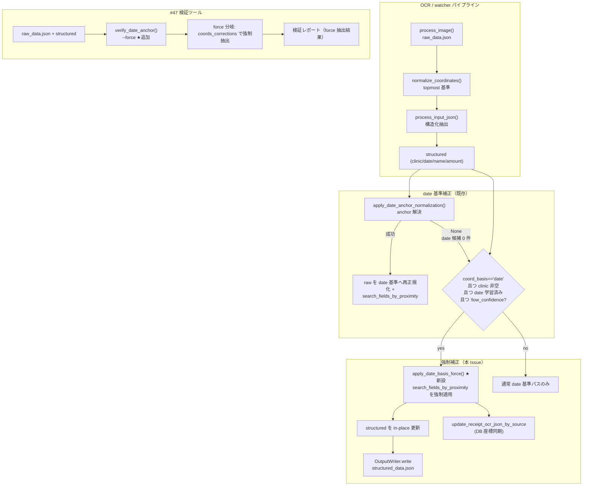

# Issue #50: アーキテクチャ設計 — date anchor による補正の強制

## 全体データフロー



## モジュール構成

### 変更モジュール

| モジュール | 追加内容 | 責務 |
|-----------|---------|------|
| `app/date_anchor.py` | `apply_date_basis_force()`（強制 date 基準抽出） | クリニック名 + date 学習済み template から name/amount を近傍抽出 |
| `app/services/image_processing_service.py` | `apply_date_anchor_normalization` 後/失敗時に `apply_date_basis_force` を呼ぶ | 画像OCR経路への統合 |
| `app/services/receipt_processor.py` | 同様の統合 | watcher 経路への統合 |
| `app/verify_date_anchor.py` | `--force` モード | #47 での強制補正の検証（受入要件2） |

### 変更しないモジュール

| モジュール | 理由 |
|-----------|------|
| `app/coord_search.py` | `search_fields_by_proximity` 等をそのまま再利用 |
| `app/coord_normalizer.py` | 再正規化は行わない設計（案A） |
| `app/structural_parser.py` | 前方補正・#40 ガードは据え置き |
| `app/db.py` / `app/template_feedback.py` | 座標の書き込みは既存関数を再利用 |
| `app/web/*` | 管理画面は対象外 |

## 設計詳細

### 1. 強制ゲート（`apply_date_basis_force` の前提条件）

以下を全て満たすときのみ実行:

1. `db_path` が設定されている。
2. `structured.get("clinic")` が非空（クリニック名抽出成功）。
3. `get_latest_template_by_clinic` で template を取得。
4. `template.get("coord_basis") or "topmost" == "date"`。
5. `template["coords_corrections"].get("date")` が非 None（date box 学習済み）。→ **#40 ガードと整合**
6. 呼び出し側で `not low_confidence`。

### 2. 強制抽出アルゴリズム

```python
def apply_date_basis_force(
    raw_path: Path,
    structured: Dict[str, Any],
    db_path: Optional[str | Path],
    output_dir: Optional[Path | str] = None,
) -> Optional[tuple[int, int]]:
    """date 基準 template の coords_corrections で name/amount を強制抽出する（Issue #50）。

    クリニック名 + date 学習済み template + coord_basis=='date' のとき、anchoring を経ずに
    直接 search_fields_by_proximity を適用し、structured を in-place 更新する。
    """
    if not db_path:
        return None
    clinic_name = (structured.get("clinic") or "").strip()
    if not clinic_name:
        return None  # 受入要件3: クリニック名抽出成功が必須

    from app.db import get_latest_template_by_clinic, get_or_create_clinic

    clinic_id = get_or_create_clinic(db_path, clinic_name)
    template = get_latest_template_by_clinic(db_path, clinic_id)
    if not template:
        return None
    if (template.get("coord_basis") or "topmost") != "date":
        return None  # 受入要件3: coord_basis=='date' のみ
    coords = template.get("coords_corrections") or {}
    if coords.get("date") is None:
        return None  # #40 ガード: date 未学習は強制しない

    from app.coord_search import search_fields_by_proximity
    from app.structural_parser import DEFAULT_PROXIMITY_THRESHOLD

    entries = _to_ocr_entries(read_json(raw_path))
    if not entries:
        return None

    proximity = search_fields_by_proximity(entries, coords, threshold=DEFAULT_PROXIMITY_THRESHOLD)
    changed = False
    for field_name, text in proximity.items():
        if field_name == "date":
            continue  # date は anchor 由来でなく強制対象外
        if text and structured.get(field_name) != text:
            structured[field_name] = text
            changed = True

    if output_dir is not None and changed:
        from app.structural_parser import OutputWriter

        OutputWriter().write(output_dir, raw_path, structured)

    if changed:
        from app.db import update_receipt_ocr_json_by_source

        update_receipt_ocr_json_by_source(db_path, str(raw_path), entries)

    return (0, 0) if changed else None
```

- 戻り値は「変更があったか」の有無（offset は使わない。`(0,0)` は互換用プレースホルダ）。
- `insert_receipt` は呼ばない（二重登録なし）。`update_receipt_ocr_json_by_source` のみ。
- `search_fields_by_proximity` は日付を除くフィールド（name/amount 等）を近傍抽出。date は anchor 由来で強制対象外。

### 3. 両経路への統合

```python
# image_processing_service.py (process() 内、apply_date_anchor_normalization の後)
if structured and db_path and not low_confidence:
    anchor_result = apply_date_anchor_normalization(active_raw_path, structured, db_path, output_dir=output_dir)
    if anchor_result is None:
        # 日付 box を特定できなかった場合の補完（受入要件3）
        from app.date_anchor import apply_date_basis_force

        apply_date_basis_force(active_raw_path, structured, db_path, output_dir=output_dir)
```

### 4. #47 検証ツールの force モード

- `verify_date_anchor(..., force: bool = False)` に `--force` を追加。
- 既存 precondition（coord_basis=='date' 且つ date box 学習済み）を満たすが anchor 解決が `None`（0件/曖昧）の場合、
  force 分岐で `search_fields_by_proximity(entries, coords)` を実行し、抽出結果をレポートに含める。
- ワークコピー上で実施（オリジナル/DB を変更しない。既存設計を維持）。

## エラーハンドリング

| シナリオ | 対応 |
|---------|------|
| `db_path` 未設定 | `None`（force しない） |
| clinic 未取得 / 新規クリニック | `get_or_create_clinic` で作成し、template が無ければ `None` |
| `coord_basis != 'date'` | 受入要件3により force しない |
| date box 未学習 | #40 ガードにより force しない |
| raw 空 | `None` |
| structured 更新が空（近傍一致なし） | `changed=False` → `None`（安全側フォールバック・値は LLM 抽出のまま） |
| `apply_date_anchor_normalization` 成功時 | force を呼ばず通常 date 基準パスに委ねる（二重補正防止） |
| low_confidence | 呼び出し側で gate（`not low_confidence`） |

## 一貫性・規約

- 閾値: `DEFAULT_PROXIMITY_THRESHOLD`(50.0) を再利用。新規閾値を発明しない。
- 出力: `OutputWriter.write` で `*-structured_data.json` を書き直す（既存 `_apply_coordinate_extraction` と同挙動）。
- 二重登録: `insert_receipt` 不呼び出し（既存 date anchor パスと同じ）。
