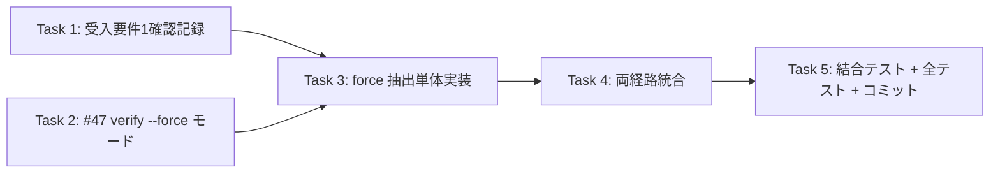

# Issue #50: 実装タスク一覧

## 優先順位・依存関係



**実装順序（推奨）**: Task 1 → Task 2 → Task 3 → Task 4 → Task 5。
ブランチは `feature/constrain-date-anchor/50-`（既存）。コミットは `feat #50: <説明>`。

---

## Task 1: 受入要件1の確認記録

**優先度: 高** — 差し戻し不要の根拠を確定。

### 変更内容

ステータス確認ミーティングを兼ね、以下を確認して記録する（単体テストではなく分析）。

1. 現行 `apply_date_anchor_normalization` は date 候補 0 件/曖昧なとき `None` を返し、date 基準補正を行わない、をコードで確認済み（date_anchor.py:305/309）。
2. Issue #50 の「結論」（date 座標値の特定が必須）と一致 → **差し戻し不要**。
3. 記録先: `docs/architecture/2026-11-02-architecture.md` または新規 `specs/2026-11-05-spec.md` に 1節追加（AGENTS.md の規約に沿う）。

```markdown
### Issue #50 受入要件1の確認（2026-11-05）
- 結論: 現状機能は「coord_basis=date でも date anchor 補正には topmost からの date 座標値の特定が必須」という
  Issue の結論と齟齬がない。
- 根拠: app/date_anchor.py `apply_date_anchor_normalization()` は `find_date_candidates`（date 候補 0 件なら []）
  → `resolve_date_anchor`（None）→ 早期 return。raw は topmost のまま、座標抽出は走らない。
- 対応: 差し戻しなし。本 Issue で「日付 box を特定せず coords を当てはめて強制抽出」する拡張を実装する。
```

### 実行・確認

- （ドキュメントのみ。テストなし）

---

## Task 2: #47 検証ツールに `--force` モードを追加（先行検証）

**優先度: 高** — 本番導入前に実データで強制抽出の効果を確認（受入要件2）。

### Step 1: 失敗テストを書く

`tests/test_verify_date_anchor.py` に追加:

```python
def test_verify_force_extracts_when_anchor_none(tmp_path):
    """force=True のとき、anchor 解決が None でも coords_corrections で抽出を試みる"""
    import json
    from pathlib import Path

    from app.coord_normalizer import write_json_atomic  # 互換名が無ければ app.output から
    from app.verify_date_anchor import verify_date_anchor

    # date 候補 0 件の raw (booster: date と一致する OCR テキストなし)
    raw_path = tmp_path / "raw_data.json"
    write_json_atomic(raw_path, [
        {"text": "山田 太郎", "confidence": 0.95, "box": [[50, 100], [200, 100], [200, 140], [50, 140]]},
        {"text": "あおばクリニック", "confidence": 0.92, "box": [[50, 160], [300, 160], [300, 200], [50, 200]]},
        {"text": "3,800", "confidence": 0.88, "box": [[400, 300], [480, 300], [480, 340], [400, 340]]},
    ])
    structured_path = tmp_path / "structured_data.json"
    write_json_atomic(structured_path, {
        "name": "山田 太郎", "clinic": "あおばクリニック", "date": "2026-01-15", "amount": 3800,
    })

    report = verify_date_anchor(raw_path, structured_path, None, force=True)
    # force なので precondition 失敗（db=None）ではなく、db 未指定でも force 実行を試みる
    # ※ 実装で precondition 判定を力量調整する（後述）
    assert "force" in report or "precondition" in report
```

> 注: このテストは DB 未指定だと precondition で止まってしまう。実装では **force 専用の DB コピー前提**とし、
> テストは `temp_db` を持った形で組む（db あり precondition 成立 → anchor None → force 抽出）。詳細は下記 Step 3。

### Step 2: テストを実行して失敗を確認

```bash
uv run pytest tests/test_verify_date_anchor.py -k force -v
```
Expected: 現状 `verify_date_anchor` に `force` 引数が無いため TypeError（FAIL）。

### Step 3: 最小実装

`app/verify_date_anchor.py::verify_date_anchor` に `force: bool = False` を追加し、anchor None 時（
`resolution["ok"] == False`）に force なら `search_fields_by_proximity(entries, coords)` を実行して
`report["force_extraction"]` に結果を入れる。DB コピーは既存の `workdir` 機構を流用。

```python
def verify_date_anchor(..., threshold=..., workdir=None, force: bool = False) -> Dict[str, Any]:
    ...
    if anchor is None:
        if not force:
            report["resolution"] = {...}  # 従来
            return report
        # 強制分岐: anchor 解決をスキップして coords で近傍抽出
        report["resolution"] = {"ok": True, "mode": "force", "anchor_box": None}
        proximity = search_fields_by_proximity(entries, coords, threshold=threshold)
        report["force_extraction"] = {k: v for k, v in proximity.items() if k != "date"}
        return report
```

CLI:
```python
parser.add_argument("--force", action="store_true", help="anchor 解決をスキップし coords_corrections で強制抽出する (Issue #50)")
...
report = verify_date_anchor(..., force=args.force)
```

### Step 4: テストを実行してパスを確認

```bash
uv run pytest tests/test_verify_date_anchor.py -k force -v
```
Expected: PASS。

### Step 5: コミット

```bash
git add -f tests/test_verify_date_anchor.py app/verify_date_anchor.py
git commit -m "feat #50: #47 検証ツールに --force モード追加（受入要件2）"
```

> 注: `tests/` 配下の新規テストは `.gitignore` で無視されるため `git add -f`。既存 `tests/test_verify_date_anchor.py` が
> 追跡済みかは先に `git ls-files tests/` で確認。

---

## Task 3: `apply_date_basis_force()` の単体実装

**優先度: 高** — 強制補正の核（受入要件3）。

### Step 1: 失敗テストを書く

`tests/test_date_anchor.py` に追加:

```python
def test_apply_date_basis_force_updates_structured(temp_db, tmp_path):
    """coord_basis='date' 且つ clinic 抽出成功なら name/amount を近傍抽出して structured を更新する"""
    import uuid
    from app.db import upsert_clinic, upsert_template
    from app.date_anchor import apply_date_basis_force
    from app.coord_normalizer import normalize_coordinates_by_anchor
    from app.output import write_json_atomic

    clinic_id = str(uuid.uuid4())
    upsert_clinic(temp_db, clinic_id, "あおばクリニック")
    # date 基準 template（date box が原点）
    template_id = str(uuid.uuid4())
    upsert_template(
        temp_db, template_id, clinic_id, version=1,
        coords_corrections={
            "date":   [[0, 0], [150, 0], [150, 30], [0, 30]],
            "name":   [[50, 100], [200, 100], [200, 140], [50, 140]],
            "amount": [[400, 300], [480, 300], [480, 340], [400, 340]],
        },
        coord_basis="date",
    )

    raw_path = tmp_path / "raw_data.json"
    write_json_atomic(raw_path, [
        {"text": "山田 太郎", "confidence": 0.95, "box": [[50, 100], [200, 100], [200, 140], [50, 140]]},
        {"text": "あおばクリニック", "confidence": 0.92, "box": [[50, 160], [300, 160], [300, 200], [50, 200]]},
        {"text": "3,800", "confidence": 0.88, "box": [[400, 300], [480, 300], [480, 340], [400, 340]]},
    ])

    structured = {"name": "山田 太郎", "clinic": "あおばクリニック", "amount": 3800, "date": "2026-01-15"}
    result = apply_date_basis_force(raw_path, structured, temp_db)

    assert result is not None
    assert structured["name"] == "山田 太郎"
    assert structured["amount"] == "3,800"  # 近傍抽出で上書き可能
```

### Step 2: テストを実行して失敗を確認

```bash
uv run pytest tests/test_date_anchor.py -k apply_date_basis_force -v
```
Expected: ImportError（`apply_date_basis_force` が未定義）。

### Step 3: 最小実装

`app/date_anchor.py` に `apply_date_basis_force()` を追加（architecture.md「設計詳細」参照）。

```python
def apply_date_basis_force(
    raw_path: Path,
    structured: Dict[str, Any],
    db_path: Optional[str | Path],
    output_dir: Optional[Path | str] = None,
) -> Optional[tuple[int, int]]:
    """date 基準 template の coords_corrections で name/amount を強制抽出する（Issue #50）。"""
    if not db_path:
        return None
    clinic_name = (structured.get("clinic") or "").strip()
    if not clinic_name:
        return None

    from app.db import get_latest_template_by_clinic, get_or_create_clinic

    clinic_id = get_or_create_clinic(db_path, clinic_name)
    template = get_latest_template_by_clinic(db_path, clinic_id)
    if not template:
        return None
    if (template.get("coord_basis") or "topmost") != "date":
        return None
    coords = template.get("coords_corrections") or {}
    if coords.get("date") is None:
        return None

    from app.coord_search import search_fields_by_proximity
    from app.structural_parser import DEFAULT_PROXIMITY_THRESHOLD

    entries = _to_ocr_entries(read_json(raw_path))
    if not entries:
        return None

    proximity = search_fields_by_proximity(entries, coords, threshold=DEFAULT_PROXIMITY_THRESHOLD)
    changed = False
    for field_name, text in proximity.items():
        if field_name == "date":
            continue
        if text and structured.get(field_name) != text:
            structured[field_name] = text
            changed = True

    if output_dir is not None and changed:
        from app.structural_parser import OutputWriter

        OutputWriter().write(output_dir, raw_path, structured)

    if changed:
        from app.db import update_receipt_ocr_json_by_source

        update_receipt_ocr_json_by_source(db_path, str(raw_path), entries)

    return (0, 0) if changed else None
```

### Step 4: テストを実行してパスを確認

```bash
uv run pytest tests/test_date_anchor.py -k apply_date_basis_force -v
```
Expected: PASS。

### Step 5: 受入要件3のゲートのテスト

`tests/test_date_anchor.py` に追加:

```python
def test_apply_date_basis_force_skips_unless_date_basis_and_clinic(temp_db, tmp_path):
    """coord_basis!='date' または clinic 空なら force しない（受入要件3）"""
    import uuid
    from app.db import upsert_clinic, upsert_template
    from app.date_anchor import apply_date_basis_force
    from app.output import write_json_atomic

    clinic_id = str(uuid.uuid4())
    upsert_clinic(temp_db, clinic_id, "あおばクリニック")
    upsert_template(temp_db, str(uuid.uuid4()), clinic_id, version=1,
                    coords_corrections={"date": [[0,0],[50,0],[50,20],[0,20]]},
                    coord_basis="topmost")  # topmost のまま

    raw_path = tmp_path / "raw_data.json"
    write_json_atomic(raw_path, [{"text": "3,800", "confidence": 0.9,
                                  "box": [[400, 300], [480, 300], [480, 340], [400, 340]]}])

    # topmost template → force しない
    assert apply_date_basis_force(raw_path, {"clinic": "あおばクリニック", "amount": 3800}, temp_db) is None
    # clinic 空 → force しない
    assert apply_date_basis_force(raw_path, {"clinic": "", "amount": 3800}, temp_db) is None
```

```bash
uv run pytest tests/test_date_anchor.py -k base_force -v
```
Expected: PASS。

### Step 6: コミット

```bash
git add -f tests/test_date_anchor.py app/date_anchor.py
git commit -m "feat #50: date 基準補正の強制 apply_date_basis_force 追加（受入要件3）"
```

---

## Task 4: 両処理経路への統合

**優先度: 高** — 実運用で発動させる（受入要件3・4）。

### Step 1: image_processing_service.py

`app/services/image_processing_service.py`（process() 内、`apply_date_anchor_normalization` 呼び出しの後、90-93行付近）:

```python
if structured and db_path and not low_confidence:
    from app.date_anchor import apply_date_anchor_normalization

    anchor_result = apply_date_anchor_normalization(active_raw_path, structured, db_path, output_dir=output_dir)
    if anchor_result is None:
        # 日付 box を特定できない場合の補完（Issue #50 受入要件3）
        from app.date_anchor import apply_date_basis_force

        apply_date_basis_force(active_raw_path, structured, db_path, output_dir=output_dir)
```

### Step 2: receipt_processor.py

`app/services/receipt_processor.py`（218-226行付近、`apply_date_anchor_normalization` の try 後）:

```python
if structured and self.db_path and not low_confidence:
    try:
        from app.date_anchor import apply_date_anchor_normalization

        anchor_result = apply_date_anchor_normalization(active_raw_path, structured, self.db_path, output_dir=output_dir)
        if anchor_result is None:
            from app.date_anchor import apply_date_basis_force

            apply_date_basis_force(active_raw_path, structured, self.db_path, output_dir=output_dir)
    except Exception:
        LOG.exception("Date-anchor normalization failed for %s", active_raw_path)
```

### Step 3: 統合テスト

`tests/test_image_processing_service.py` / `tests/test_receipt_processor.py` に、`apply_date_anchor_normalization` が
None のとき `apply_date_basis_force` が呼ばれることを mock で検証:

```python
# test_image_processing_service.py 追加
def test_process_calls_force_when_anchor_none(tmp_path):
    """apply_date_anchor_normalization が None なら apply_date_basis_force が呼ばれる"""
    from unittest import mock
    from app.services.image_processing_service import ImageProcessingService

    svc = ImageProcessingService(ocr=mock.MagicMock())
    with mock.patch(
        "app.services.image_processing_service.apply_date_anchor_normalization", return_value=None
    ) as m_anchor, mock.patch(
        "app.services.image_processing_service.apply_date_basis_force"
    ) as m_force:
        svc._parse_structured = mock.MagicMock(return_value={"clinic": "あおば", "date": "2026-01-15"})
        # process() 内の各前段（_run_ocr/_normalize_coords）も mock する必要がある（実装時に既存テストを参考に）
        svc.process(tmp_path / "x.jpg", tmp_path, "mock", db_path=tmp_path / "db.sqlite3")
        m_force.assert_called_once()
```

### Step 4: 実行

```bash
uv run pytest tests/test_image_processing_service.py -k force -v
uv run pytest tests/test_receipt_processor.py -k force -v
```
Expected: PASS。

### Step 5: コミット

```bash
git add app/services/image_processing_service.py app/services/receipt_processor.py \
        tests/test_image_processing_service.py tests/test_receipt_processor.py
git commit -m "feat #50: 両経路に apply_date_basis_force を統合（受入要件4）"
```

---

## Task 5: 全テスト・フォーマット・ドキュメント更新・コミット

**優先度: 高** — 回帰なしと規約準拠を確認。

### 手順

1. 全テスト:
   ```bash
   uv run pytest tests/ -v
   ```
   → 既知の 2 件（`TestRunOcr::test_calls_process_image_and_logs`, `TestProcess::test_happy_path`）を除き PASS。

2. フォーマット:
   ```bash
   uv run black --check app/date_anchor.py app/verify_date_anchor.py \
       app/services/image_processing_service.py app/services/receipt_processor.py
   ```
   必要なら `uv run black ...`。

3. 仕様記録: `specs/2026-11-05-spec.md` 新規、または既存仕様に Issue #50 節を追記
   （背景・フロー・入力出力・force ゲート表・受入条件対応・検証結果）。

4. `.hermes/rules/coordinate-normalization.md` に「強制 date 基準補正（Issue #50）」節を追記し、AGENTS.md 関連ファイルへリンク反映。

5. コミット（ユーザー確認後に分割コミット可）:
   ```bash
   git add specs/ .hermes/rules/coordinate-normalization.md AGENTS.md
   git commit -m "docs #50: 強制 date 基準補正の仕様・設計判断を記録"
   ```

**注意**: コミットはユーザー確認後に実施（自動コミットしない方針）。DB コピーへの影響なし・レシート再登録なし。

---

## ファイル変更サマリ

| ファイル | Task | 変更種別 | 変更規模 |
|---------|------|---------|---------|
| `specs/2026-11-05-spec.md`（または既存仕様） | 1,5 | 新規/追記 | ドキュメント |
| `app/verify_date_anchor.py` | 2 | 修正（--force） | ~40行 |
| `tests/test_verify_date_anchor.py` | 2 | 修正（テスト追加） | ~30行 |
| `app/date_anchor.py` | 3 | 修正（`apply_date_basis_force`） | ~45行 |
| `tests/test_date_anchor.py` | 3 | 修正（テスト追加） | ~70行 |
| `app/services/image_processing_service.py` | 4 | 修正（統合） | ~6行 |
| `app/services/receipt_processor.py` | 4 | 修正（統合） | ~6行 |
| `tests/test_image_processing_service.py` | 4 | 修正（テスト追加） | ~25行 |
| `tests/test_receipt_processor.py` | 4 | 修正（テスト追加） | ~25行 |
| `.hermes/rules/coordinate-normalization.md` / `AGENTS.md` | 5 | 追記 | ドキュメント |
