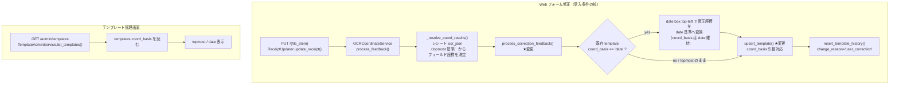

# Issue #51: アーキテクチャ設計 — coord_basis の値の調整

## 全体データフロー



## モジュール構成

### 変更モジュール

| モジュール | 変更内容 | 責務 |
|-----------|---------|------|
| `app/db.py` | `upsert_template()` に任意引数 `coord_basis: str | None = None` を追加 | INSERT/UPDATE の SQL を `coord_basis` を含む形に拡張 |
| `app/template_feedback.py` | `process_correction_feedback()` で既存 basis が `date` なら修正座標を date 基準へ変換し `coord_basis` を維持（+ `_shift_correction_to_date_basis`） | 全座標と `coord_basis` を常に同一基準（date）に保つ |

### 変更しないモジュール

| モジュール | 理由 |
|-----------|------|
| `app/services/ocr_coordinate_service.py` | 座標解決ロジックは不変。`process_feedback` が既存 `field_coords_map` のまま `process_correction_feedback` を呼ぶ |
| `app/services/receipt_updater.py` | 修正フローは不変 |
| `app/web/server.py` / `admin_templates.html` | 管理画面は DB の `coord_basis` を読んで表示するだけ（受入条件2は DB 値修正で自動反映） |
| `app/db.py::update_template_basis` | topmost→date のトグル用。本 Issue では触らない |
| `app/coord_normalizer.py` / `date_anchor.py` | 本 Issue のスコープ外 |

## 設計詳細

### 1. `upsert_template()` の `coord_basis` 対応（`app/db.py`）

`coord_basis` は `moment` でなく任意引数とし、**未指定なら既存挙動を維持**する（呼び出し元の後方互換）。

```python
def upsert_template(
    db_path: str | Path,
    template_id: str,
    clinic_id: str,
    version: int,
    coords_corrections: Dict[str, Any],
    coord_basis: Optional[str] = None,  # 追加
) -> None:
    coords_str = json.dumps(coords_corrections, ensure_ascii=False)
    conn = get_db_connection(db_path)
    try:
        with conn:
            # 新規 INSERT: coord_basis 指定があればそれ、無ければ COALESCE(?, 'topmost') でスキーマ既定に従う
            conn.execute(
                """
                INSERT INTO templates (id, clinic_id, version, coords_corrections, coord_basis)
                VALUES (?, ?, ?, ?, COALESCE(?, 'topmost'))
                ON CONFLICT(id) DO UPDATE SET
                    clinic_id = excluded.clinic_id,
                    version = excluded.version,
                    coords_corrections = excluded.coords_corrections
                    {coord_basis_set}
                """,
                (template_id, clinic_id, version, coords_str, coord_basis),
            )
    finally:
        conn.close()
```

**ポイント**: JOIN/CTE を使わず、`coord_basis` が `None` なら UPDATE 対象から除外する必要がある。
単純に `coord_basis = excluded.coord_basis` を常に入れると、`None` 指定時に既存値を壊すため、条件分岐で SQL 文字列を組み立てる。
具体的な Safe な実装（`tasks.md` に complete code 記載）:
- `coord_basis` が非 None なら UPDATE 句に `coord_basis = excluded.coord_basis` を含める
- `coord_basis` が None（従来呼び出し）なら従来どおり `clinic_id/version/coords_corrections` のみ UPDATE（coord_basis は不変）

### 2. `process_correction_feedback()` の coord_basis 整合（`app/template_feedback.py`・案ii）

既存テンプレの `coord_basis` が `date` なら、修正座標を date 基準へ変換し `coord_basis` は `date` のまま維持する。

```python
existing_basis = (existing or {}).get("coord_basis")
if existing_basis == "date":
    shifted = _shift_correction_to_date_basis(db_path, receipt_id, field_coords_map)
    if shifted is None:
        return {"updated_fields": [], "not_found_fields": not_found_fields, "history_id": None}  # anchor 未解決
    updated_coords.update(shifted)   # date 基準の修正座標
    coord_basis = "date"             # date のまま
else:
    # 従来どおり field_coords_map、coord_basis は existing/既定
```

`_shift_correction_to_date_basis()`: 修正レシート `ocr_json` の一意な date box の top-left で修正座標を減算
（`coord_normalizer.shift_template_coords`）。topmost なら date へ変換、date 基準なら原点で no-op。

**根拠**: 逆変換（date → topmost）はシフト後の絶対位置が失われ一意でない。修正座標を date 方向へ揃えれば
新規基盤・スキーマ変更不要で、保存済み OCR が date 基準でも topmost でも整合する（レビュー P1 対応）。

### 3. 履歴と管理画面

- `process_correction_feedback` は既存どおり `insert_template_history`（`change_reason='user_correction'`）を呼ぶ。
  coord_basis の変更もこの履歴で代表される（多段の履歴追加は YAGNI で実施しない）。
- `TemplateAdminService.list_templates()` は `t["basis"] = t.get("coord_basis") or "topmost"` で DB 値表示。date テンプレは
  修正後も `coord_basis` が `date` のままのため、管理画面も `date` 表示のまま（受入条件2、コード変更不要）。

## エラーハンドリング

| シナリオ | 対応 |
|---------|------|
| 既存 template なし（新規作成） | `existing_basis=None` → `upsert` は既定 `topmost`（従来どおり） |
| date テンプレ + anchor 未解決（receipt 無し / date 候補 0・複数） | 座標を書かず `coord_basis` も不変（安全側フォールバック） |
| `coord_basis` が不明（旧データ等） | `(existing or {}).get(...)` で None → 既定 topmost のまま。破壊しない |
| `upsert_template` の UPDATE セットが空にならないよう | `coord_basis` 非 None の場合のみ SQL に付与（既存必須カラム update は維持） |
| low_confidence 等で feedback 自体が走らない | 既存フローが `ReceiptUpdater` 側でゲートする。変更なし |
