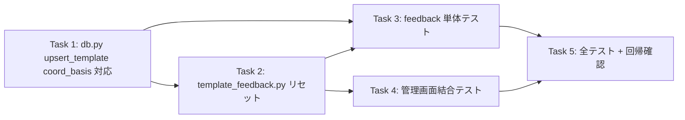

# Issue #51: 実装タスク一覧

## 優先順位・依存関係



**実装順序（推奨）**: Task 1 → Task 2 → Task 3 → Task 4 → Task 5。
ブランチは `fix/51-basis-consistency-on-correction`。コミットは `fix #51: <説明>`。

---

## Task 1: `upsert_template()` に `coord_basis` 引数を追加

**優先度: 高** — データ整合を実現する DB 層の土台。

### 変更内容

`app/db.py::upsert_template()`（現行 264-296行）に任意引数 `coord_basis: Optional[str] = None` を追加。
`coord_basis` が非 None のときは INSERT/UPDATE の両方でその値を設定し、None（従来呼び出し）なら既存挙動を維持する。

```python
def upsert_template(
    db_path: str | Path,
    template_id: str,
    clinic_id: str,
    version: int,
    coords_corrections: Dict[str, Any],
    coord_basis: Optional[str] = None,  # 追加
) -> None:
    """Upsert a template config for a clinic.

    Args:
        db_path: Path to the SQLite database.
        template_id: Unique template ID (UUID string).
        clinic_id: Associated clinic ID.
        version: Version number.
        coords_corrections: Dictionary containing OCR corrections.
        coord_basis: Optional coordinate basis ('topmost' / 'date').
            When None, keeps existing behavior (default to schema default
            'topmost' on insert; leaves the column unchanged on update).
    """
    coords_str = json.dumps(coords_corrections, ensure_ascii=False)

    # coord_basis 指定時のみ UPDATE 句に含める（None なら従来どおり不変を維持）
    if coord_basis is not None:
        update_clause = """
            clinic_id = excluded.clinic_id,
            version = excluded.version,
            coords_corrections = excluded.coords_corrections,
            coord_basis = excluded.coord_basis
        """
        values_sql = "(id, clinic_id, version, coords_corrections, coord_basis)"
        values_ph = "VALUES (?, ?, ?, ?, ?)"
        params = (template_id, clinic_id, version, coords_str, coord_basis)
    else:
        update_clause = """
            clinic_id = excluded.clinic_id,
            version = excluded.version,
            coords_corrections = excluded.coords_corrections
        """
        values_sql = "(id, clinic_id, version, coords_corrections)"
        values_ph = "VALUES (?, ?, ?, ?)"
        params = (template_id, clinic_id, version, coords_str)

    sql = f"""
        INSERT INTO templates {values_sql}
        VALUES {values_ph}
        ON CONFLICT(id) DO UPDATE SET
            {update_clause}
    """

    conn = get_db_connection(db_path)
    try:
        with conn:
            conn.execute(sql, params)
    finally:
        conn.close()
```

### 注意点
- `coord_basis=None`（従来呼び出し）では SQL/params が以前と同一。呼び出し元（`template_feedback.py`、テスト）に後方互換。
- `coord_basis` は schema 上 `NOT NULL DEFAULT 'topmost'`。INSERT で指定しない場合は既定 topmost が入る。
- 「UPDATE set が常に最低3列ある」ため `DO UPDATE SET` が空になることはない。

**変更ファイル**: `app/db.py`

---

## Task 2: `process_correction_feedback()` で date テンプレの修正座標を date 基準へ変換して維持

**優先度: 高** — 矛盾解消の核。

### 変更内容

`app/template_feedback.py::process_correction_feedback()` で、既存テンプレの `coord_basis` が `date` なら、
修正座標を date 基準へ変換し `coord_basis` を `date` のまま維持する（topmost へ戻さない）。

現行 62-85行の `existing` 取得〜`upsert_template` 呼び出し部分を修正:

```python
    # Get current template or prepare for new one
    existing = get_latest_template_by_clinic(db_path, clinic_id)
    if existing:
        current_coords: Dict[str, Any] = existing.get("coords_corrections") or {}
        template_id: str = existing["id"]
        new_version: int = existing["version"] + 1
    else:
        current_coords = {}
        template_id = str(uuid.uuid4())
        new_version = 1

    # Update only the fields that have coordinates
    updated_coords = dict(current_coords)
    existing_basis = (existing or {}).get("coord_basis")

    if existing_basis == "date":
        # Issue #51(案ii): date 基準テンプレは修正座標を date 基準へ変換し coord_basis を date 維持
        shifted = _shift_correction_to_date_basis(db_path, receipt_id, field_coords_map)
        if shifted is None:
            # anchor 未解決 → 座標を書き込まず基底も変えない（安全側）
            return {"updated_fields": [], "not_found_fields": not_found_fields, "history_id": None}
        for field_name in updated_fields:
            updated_coords[field_name] = shifted[field_name]
        coord_basis = "date"
    else:
        for field_name in updated_fields:
            updated_coords[field_name] = field_coords_map[field_name]
        coord_basis = existing_basis

    # Upsert the template first to ensure the row exists for FK constraint
    upsert_template(
        db_path=db_path,
        template_id=template_id,
        clinic_id=clinic_id,
        version=new_version,
        coords_corrections=updated_coords,
        coord_basis=coord_basis,
    )
```

### 注意点
- `_shift_correction_to_date_basis()` は修正レシート `ocr_json` から**一意な** date box を特定し、その top-left で
  修正座標を減算（`coord_normalizer.shift_template_coords`）。ocr_json が date 基準なら date box は原点で no-op、
  topmost 基準なら date へ変換（両基準を一括処理）。
- `existing_basis==None`（新規）と `'topmost'` は従来どおり（`coord_basis` は既定/不変）。
- anchor 未解決（receipt 無し / ocr_json 無し / date 候補 0・複数）は座標を書かず基底も変えない（安全側）。
- これ以外の変更ロジック（updated_fields / 履歴）は不変。

**変更ファイル**: `app/template_feedback.py`

---

## Task 3: フィードバック単体テスト（date 基準へ変換して維持）

**優先度: 高** — 受入条件1・4の検証。

### 変更内容

`tests/test_feedback.py::TestProcessCorrectionFeedback` に、date テンプレ修正で座標を date 基準へ変換し
`coord_basis` を `date` 維持するテスト／date 基準 ocr_json での no-op／anchor 未解決フォールバックを追加。

```python
# 主テスト: topmost 修正を date 基準へ変換し coord_basis は date 維持
def test_keeps_date_basis_and_converts_correction_on_date_template(self, temp_db, seed_clinic_and_receipt):
    """Issue #51(案ii): date テンプレでは修正座標を date へ変換し coord_basis を date 維持"""
    clinic_id = seed_clinic_and_receipt["clinic_id"]
    receipt_id = seed_clinic_and_receipt["receipt_id"]
    upsert_template(temp_db, str(uuid.uuid4()), clinic_id, version=2,
                    coords_corrections={"date": [[0, 0], [150, 0], [150, 30], [0, 30]]},
                    coord_basis="date")
    amount_coords = [[400, 300], [480, 300], [480, 340], [400, 340]]
    result = process_correction_feedback(temp_db, clinic_id, {"amount": amount_coords}, receipt_id=receipt_id)
    assert result["updated_fields"] == ["amount"]
    template = get_latest_template_by_clinic(temp_db, clinic_id)
    assert template["coord_basis"] == "date"
    assert template["coords_corrections"]["amount"] == [[350, 250], [430, 250], [430, 290], [350, 290]]

# 併せて: test_date_basis_correction_noop_on_date_basis_ocr（no-op 確認）/
# test_skips_feedback_when_date_anchor_unresolvable（anchor 未解決で書込まず基底不変）
```

### 実行・確認

- `uv run pytest tests/test_feedback.py -k keeps_date_basis -v` / `-k date_basis_correction_noop -v` / `-k skips_feedback_when_date_anchor -v` → PASS

**変更ファイル**: `tests/test_feedback.py`

---

## Task 4: 管理画面結合テスト（受入条件2）

**優先度: 中** — 管理画面表示の反映確認。

### 変更内容

`tests/test_web.py` に、`coord_basis='date'` テンプレのレシートを Web フォーム修正しても
管理画面の表示が `date` のまま変わることを `TestClient` 経由で検証するテストを改訂（`test_admin_keeps_date_basis_after_correction_on_date_template`）。

```python
def test_admin_keeps_date_basis_after_correction_on_date_template(temp_db, tmp_path):
    """Issue #51(案ii): date テンプレを Web 修正しても管理画面の coord_basis は date 表示のまま"""
    clinic_id = _seed_template_clinic(temp_db, "あおばクリニック")
    upsert_template(
        temp_db, str(uuid.uuid4()), clinic_id, version=2,
        coords_corrections={"amount": [[443, 300], [523, 300], [523, 340], [443, 340]]},
        coord_basis="date",
    )
    # raw に日付エントリが無い → anchor 未解決 → 座標を書かず基底も date のまま
    out_dir = tmp_path / "output_json"; out_dir.mkdir()
    write_json_atomic(out_dir / "receipt-001-raw_data.json",
                      [{"text": "3,800", "confidence": 0.9, "box": [[400, 300], [480, 300], [480, 340], [400, 340]]}])
    write_json_atomic(out_dir / "receipt-001-structured_data.json",
                      {"name": "山田 太郎", "clinic": "あおばクリニック", "amount": 3800, "date": "2026-01-15"})
    before = get_latest_template_by_clinic(temp_db, clinic_id)
    before_coords = dict((before or {}).get("coords_corrections") or {})
    app = create_app(output_dir=str(out_dir), db_path=str(temp_db))
    with TestClient(app) as c:
        assert c.put("/receipt-001", json={"amount": "3,800"}).status_code == 200
        assert c.get("/admin/templates").status_code == 200
    template = get_latest_template_by_clinic(temp_db, clinic_id)
    assert (template or {}).get("coord_basis") == "date"
    assert (template or {}).get("coords_corrections") == before_coords
```

※ `_seed_template_clinic` は既存ヘルパー（test_web.py 上に定義）。clinic 名は「あおばクリニック」に合わせて調整する。
`uuid` と `TestClient`、`create_app` は既存 import を再利用。

### 実行・確認

- `uv run pytest tests/test_web.py -k keeps_date_basis -v` → PASS

**変更ファイル**: `tests/test_web.py`

---

## Task 5: 全テスト・フォーマット確認・コミット

**優先度: 高** — 回帰なしを確認。

### 手順

1. 全テスト実行:
   ```bash
   uv run pytest tests/ -v
   ```
   → 既知の 2 件（`test_image_processing_service.py::TestRunOcr::test_calls_process_image_and_logs` と
   `::TestProcess::test_happy_path`）を除き全て PASS すること（これらは `origin/main` でも落ちる事前存在失敗。feature では修正しない）。

2. フォーマット確認:
   ```bash
   uv run black --check app/db.py app/template_feedback.py
   ```
   → 整形が必要なら `uv run black app/db.py app/template_feedback.py` を実行。

3. コミット（ユーザー確認後に分割コミット可）:
   ```bash
   git add app/db.py app/template_feedback.py tests/test_feedback.py tests/test_web.py
   git commit -m "fix #51: coord_basis の整合（修正時も date 基準へ揃える）"
   ```

**注意**: コミットはユーザー確認後に実施する（自動コミットしない方針）。DB コピー等への影響なし・レシート再登録なし。

---

## ファイル変更サマリ

| ファイル | Task | 変更種別 | 変更規模 |
|---------|------|---------|---------|
| `app/db.py` | 1 | 修正（`upsert_template` 拡張） | ~15行 |
| `app/template_feedback.py` | 2 | 修正（date 基準へ変換 + フォールバック） | ~40行 |
| `tests/test_feedback.py` | 3 | 修正（テスト追加） | ~40行 |
| `tests/test_web.py` | 4 | 修正（テスト追加） | ~30行 |
