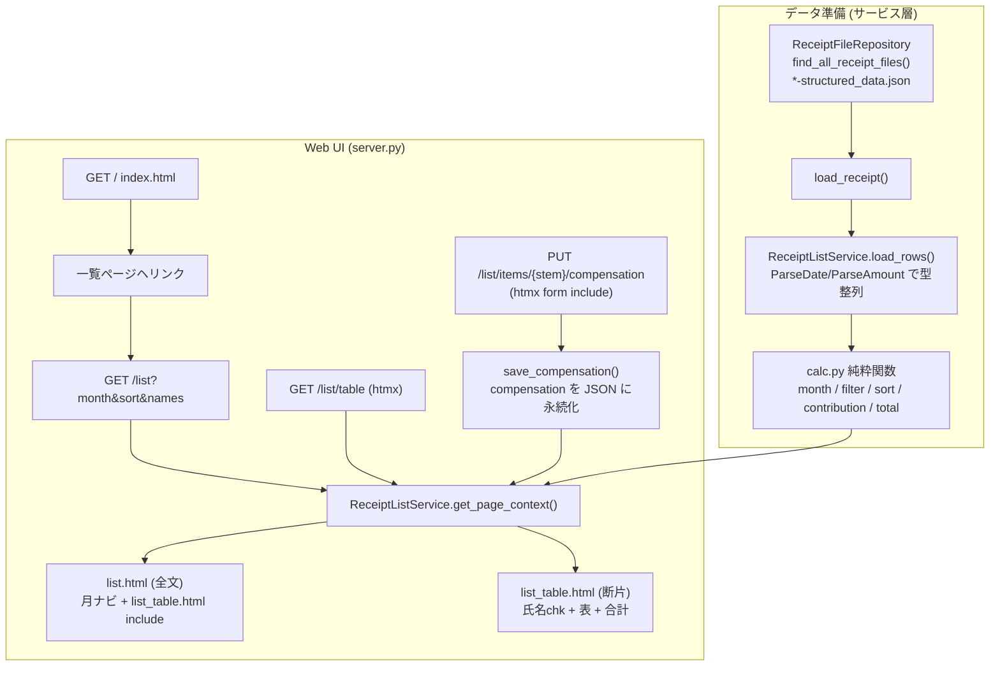

# Issue #54: アーキテクチャ設計

## 全体データフロー



## 受け入れ要件2の計算の核心（「単純にマイナスしない」）

```
行 contribution  = max(0, amount - compensation)
月合計 total     = Σ (行 contribution)
```

例（テストで断言）:
- 行A: amount=5000, comp=6000 → `max(0,-1000)` = **0**
- 行B: amount=3000, comp=0   → **3000**
- 月合計 = 0 + 3000 = **3000**  （`8000 - 6000 = 2000` としない＝一括引きしない）

## モジュール構成

### 新規モジュール

| モジュール | 責務 |
|-----------|------|
| `app/calc.py` | 純粋計算: `ReceiptRow` dataclass、`compute_contribution` / `compute_total` / `filter_by_names` / `sort_by_date` / `month_of` / `collect_months` / `available_names`。ファイル I/O・DB に依存しない |
| `app/services/receipt_list_service.py` | データ読取 + 表示文脈構築 + 補填額永続化（SRP）。`ReceiptFileRepository` と `calc.py` を利用 |
| `app/web/templates/list.html` | 一覧ページ全文（ヘッダ、月ナビゲーション、表領域 include） |
| `app/web/templates/list_table.html` | htmx swap 対象の断片。氏名チェックボックス + 表 + 月合計 |

### 変更モジュール

| モジュール | 変更内容 |
|-----------|---------|
| `app/web/server.py` | `ReceiptListService` の DI 追加、`GET /list`・`GET /list/table`・`PUT /list/items/{stem}/compensation` を追加 |
| `app/web/templates/index.html` | 一覧ページへ遷移するリンクを1行追加 |

### 変更しないモジュール

| モジュール | 理由 |
|-----------|------|
| `app/services/receipt_service.py` | 既存一覧・詳細・修正フローに影響させない |
| `app/services/receipt_file_repository.py` | JSON I/O はそのまま再利用 |
| `app/normalization.py` | `parse_amount` / `parse_date` を借用（変更不要） |
| DB / migrations | 補填額は JSON 永続化のため DB 変更なし |

## ルーティング設計（server.py 追加分）

### `GET /list` — 一覧ページ全文
- クエリ: `month`（省略時は今年1月 `YYYY-01`）、`sort`（`asc`/`desc`）、`names`（カンマ区切り、複数可）
- 戻り値: `list.html`（全文）。内部で `list_table.html` を include

### `GET /list/table` — htmx 断片
- 同一クエリ。ただし断片のみ返す → 氏名チェックボックス変更時に `#list-state` 形式の form を使い、`hx-include="#list-state"` と `hx-target="#list-table-region"` で該当領域だけ差し替え
- `names` はカンマ連結ではなく `names` の複数パラメータを送る（氏名自体にカンマが含まれても壊れない設計）

### `PUT /list/items/{file_stem}/compensation` — 補填額保存（htmx）
- フォーム値: `month`, `sort`, `names`, `compensation`（1行分）
- 処理: `ReceiptListService.save_compensation(file_stem, value)` で JSON に永続化し、その月・フィルタ状態の `list_table.html` 断片を返す
- これにより補填額入力→合計が非同期で再計算・再描画される（氏名選択状態も維持）

## htmx の利用方式

- CDN: `<script src="https://unpkg.com/htmx.org@1.9.12"></script>`（`detail.html` と同一。新規依存なし）
- 氏名チェックボックス: フォームの `hx-get="/list/table"` + `hx-target="#list-table-region"` + `hx-swap="innerHTML"`。直接 `#list-state` を `hx-include` し、ネスト form を避けた設計で month/sort/names を送る
- 補填額入力欄: 各行の `<input name="compensation">` に `hx-put` + `hx-include="#list-state"` + `hx-target="#list-table-region"`。サーバは断片を返して再計算
- 月ナビゲーション: 通常リンク（`/list?month=...`）。サーバ側で前月・翌月を算出

## データ項目（structured_data.json → 一覧）

| 一覧列 | JSON キー | 型変換 |
|--------|-----------|--------|
| 日付 | `date` | `str`（ISO のまま表示） |
| クリニック名(調剤薬局名) | `clinic` | `str` |
| 氏名 | `name` | `str` |
| 金額 | `amount` | `int`（`parse_amount`） |
| 補填額（入力欄） | `compensation` | `int`（`parse_amount`、空/不正=0） |

- 月キーは `date[:7]`（`YYYY-MM`）。
- 補填額は保存時に `structured_data.json["compensation"]` に書き込む（`ReceiptFileRepository.save_receipt`）。
- 既存詳細修正 `PUT /{stem}` は `normalize()` が `{**old_data, **updates}` のため、`compensation` を上書きせず保持する。

## エラーハンドリング

| シナリオ | 対応 |
|---------|------|
| structured_data 読み込み失敗 | `load_rows()` 内で該当ファイルをスキップ（既存 `get_all_receipts` と同様） |
| 補填額が空・非数値 | `parse_amount` が None → 0 扱い。JSON 保存も 0 で保存 |
| month 不正・データなし | 空の表 + 合計 0 円を表示（エラーにしない） |
| compensation 保存対象ファイルなし | `FileNotFoundError` → 404 |
