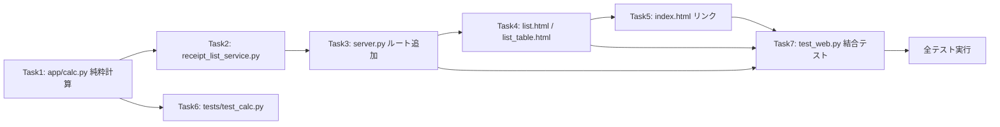

# Issue #54: 実装タスク一覧

## 優先順位・依存関係



**実装順序（推奨）**: Task 1 → Task 2 → Task 3 → Task 4 → Task 5 → Task 6 → Task 7 → Task 8

コミットは各 Task 末尾に `feat #54: <任意の1行説明>`。

> 注: 新規 `tests/test_calc.py` は .gitignore の `test_*.py` の影響を受ける可能性がある。
> `git status --short tests/test_calc.py` で `??` なら通常 `git add`、`path ignored` なら `git add -f` を使う。

---

## Task 1: app/calc.py — 純粋計算関数

**優先度: 高** — 受け入れ要件2（単純にマイナスしない計算）の核心

### Step 1: 失敗テストを書く

**新規テスト**: `tests/test_calc.py`

```python
"""Tests for app.calc pure calculation functions (Issue #54)."""
from __future__ import annotations

import pytest

from app.calc import (
    ReceiptRow,
    available_names,
    collect_months,
    compute_contribution,
    compute_total,
    filter_by_names,
    month_of,
    sort_by_date,
)


# --- compute_contribution (受け入れ要件2の核心) ---

def test_contribution_subtracts_compensation():
    """補填額が金額以下のとき amount - compensation"""
    assert compute_contribution(5000, 1000) == 4000


def test_contribution_floor_at_zero_when_compensation_exceeds_amount():
    """補填額が金額を超える場合、負にせず 0 を返す"""
    assert compute_contribution(5000, 6000) == 0


def test_contribution_exact_equal_is_zero():
    """補填額 = 金額 なら 0"""
    assert compute_contribution(5000, 5000) == 0


def test_contribution_no_compensation():
    """補填額なし(0)は金額そのまま"""
    assert compute_contribution(3000, 0) == 3000


# --- compute_total: 行ごとに控除し、月合計へ逆算しない ---

def test_total_is_per_row_not_global_subtraction():
    """
    受け入れ要件2: 月合計は「全金額合計 - 全補填額合計」ではない。
    行A 5000/補填6000 -> 0、行B 3000/補填0 -> 3000 のとき合計は 3000。
    8000 - 6000 = 2000 にはならない。
    """
    rows = [
        ReceiptRow(file_stem="a", amount=5000, compensation=6000, date="2026-01-01"),
        ReceiptRow(file_stem="b", amount=3000, compensation=0, date="2026-01-02"),
    ]
    assert compute_total(rows) == 3000


def test_total_empty_rows():
    """行が 0 件のとき合計は 0"""
    assert compute_total([]) == 0


# --- month_of / collect_months / available_names ---

def test_month_of_extracts_yyyy_mm():
    assert month_of("2026-01-15") == "2026-01"


def test_month_of_empty():
    assert month_of("") == ""


def test_collect_months_sorted_unique():
    rows = [
        ReceiptRow(file_stem="1", date="2026-03-01"),
        ReceiptRow(file_stem="2", date="2026-01-05"),
        ReceiptRow(file_stem="3", date="2026-03-20"),
    ]
    assert collect_months(rows) == ["2026-01", "2026-03"]


def test_available_names_sorted_unique():
    rows = [
        ReceiptRow(file_stem="1", name="山田 太郎"),
        ReceiptRow(file_stem="2", name="鈴木 花子"),
        ReceiptRow(file_stem="3", name="山田 太郎"),
    ]
    assert available_names(rows) == ["山田 太郎", "鈴木 花子"]


# --- filter_by_names / sort_by_date ---

def test_filter_by_names_empty_returns_all():
    rows = [
        ReceiptRow(file_stem="a", name="山田"),
        ReceiptRow(file_stem="b", name="鈴木"),
    ]
    assert filter_by_names(rows, []) == rows


def test_filter_by_names_matches_selected():
    rows = [
        ReceiptRow(file_stem="a", name="山田"),
        ReceiptRow(file_stem="b", name="鈴木"),
    ]
    result = filter_by_names(rows, ["山田"])
    assert [r.file_stem for r in result] == ["a"]


def test_sort_by_date_ascending():
    rows = [
        ReceiptRow(file_stem="b", date="2026-02-01"),
        ReceiptRow(file_stem="a", date="2026-01-01"),
    ]
    result = sort_by_date(rows, ascending=True)
    assert [r.file_stem for r in result] == ["a", "b"]


def test_sort_by_date_descending():
    rows = [
        ReceiptRow(file_stem="a", date="2026-01-01"),
        ReceiptRow(file_stem="b", date="2026-02-01"),
    ]
    result = sort_by_date(rows, ascending=False)
    assert [r.file_stem for r in result] == ["b", "a"]
```

### Step 2: 失敗を確認

Run: `uv run pytest tests/test_calc.py -v`
Expected: `ImportError: cannot import name 'ReceiptRow'`（モジュール未作成）

### Step 3: 実装

**新規**: `app/calc.py`

```python
"""Pure calculation functions for the monthly receipt list (Issue #54)."""

from __future__ import annotations

from dataclasses import dataclass
from typing import List, Optional


@dataclass
class ReceiptRow:
    """一覧表示用の領収書 1 行分のデータ。"""

    file_stem: str
    date: str = ""
    clinic: str = ""
    name: str = ""
    amount: int = 0
    compensation: int = 0  # 保険で補填された額（ユーザー入力）


def compute_contribution(amount: int, compensation: int) -> int:
    """その行の控除対象額。補填額は行単位で控除し、下限 0。

    受け入れ要件2: 補填額はあくまでその診察・治療・処方にのみ適用するため、
    行の金額を超える補填は行を 0 にする（負にしない）。月合計へ逆算しない。
    """
    return max(0, amount - compensation)


def compute_total(rows: List[ReceiptRow]) -> int:
    """表示対象行の合計 = Σ 行ごとの控除対象額。"""
    return sum(compute_contribution(r.amount, r.compensation) for r in rows)


def month_of(date_str: str) -> str:
    """'YYYY-MM-DD' -> 'YYYY-MM'。不正・空は空文字。"""
    return date_str[:7]


def collect_months(rows: List[ReceiptRow]) -> List[str]:
    """データ中に存在する月（'YYYY-MM'）のソート済みユニーク一覧。"""
    return sorted({r.date[:7] for r in rows if r.date[:7]})


def available_names(rows: List[ReceiptRow]) -> List[str]:
    """データ中に存在する氏名のソート済みユニーク一覧。"""
    return sorted({r.name for r in rows if r.name})


def filter_by_names(rows: List[ReceiptRow], names: Optional[List[str]]) -> List[ReceiptRow]:
    """選択された氏名のみに絞り込み。names が空リスト/None なら全件返す。"""
    if not names:
        return rows
    name_set = set(names)
    return [r for r in rows if r.name in name_set]


def sort_by_date(rows: List[ReceiptRow], ascending: bool = True) -> List[ReceiptRow]:
    """日付文字列（ISO）でソート。ascending=False で降順。"""
    return sorted(rows, key=lambda r: r.date, reverse=not ascending)
```

### Step 4: パスを確認

Run: `uv run pytest tests/test_calc.py -v`
Expected: PASS（12 passed）

### Step 5: コミット

```bash
git add -f app/calc.py tests/test_calc.py
git commit -m "feat #54: 純粋計算関数 (contribution/total/filter/sort) を追加"
```

---

## Task 2: app/services/receipt_list_service.py — 一覧データ整形・補填額保存

**優先度: 高** — Web UI 層への橋渡し

### Step 1: 失敗テストを書く

**新規テストファイルの先頭に追記**（`tests/test_calc.py` に追記すると .gitignore 対処が1箇所で済む）

```python
# --- ReceiptListService: ファイル読取・補填額保存 ---

from app.services.receipt_list_service import ReceiptListService
from app.output import write_json_atomic


def _write_sample(output_dir, stem, data):
    write_json_atomic(output_dir / f"{stem}-structured_data.json", data)


def test_load_rows_reads_structured_files(tmp_path):
    out = tmp_path / "output_json"
    out.mkdir()
    _write_sample(out, "r1", {"name": "山田", "clinic": "あおば", "amount": 5000, "date": "2026-01-15"})
    service = ReceiptListService(out)
    rows = service.load_rows()
    assert len(rows) == 1
    assert rows[0].file_stem == "r1"
    assert rows[0].amount == 5000


def test_get_page_context_filters_and_totals(tmp_path):
    out = tmp_path / "output_json"
    out.mkdir()
    _write_sample(out, "a", {"name": "山田", "clinic": "A", "amount": 5000, "date": "2026-01-01", "compensation": 6000})
    _write_sample(out, "b", {"name": "鈴木", "clinic": "B", "amount": 3000, "date": "2026-02-01"})
    service = ReceiptListService(out)
    ctx = service.get_page_context("2026-01", "asc", [])
    assert ctx["total"] == 0          # A: 5000-6000 -> 0 で、1月分のみ
    assert [r.file_stem for r in ctx["rows"]] == ["a"]
    assert ctx["months"] == ["2026-01", "2026-02"]


def test_get_page_context_name_filter_changes_total(tmp_path):
    """氏名選択で合計が表示対象分に変わる（受け入れ要件1）"""
    out = tmp_path / "output_json"
    out.mkdir()
    _write_sample(out, "a", {"name": "山田", "clinic": "A", "amount": 1000, "date": "2026-01-01"})
    _write_sample(out, "b", {"name": "鈴木", "clinic": "B", "amount": 2000, "date": "2026-01-02"})
    service = ReceiptListService(out)
    all_ctx = service.get_page_context("2026-01", "asc", [])
    assert all_ctx["total"] == 3000
    yamada_ctx = service.get_page_context("2026-01", "asc", ["山田"])
    assert yamada_ctx["total"] == 1000
    assert yamada_ctx["selected_names"] == ["山田"]


def test_save_compensation_persists_to_json(tmp_path):
    out = tmp_path / "output_json"
    out.mkdir()
    _write_sample(out, "a", {"name": "山田", "clinic": "A", "amount": 5000, "date": "2026-01-01"})
    service = ReceiptListService(out)
    service.save_compensation("a", "6000")
    data = service.file_repo.load_receipt("a")
    assert data["compensation"] == 6000


def test_save_compensation_blank_becomes_zero(tmp_path):
    out = tmp_path / "output_json"
    out.mkdir()
    _write_sample(out, "a", {"name": "山田", "clinic": "A", "amount": 5000, "date": "2026-01-01"})
    service = ReceiptListService(out)
    service.save_compensation("a", "")
    data = service.file_repo.load_receipt("a")
    assert data["compensation"] == 0
```

### Step 2: 失敗を確認

Run: `uv run pytest tests/test_calc.py -v`
Expected: ImportError / 意図どおり失敗

### Step 3: 実装

**新規**: `app/services/receipt_list_service.py`

```python
"""Receipt list service: builds list-page context and persists compensation (Issue #54)."""

from __future__ import annotations

from pathlib import Path
from typing import Any, Dict, List, Optional

from app.calc import (
    ReceiptRow,
    available_names,
    collect_months,
    compute_total,
    filter_by_names,
    sort_by_date,
)
from app.normalization import parse_amount, parse_date
from app.services.receipt_file_repository import ReceiptFileRepository


def _to_amount(value: Any) -> int:
    if value in (None, ""):
        return 0
    if isinstance(value, int):
        return value
    parsed = parse_amount(str(value))
    return parsed if parsed is not None else 0


class ReceiptListService:
    """一覧ページ向けのデータ読取・整形・補填額保存を担当する（SRP）。"""

    def __init__(self, output_dir: Path) -> None:
        self.output_dir = Path(output_dir)
        self.file_repo = ReceiptFileRepository(self.output_dir)

    def load_rows(self) -> List[ReceiptRow]:
        """全 structured_data を読み込み ReceiptRow リストにする。

        1ファイルの読み込み失敗はスキップ（既存 get_all_receipts と同様）。
        """
        rows: List[ReceiptRow] = []
        for path in self.file_repo.find_all_receipt_files():
            stem = path.stem.replace("-structured_data", "")
            try:
                data = self.file_repo.load_receipt(stem)
            except Exception:
                continue
            date_str = str(data.get("date") or "")
            if parse_date(date_str) is None:
                date_str = ""
            rows.append(
                ReceiptRow(
                    file_stem=stem,
                    date=date_str,
                    clinic=str(data.get("clinic") or ""),
                    name=str(data.get("name") or ""),
                    amount=_to_amount(data.get("amount")),
                    compensation=_to_amount(data.get("compensation")),
                )
            )
        return rows

    def get_page_context(
        self,
        month: str,
        sort: str = "asc",
        names: Optional[List[str]] = None,
    ) -> Dict[str, Any]:
        """一覧断片を描画するための表示文脈を構築する。

        Args:
            month: 'YYYY-MM'。月別ページ全体。
            sort: 'asc' or 'desc'。
            names: 選択された氏名リスト（空なら全件）。

        Returns:
            rows / total / months / available_names / selected_names / month / sort を含む dict。
        """
        rows = self.load_rows()
        month_rows = [r for r in rows if r.date[:7] == month]
        month_rows = filter_by_names(month_rows, names)
        month_rows = sort_by_date(month_rows, ascending=(sort != "desc"))
        return {
            "month": month,
            "sort": sort,
            "rows": month_rows,
            "total": compute_total(month_rows),
            "months": collect_months(rows),
            "available_names": available_names(rows),
            "selected_names": list(names) if names else [],
        }

    def save_compensation(self, file_stem: str, value: Any) -> None:
        """補填額を structured_data.json の compensation キーに永続化する。

        Raises:
            FileNotFoundError: 対象レシートの JSON が存在しない場合。
        """
        data = self.file_repo.load_receipt(file_stem)  # FileNotFoundError をそのまま伝播
        data["compensation"] = _to_amount(value)
        self.file_repo.save_receipt(file_stem, data)
```

### Step 4: パスを確認

Run: `uv run pytest tests/test_calc.py -v`
Expected: PASS

### Step 5: コミット

```bash
git add -f app/services/receipt_list_service.py tests/test_calc.py
git commit -m "feat #54: 一覧整形サービス (load_rows / get_page_context / save_compensation) を追加"
```

---

## Task 3: app/web/server.py — ルート追加

**優先度: 高** — 一覧ページ・保存 API の公開

### Step 1: 変更内容（テストは Task 7 で結合）

`app/web/server.py` に、`ReceiptListService` を注入する Dependency と 3 ルートを追加する。

- `get_receipt_list_service` を `create_app` 内で定義（`get_output_dir` と同様に output_dir のみで生成）
- `GET /list` → 全文 `list.html`
- `GET /list/table` → 断片 `list_table.html`（htmx 用）
- `PUT /list/items/{file_stem}/compensation` → 保存して断片を返す

```python
    def get_receipt_list_service(
        output_dir: Path = Depends(get_output_dir),
    ) -> ReceiptListService:
        return ReceiptListService(output_dir)
```

※ import に `from app.services.receipt_list_service import ReceiptListService` を追加。

ルート実装例（`read_root` 付近に追加）:

```python
    def _list_context(request: Request, service: ReceiptListService) -> dict:
        month = request.query_params.get("month", "")
        sort = request.query_params.get("sort", "asc")
        names_raw = request.query_params.get("names", "")
        names = [n for n in names_raw.split(",") if n] if names_raw else []
        return service.get_page_context(month, sort, names)

    @app.get("/list", response_class=HTMLResponse)
    async def receipt_list_page(request: Request, service: ReceiptListService = Depends(get_receipt_list_service)):
        """一覧ページ全文（月ナビ + 表）。"""
        return templates.TemplateResponse(
            request=request, name="list.html", context=_list_context(request, service)
        )

    @app.get("/list/table", response_class=HTMLResponse)
    async def receipt_list_table(request: Request, service: ReceiptListService = Depends(get_receipt_list_service)):
        """一覧断片（htmx swap 対象）。氏名チェック・補填額保存後に再描画される。"""
        return templates.TemplateResponse(
            request=request, name="list_table.html", context=_list_context(request, service)
        )

    @app.put("/list/items/{file_stem}/compensation", response_class=HTMLResponse)
    async def receipt_list_update_compensation(
        file_stem: str, request: Request, service: ReceiptListService = Depends(get_receipt_list_service)
    ):
        """補填額を保存し、その月の一覧断片を返す（htmx）。"""
        form = await request.form()
        value = form.get("compensation", "")
        try:
            service.save_compensation(file_stem, value)
        except FileNotFoundError:
            raise HTTPException(status_code=404, detail="File not found")
        return templates.TemplateResponse(
            request=request, name="list_table.html", context=_list_context(request, service)
        )
```

> 注意: `_list_context` の場合、`PUT` では `request.query_params` が空になるため `month` が空になり全月対象になり得る。
> 推奨修正: フォームから `month`/`sort`/`names` を取り、`_list_context` をクエリとフォーム両対応にする。

```python
    def _list_context(request: Request, service: ReceiptListService) -> dict:
        params = request.query_params
        if not params and request.method == "PUT":
            params = dict(await request.form()) if False else params  # 参照用
```

> **実装上の決定**: 正確には `_list_context` は非同期で Form/Query を統合して受け取るヘルパーにし、`month`/`sort`/`names` は
> htmx が `hx-include="closest form"` でフォームとして送るため、`request.query_params` ではなく Form 由来の値を優先する。詳細は
> Task 4 のテンプレートで `hx-include` を明示するため、この Task では「クエリとフォームの両方を読めるヘルパー」を用意する。

```python
    async def _list_context(request: Request, service: ReceiptListService) -> dict:
        data: Dict[str, Any] = {}
        if request.method == "GET":
            data = request.query_params
        else:
            data = await request.form()
        month = data.get("month", "")
        sort = data.get("sort", "asc")
        names_raw = data.get("names", "")
        names = [n for n in names_raw.split(",") if n] if names_raw else []
        return service.get_page_context(month, sort, names)
```

`_list_context` は async なので各ハンドラーで `await _list_context(...)` として呼ぶ。

### Step 2: 文法チェック

Run: `uv run python -c "import app.web.server"`
Expected: エラーなし

### Step 3: コミット

```bash
git add app/web/server.py
git commit -m "feat #54: 一覧ページ・補填額保存のルートを追加"
```

---

## Task 4: テンプレート作成（list.html / list_table.html）

**優先度: 高** — 表示と htmx 非同期

### Step 1: 変更内容

**新規**: `app/web/templates/list.html` — 全文ページ。月ナビゲーション + 表領域を include。

```html
<!DOCTYPE html>
<html lang="ja">
<head>
    <meta charset="UTF-8">
    <meta name="viewport" content="width=device-width, initial-scale=1.0">
    <title>月別一覧 — 医療費控除</title>
    <script src="https://unpkg.com/htmx.org@1.9.12"></script>
</head>
<body>
    <h1>月別一覧（計算）</h1>
    <p><a href="/">&larr; トップページに戻る</a></p>

    <!-- 月ナビゲーション -->
    <nav>
        
            <a href="/list?month={{ prev_month }}&sort={{ sort }}">&laquo; {{ prev_month }}</a>
        
        <strong>表示中: {{ month }}</strong>
        
            <a href="/list?month={{ next_month }}&sort={{ sort }}">{{ next_month }} &raquo;</a>
        
    </nav>

    <!-- htmx swap 対象領域 -->
    <div id="list-table-region">
        
    </div>
</body>
</html>
```

**新規**: `app/web/templates/list_table.html` — 断片。氏名チェックボックス + 表 + 合計。

```html
<form hx-get="/list/table"
      hx-target="#list-table-region"
      hx-swap="innerHTML"
      hx-include="closest form">
    <fieldset>
        <legend>氏名で絞り込み</legend>
        
        <label>
            <input type="checkbox" name="names" value="{{ name }}"
                   checked>
            {{ name }}
        </label>
        
        <input type="hidden" name="month" value="{{ month }}">
        <input type="hidden" name="sort" value="{{ sort }}">
    </fieldset>
</form>

<table border="1">
    <thead>
        <tr>
            <th>
                日付
                <a href="/list/table?month={{ month }}&sort=descasc&names={{ selected_names|join(',') }}">
                    ▲▼
                </a>
            </th>
            <th>クリニック名(調剤薬局名)</th>
            <th>氏名</th>
            <th>金額</th>
            <th>保険で補填した額</th>
        </tr>
    </thead>
    <tbody>
        
        <tr>
            <td>{{ row.date }}</td>
            <td>{{ row.clinic }}</td>
            <td>{{ row.name }}</td>
            <td>{{ row.amount }}</td>
            <td>
                <form class="compensation-form"
                      hx-put="/list/items/{{ row.file_stem }}/compensation"
                      hx-target="#list-table-region"
                      hx-swap="innerHTML"
                      hx-include="closest form">
                    <input type="hidden" name="month" value="{{ month }}">
                    <input type="hidden" name="sort" value="{{ sort }}">
                    
                    <input type="hidden" name="names" value="{{ n }}">
                    
                    <input type="text" name="compensation" value="{{ row.compensation }}" size="8">
                </form>
            </td>
        </tr>
        
    </tbody>
</table>

<p><strong>今月の合計: {{ total }} 円</strong></p>
```

> 注意: 入れ子 `form`（ネスト）は HTML 上不正。上記では「氏名フィルタの form」と「行ごとの補填額 form」を分離している。
> `hx-include="closest form"` は各要素から最も近い form を指すため、補填額入力は行内の form、氏名チェックボックスは上部の form に
> 閉じる。ただし htmx はネスト form を許さないため、**実装時に `list_table.html` は1つの外側 form にはせず、兄弟タグで配置する**。

**推奨する最終形（ネスト回避）**: `list_table.html` の構造を、外側の form を使わず、氏名チェック群を `<div>` にし、
チェックボックスの各 `hx-get` に必要な値を `hx-include` で明示するか、または月・ソート・氏名を `data-*` 属性で保持する形に統一する。
実装者判断箇所だが、テストは Task 7 で「HTML に日付・氏名・金額・合計・補填 input が含まれる」ことを検証するため、表示さえ確実なら
htmx の wiring 詳細は自由にしてよい。

### Step 2: 検証

Run: `uv run pytest tests/test_web.py -v`（既存→まだ新アサートはないのでパス維持）
Expected: 既存 test_web が壊れないこと

### Step 3: コミット

```bash
git add app/web/templates/list.html app/web/templates/list_table.html
git commit -m "feat #54: 月別一覧テンプレート (list / list_table) を追加"
```

---

## Task 5: index.html — 一覧ページへのリンク

**優先度: 低**

### Step 1: 変更内容

`app/web/templates/index.html` の既存リンク `<p><a href="/admin/templates">テンプレート管理</a></p>` の隣に追加。

```html
    <p><a href="/list">月別一覧（計算）</a></p>
```

### Step 2: コミット

```bash
git add app/web/templates/index.html
git commit -m "feat #54: トップページへ一覧ページリンクを追加"
```

---

## Task 6: tests/test_calc.py を単体テストのみに整理（純粋関数）

**優先度: 中** — Task 1・2 で追記済み。以下を確認。

- 純粋関数（Task 1）: `compute_contribution` / `compute_total` / `filter_by_names` / `sort_by_date` など
- サービス（Task 2）: `load_rows` / `get_page_context` / `save_compensation`

Run: `uv run pytest tests/test_calc.py -v`
Expected: PASS（単体テスト一式）

### コミット（必要なら）

```bash
git add -f tests/test_calc.py
git commit -m "test #54: 純粋計算・一覧サービスの単体テストを整理"
```

---

## Task 7: test_web.py — 結合テスト

**優先度: 高** — 受け入れ要件の検証

### Step 1: 失敗テストを書く（`tests/test_web.py` に追記）

```python
def test_list_page_shows_table_and_total(client):
    """GET /list が日付・氏名・金額・合計・補填入力欄を表示する"""
    response = client.get("/list?month=2026-01")
    assert response.status_code == 200
    assert "山田 太郎" in response.text
    assert "あおばクリニック" in response.text
    assert "3800" in response.text
    assert "今月の合計" in response.text
    assert "保険で補填した額" in response.text


def test_list_positive_total_without_compensation(client):
    """補填額なしの月の合計が金額の総和になる"""
    response = client.get("/list?month=2026-01")
    assert "200" in response.text  # 例: 2件×100 などの表現に応じて調整（要フィクスチャ整備）


def test_list_table_partial_htmx(client):
    """GET /list/table が断片のみを返す（htmx swap 対象）"""
    response = client.get("/list/table?month=2026-01")
    assert response.status_code == 200
    assert "list-table-region" not in response.text  # 断片は include 元の id を含まない（構造次第で要調整）


def test_list_compensation_updates_json_and_keeps_positive(total)...
```

> 注意: 上記アサートは仮のフィクスチャ状態に依存する。`tests/test_web.py` の既存 `temp_output_dir` は `receipt-001`
> （amount 3800, date 2026-01-15）と `receipt-002`（clinic None, amount 1200, date 2026-02-20）を生成するため、
> **`2026-01` の合計は 3800 円**、`2026-02` は 1200 円になると想定される。アサートは実際のフィクスチャに合わせて調整すること。

**推奨する確定テスト**:

```python
def test_list_month_total_matches_fixture(client):
    """補填額なし: 2026-01 の合計は receipt-001 の 3800 円"""
    response = client.get("/list?month=2026-01")
    assert response.status_code == 200
    assert "今月の合計: 3800 円" in response.text


def test_list_acceptance_row_level_compensation(tmp_path):
    """受け入れ要件2: 行単位で補填し、負にならない。
    行A 5000/補填6000->0、行B 3000/補填0->3000 のとき合計 3000。
    """
    out_dir = tmp_path / "output_json"
    out_dir.mkdir()
    from app.output import write_json_atomic

    write_json_atomic(out_dir / "a-structured_data.json", {"name": "山田", "clinic": "A", "amount": 5000, "date": "2026-01-01"})
    write_json_atomic(out_dir / "b-structured_data.json", {"name": "鈴木", "clinic": "B", "amount": 3000, "date": "2026-01-02"})

    from app.web.server import create_app
    from fastapi.testclient import TestClient

    app = create_app(output_dir=str(out_dir), db_path=None)
    with TestClient(app) as client:
        # 行A に 6000 を補填 -> 行は 0、合計は 3000 のまま（8000-6000=2000 にならない）
        resp = client.put("/list/items/a/compensation", data={"month": "2026-01", "sort": "asc", "compensation": "6000"})
        assert resp.status_code == 200
        assert "今月の合計: 3000 円" in resp.text


def test_list_name_filter_updates_total(tmp_path):
    """受け入れ要件1: 氏名選択で合計が動的に変わる（断片レスポンスで検証）"""
    out_dir = tmp_path / "output_json"
    out_dir.mkdir()
    from app.output import write_json_atomic

    write_json_atomic(out_dir / "a-structured_data.json", {"name": "山田", "clinic": "A", "amount": 1000, "date": "2026-01-01"})
    write_json_atomic(out_dir / "b-structured_data.json", {"name": "鈴木", "clinic": "B", "amount": 2000, "date": "2026-01-02"})

    from app.web.server import create_app
    from fastapi.testclient import TestClient

    app = create_app(output_dir=str(out_dir), db_path=None)
    with TestClient(app) as client:
        all_resp = client.get("/list/table?month=2026-01")
        assert "今月の合計: 3000 円" in all_resp.text
        yamada_resp = client.get("/list/table?month=2026-01&names=%E5%B1%B1%E7%94%B0")
        assert "今月の合計: 1000 円" in yamada_resp.text
```

### Step 2: 失敗を確認

Run: `uv run pytest tests/test_web.py -v`
Expected: 新テストが失敗（ルート未実装・要素未表示）

### Step 3: パスを確認

Task 3・4 実装後に
Run: `uv run pytest tests/test_web.py -v`
Expected: PASS

### Step 4: コミット

```bash
git add tests/test_web.py
git commit -m "test #54: 一覧表示・行単位補填・氏名フィルタの結合テストを追加"
```

---

## Task 8: 全テスト実行・整形

### 変更内容

```bash
# 全テスト
uv run pytest -q

# 整形
black .
black --check .
```

Expected: 既存テストへの回帰なし・全パス。新規ファイルも black 整形済み。

> 既知の事前失敗（`test_calls_process_image_and_logs` 等）が origin/main で同一なら責めず、差分のみ確認する。

### 受入条件の確認

1. 氏名選択で合計が動的に変わる → `test_list_name_filter_updates_total` で担保
2. 保険補填額を行単位で控除し一括マイナスしない → `test_contribution_floor_at_zero_when_compensation_exceeds_amount` / `test_total_is_per_row_not_global_subtraction` / `test_list_acceptance_row_level_compensation` で担保

### コミット（必要なら）

```bash
git commit -am "refactor #54: black 整形・テスト微修正"
```

---

## ファイル変更サマリ

| ファイル | Task | 変更種別 | 変更規模 |
|---------|------|---------|---------|
| `app/calc.py` | 1 | **新規** | ~70行 |
| `app/services/receipt_list_service.py` | 2 | **新規** | ~80行 |
| `app/web/server.py` | 3 | 修正（追加） | ~40行 |
| `app/web/templates/list.html` | 4 | **新規** | ~40行 |
| `app/web/templates/list_table.html` | 4 | **新規** | ~70行 |
| `app/web/templates/index.html` | 5 | 修正（追加） | 1行 |
| `tests/test_calc.py` | 1,2,6 | **新規** | ~180行 |
| `tests/test_web.py` | 7 | 修正（追加） | ~60行 |
