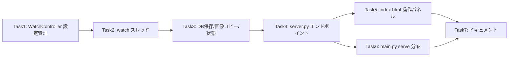

# Issue #56: 実装タスク一覧

## 優先順位・依存関係



**実装順序（推奨）**: Task 1 → Task 2 → Task 3 → Task 4 → Task 5 → Task 6 → Task 7

コミットは各 Task 末尾に `feat #56: <説明>`（Task 7 のみ `docs #56: <説明>`）。

> 注: 新規 `tests/test_watch_controller.py` は .gitignore の影響を受ける可能性がある。
> `git status --short tests/test_watch_controller.py` が `??` なら通常 `git add`、
> `path ignored` なら `git add -f` を使う（2026-11-09 実測では `??` で通常 add 可能）。
>
> 注: 1 つのテストファイルを複数 Task にまたがる場合、**ファイルごとではなく内容を分割**して
> コミットする（各コミットが単独で green になる）。
>
> 注: `black .` 実行時、Python 3.11 では「Python 3.11 cannot parse code formatted for
> Python 3.12+」警告が出る場合があるが失敗ではない。`uv run black .` のまま進める。

---

## Task 1: WatchController — 設定管理（input_dir / db_path / preprocess_mode）

**優先度: 高** — 全ての機能の土台

### Step 1: 失敗テストを書く

**新規テスト**: `tests/test_watch_controller.py`（Task 1〜3 で段階的に追記する。今回は設定系のみ）

```python
"""Tests for app.services.watch_controller (Issue #56)."""
from __future__ import annotations

import sqlite3

import pytest

from app.services.watch_controller import PREPROCESS_MODES, WatchController
from app.db_migrations import run_migrations

SCHEMA_PATH = "docs/schema.sql"


# --- 設定: input_dir ---

def test_set_input_dir_creates_directory(tmp_path):
    """存在しない input_dir を指定すると mkdir され、状態が更新される"""
    ctl = WatchController(output_dir=str(tmp_path / "output"))
    target = tmp_path / "nested" / "receipts"
    result = ctl.set_input_dir(str(target))
    assert target.is_dir()
    assert ctl.input_dir == target
    assert result == target


def test_default_input_dir_is_downloads_receipts():
    """デフォルト input_dir は ~/Downloads/receipts（args.py と同じ）"""
    from pathlib import Path

    ctl = WatchController()
    assert ctl.input_dir == Path.home() / "Downloads" / "receipts"


# --- 設定: db_path ---

def test_set_db_path_runs_migrations(tmp_path):
    """db_path 設定時に migration が走りテーブルが作られる"""
    ctl = WatchController(output_dir=str(tmp_path / "output"))
    db = tmp_path / "db.sqlite3"
    ctl.set_db_path(db)
    assert ctl.has_db is True
    conn = sqlite3.connect(str(db))
    tables = {r[0] for r in conn.execute("SELECT name FROM sqlite_master WHERE type='table'")}
    conn.close()
    assert {"receipts", "clinics", "templates", "corrections"} <= tables


def test_set_db_path_none_clears():
    """db_path=None で has_db が False になる"""
    ctl = WatchController()
    ctl.set_db_path(None)
    assert ctl.has_db is False


# --- 設定: preprocess_mode ---

def test_set_preprocess_mode_valid():
    ctl = WatchController()
    for mode in PREPROCESS_MODES:
        ctl.set_preprocess_mode(mode)
        assert ctl.preprocess_mode == mode


def test_set_preprocess_mode_invalid_raises():
    ctl = WatchController()
    with pytest.raises(ValueError):
        ctl.set_preprocess_mode("bogus")
```

### Step 2: 失敗を確認

```bash
uv run pytest tests/test_watch_controller.py -q
```

期待出力: `ModuleNotFoundError` か `1 failed` 系（`app.services.watch_controller` が存在しないため収集失敗）。

### Step 3: 実装（最小）

**新規**: `app/services/watch_controller.py`

```python
"""Web UI 用 watch オーケストレーター (Issue #56)。

CLI の --watch / --input-dir / --db-path / --preprocess-mode 相当の状態と
ポーリング監視スレッドを保持し、FastAPI (server.py) から操作される。
状態はプロセス内メモリのみ（DB スキーマ変更なし）。
"""

from __future__ import annotations

import logging
import threading
from pathlib import Path

LOG = logging.getLogger(__name__)

DEFAULT_INPUT_DIR = str(Path.home() / "Downloads" / "receipts")
PREPROCESS_MODES = ["none", "clahe", "adaptive", "clahe+adaptive"]
DATA_DIR = Path("data")
SCHEMA_PATH = Path("docs/schema.sql")


class WatchController:
    """Web UI 用の watch 状態・設定・処理オーケストレーター。"""

    def __init__(
        self,
        input_dir: str | Path = DEFAULT_INPUT_DIR,
        output_dir: str | Path = "output_json",
        processed_dir: str | Path = "processed",
        failed_dir: str | Path = "failed",
        db_path: str | Path | None = None,
        preprocess_mode: str = "none",
        poll_interval: int = 5,
        model: str = "mock",
        schema_path: Path = SCHEMA_PATH,
    ) -> None:
        self.input_dir = Path(input_dir)
        self.output_dir = Path(output_dir)
        self.processed_dir = Path(processed_dir)
        self.failed_dir = Path(failed_dir)
        self.poll_interval = poll_interval
        self.model = model
        self.schema_path = Path(schema_path)
        self._db_path: Path | None = None
        self._preprocess_mode = "none"
        self._ocr = None
        self._ocr_lock = threading.Lock()
        self._scan_lock = threading.Lock()
        self._stop_event = threading.Event()
        self._thread: threading.Thread | None = None
        self._is_processing = False
        self.last_error: str | None = None
        self.set_preprocess_mode(preprocess_mode)
        if db_path:
            self.set_db_path(db_path)

    # ------------------------------------------------------------------
    # 設定
    # ------------------------------------------------------------------

    def set_input_dir(self, path: str | Path) -> Path:
        """input_dir を更新し、存在しなければ作成する。"""
        p = Path(path).expanduser()
        p.mkdir(parents=True, exist_ok=True)
        self.input_dir = p
        LOG.info("input_dir -> %s", p)
        return p

    def set_db_path(self, path: str | Path | None) -> None:
        """db_path を設定し、migration を適用する。None で未選択に戻す。"""
        if path is None:
            self._db_path = None
            return
        from app.db_migrations import run_migrations

        p = Path(path)
        run_migrations(p, self.schema_path)
        self._db_path = p
        LOG.info("db_path -> %s", p)

    def set_preprocess_mode(self, mode: str) -> None:
        """前処理モードを検証して設定する。未知の値は ValueError。"""
        if mode not in PREPROCESS_MODES:
            raise ValueError(f"unknown preprocess_mode: {mode}")
        self._preprocess_mode = mode

    @property
    def preprocess_mode(self) -> str:
        return self._preprocess_mode

    @property
    def has_db(self) -> bool:
        return self._db_path is not None

    @property
    def db_path(self) -> str | None:
        return str(self._db_path) if self._db_path else None
```

### Step 4: グリーンを確認

```bash
uv run pytest tests/test_watch_controller.py -q
```

期待出力: `7 passed`

> 注: `test_set_db_path_none_clears` の `__import__("pathlib")` は簡略化のための書き方。
> 気になる場合は `from pathlib import Path` をファイル冒頭に置き直す。

### Step 5: 整形 + コミット

```bash
uv run black app/services/watch_controller.py tests/test_watch_controller.py
git add app/services/watch_controller.py tests/test_watch_controller.py
git commit -m "feat #56: WatchController 設定管理 (input_dir/db_path/preprocess_mode)"
```

---

## Task 2: WatchController — watch スレッド（start / stop / is_processing）

**優先度: 高** — 受け入れ要件 1・3 の核心

### Step 1: 失敗テストを追記

`tests/test_watch_controller.py` に追記:

```python
# --- watch スレッド ---

def _make_ctl(tmp_path, scan_fn, poll_interval: float = 0.1, with_db: bool = True) -> WatchController:
    """テスト用コントローラ生成。scan_fn は fake、DB は migration 済み実ファイル。"""
    ctl = WatchController(
        input_dir=str(tmp_path / "input"),
        output_dir=str(tmp_path / "output_json"),
        processed_dir=str(tmp_path / "processed"),
        failed_dir=str(tmp_path / "failed"),
        poll_interval=poll_interval,
        scan_fn=scan_fn,
        ocr_factory=lambda: object(),
    )
    if with_db:
        db = tmp_path / "db.sqlite3"
        run_migrations(db, SCHEMA_PATH)
        ctl.set_db_path(db)
    return ctl


def test_start_watch_requires_db(tmp_path):
    """DB 未選択で start_watch は ValueError（受け入れ要件 2）"""
    ctl = _make_ctl(tmp_path, scan_fn=lambda *a, **k: 0, with_db=False)
    with pytest.raises(ValueError, match="データベース"):
        ctl.start_watch()
    assert ctl.watch_on is False


def test_start_stop_watch_toggles(tmp_path):
    """start で watch_on=True、stop で False に戻る"""
    ctl = _make_ctl(tmp_path, scan_fn=lambda *a, **k: 0)
    ctl.start_watch()
    assert ctl.watch_on is True
    ctl.stop_watch()
    assert ctl.watch_on is False


def test_start_watch_idempotent(tmp_path):
    """二重 start は no-op（スレッドは 1 つ）"""
    ctl = _make_ctl(tmp_path, scan_fn=lambda *a, **k: 0)
    ctl.start_watch()
    first = ctl._thread
    ctl.start_watch()
    assert ctl._thread is first
    ctl.stop_watch()


def test_scan_sets_processing_flag(tmp_path):
    """スキャン中は is_processing=True、終了後 False"""
    import threading

    entered = threading.Event()
    release = threading.Event()

    def slow_scan(*args, **kwargs):
        entered.set()
        release.wait(timeout=5)

    ctl = _make_ctl(tmp_path, scan_fn=slow_scan, poll_interval=0.1)
    ctl.start_watch()
    assert entered.wait(timeout=5), "scan が開始されない"
    assert ctl.is_processing is True
    release.set()
    deadline = 0
    while ctl.is_processing and deadline < 50:
        import time

        time.sleep(0.1)
        deadline += 1
    assert ctl.is_processing is False
    ctl.stop_watch()


def test_scan_skips_when_already_processing(tmp_path):
    """処理中は次のスキャンを開始しない（多重スキャン防止）"""
    import threading

    entered = threading.Event()
    release = threading.Event()
    calls = []

    def slow_scan(*args, **kwargs):
        calls.append(1)
        entered.set()
        release.wait(timeout=5)

    ctl = _make_ctl(tmp_path, scan_fn=slow_scan, poll_interval=0.05)
    ctl.start_watch()
    assert entered.wait(timeout=5)
    ctl._run_scan()  # 処理中に手動実行しても開始されない
    assert len(calls) == 1
    release.set()
    ctl.stop_watch()


def test_watch_loop_calls_scan_repeatedly(tmp_path):
    """ポーリングで scan_fn が複数回呼ばれる"""
    calls = []

    def counting_scan(*args, **kwargs):
        calls.append(1)
        return 0

    ctl = _make_ctl(tmp_path, scan_fn=counting_scan, poll_interval=0.05)
    ctl.start_watch()
    import time

    deadline = 0
    while len(calls) < 2 and deadline < 100:
        time.sleep(0.1)
        deadline += 1
    ctl.stop_watch()
    assert len(calls) >= 2
```

### Step 2: 失敗を確認

```bash
uv run pytest tests/test_watch_controller.py -q
```

期待出力: `12 failed`（`__init__` に `scan_fn` / `ocr_factory` が未実装 + watch 系メソッド未実装）。

### Step 3: 実装

`app/services/watch_controller.py` の `__init__` を次の形に変更し、メソッドを追加する。

`__init__` 変更（引数に `scan_fn` / `ocr_factory` を追加、`from app import watcher` を追加）:

```python
def __init__(
    self,
    input_dir: str | Path = DEFAULT_INPUT_DIR,
    output_dir: str | Path = "output_json",
    processed_dir: str | Path = "processed",
    failed_dir: str | Path = "failed",
    db_path: str | Path | None = None,
    preprocess_mode: str = "none",
    poll_interval: int = 5,
    model: str = "mock",
    scan_fn=watcher.scan_and_process,
    ocr_factory=None,
    schema_path: Path = SCHEMA_PATH,
) -> None:
    ...
    self.scan_fn = scan_fn
    self._ocr_factory = ocr_factory or _default_ocr_factory
    ...
```

モジュール末尾（import 直後）に追記:

```python
def _default_ocr_factory():
    """PaddleOCR の遅延初期化。--serve 起動を速く保つため module 直下では生成しない。"""
    from paddleocr import PaddleOCR

    return PaddleOCR(use_angle_cls=True, lang="japan", enable_mkldnn=False)
```

メソッド追加（Task 1 のコードに続けて）:

```python
    # ------------------------------------------------------------------
    # watch スレッド
    # ------------------------------------------------------------------

    def start_watch(self) -> None:
        """ポーリング監視スレッドを開始する。DB 未選択は ValueError。"""
        if not self.has_db:
            raise ValueError("データベースを選択してください")
        if self.watch_on:
            return
        self._stop_event.clear()
        self._thread = threading.Thread(target=self._watch_loop, name="web-watcher", daemon=True)
        self._thread.start()
        LOG.info("watch started (poll_interval=%d)", self.poll_interval)

    def stop_watch(self) -> None:
        """監視スレッドを停止する。スキャン中の場合は timeout で戻る（daemon）。"""
        self._stop_event.set()
        if self._thread is not None:
            self._thread.join(timeout=self.poll_interval + 5)
            self._thread = None
        LOG.info("watch stopped")

    @property
    def watch_on(self) -> bool:
        return self._thread is not None and self._thread.is_alive()

    @property
    def is_processing(self) -> bool:
        return self._is_processing

    def _watch_loop(self) -> None:
        while not self._stop_event.is_set():
            self._run_scan()
            self._stop_event.wait(self.poll_interval)

    def _run_scan(self) -> None:
        """input_dir をスキャンして処理する。既に処理中ならスキップ。"""
        if not self._scan_lock.acquire(blocking=False):
            LOG.debug("Scan already in progress, skipping")
            return
        self._is_processing = True
        try:
            self.scan_fn(
                self.input_dir,
                self._get_ocr(),
                self.output_dir,
                self.processed_dir,
                self.failed_dir,
                model=self.model,
                db_path=self._db_path,
                preprocess_mode=self._preprocess_mode,
            )
            self.last_error = None
        except Exception:
            LOG.exception("Scan failed")
            self.last_error = "スキャン中にエラーが発生しました"
        finally:
            self._is_processing = False
            self._scan_lock.release()

    def _get_ocr(self):
        """OCR エンジンの遅延初期化（スレッドセーフ）。テストでは ocr_factory を注入。"""
        if self._ocr is None:
            with self._ocr_lock:
                if self._ocr is None:
                    self._ocr = self._ocr_factory()
        return self._ocr
```

> 注: `from app import watcher` を `app/services/watch_controller.py` の import 部に追加すること
> （`watcher.scan_and_process` をデフォルト引数に使うため）。

### Step 4: グリーンを確認

```bash
uv run pytest tests/test_watch_controller.py -q
```

期待出力: `13 passed`

### Step 5: 整形 + コミット

```bash
uv run black app/services/watch_controller.py tests/test_watch_controller.py
git add app/services/watch_controller.py tests/test_watch_controller.py
git commit -m "feat #56: WatchController watch スレッド (start/stop/多重スキャン防止)"
```

---

## Task 3: WatchController — DB アップロード保存 / 画像コピー / 状態取得

**優先度: 中** — アップロード系の基礎

### Step 1: 失敗テストを追記

`tests/test_watch_controller.py` に追記:

```python
# --- DB アップロード保存 ---

def test_save_db_upload_migrates_and_sets_db_path(tmp_path):
    """アップロードした DB は data/ に保存され migration 済みになる（Q2 案A）"""
    from pathlib import Path

    db = tmp_path / "src.sqlite3"
    run_migrations(db, SCHEMA_PATH)
    ctl = _make_ctl(tmp_path, scan_fn=lambda *a, **k: 0, with_db=False)
    dest = ctl.save_db_upload(db.read_bytes(), "my.db")
    assert dest == Path("data") / "my.db"
    assert dest.exists()
    assert ctl.has_db is True
    conn = sqlite3.connect(str(dest))
    tables = {r[0] for r in conn.execute("SELECT name FROM sqlite_master WHERE type='table'")}
    conn.close()
    assert "receipts" in tables


def test_save_db_upload_sanitizes_filename(tmp_path):
    """パス注入を防ぐため basename のみ使う"""
    db = tmp_path / "src.sqlite3"
    run_migrations(db, SCHEMA_PATH)
    ctl = _make_ctl(tmp_path, scan_fn=lambda *a, **k: 0, with_db=False)
    dest = ctl.save_db_upload(db.read_bytes(), "../../evil.db")
    assert dest.name == "evil.db"
    assert dest.parent.name == "data"  # data/ 直下に落ち着く


def test_save_db_upload_invalid_file_raises(tmp_path):
    """DB でないバイト列は 400 相当（ValueError/例外）になり、保存先は掃除される"""
    ctl = _make_ctl(tmp_path, scan_fn=lambda *a, **k: 0, with_db=False)
    with pytest.raises(Exception):
        ctl.save_db_upload(b"not a sqlite db", "bad.db")
    assert not (Path("data") / "bad.db").exists()


# --- 画像コピー ---

def test_copy_image_writes_to_input_dir(tmp_path):
    ctl = _make_ctl(tmp_path, scan_fn=lambda *a, **k: 0)
    dest = ctl.copy_image("IMG_001.jpg", b"fake-jpeg-bytes")
    assert dest == ctl.input_dir / "IMG_001.jpg"
    assert dest.read_bytes() == b"fake-jpeg-bytes"


def test_copy_image_rejects_non_image(tmp_path):
    ctl = _make_ctl(tmp_path, scan_fn=lambda *a, **k: 0)
    with pytest.raises(ValueError, match="画像"):
        ctl.copy_image("notes.txt", b"hello")


# --- 状態 ---

def test_get_status_shape(tmp_path):
    ctl = _make_ctl(tmp_path, scan_fn=lambda *a, **k: 0, with_db=False)
    s = ctl.get_status()
    assert set(s) == {
        "watch_on", "is_processing", "input_dir", "db_path",
        "has_db", "preprocess_mode", "poll_interval", "last_error",
    }
    assert s["has_db"] is False
    assert s["preprocess_mode"] == "none"
```

### Step 2: 失敗を確認

```bash
uv run pytest tests/test_watch_controller.py -q
```

期待出力: `18 failed`（`save_db_upload` / `copy_image` / `get_status` 未実装）。

### Step 3: 実装

`app/services/watch_controller.py` にメソッド追加:

```python
    # ------------------------------------------------------------------
    # DB アップロード保存 / 画像コピー
    # ------------------------------------------------------------------

    def save_db_upload(self, content: bytes, filename: str) -> Path:
        """アップロードされた DB を data/ に保存し migration を適用する。

        不正なファイルは例外を投げ、保存先を掃除する（Q2 案A: data/ へ元ファイル名で保存）。
        """
        name = Path(filename).name  # basename のみ（パス注入防止）
        DATA_DIR.mkdir(parents=True, exist_ok=True)
        dest = DATA_DIR / name
        dest.write_bytes(content)
        try:
            self.set_db_path(dest)
        except Exception:
            LOG.exception("Failed to migrate uploaded DB %s", dest)
            dest.unlink(missing_ok=True)
            raise
        return dest

    def copy_image(self, filename: str, content: bytes) -> Path:
        """アップロード画像を input_dir へコピーする（案C: コピーのみ・即時処理しない）。"""
        from app import watcher

        name = Path(filename).name
        if Path(name).suffix.lower() not in watcher.IMAGE_EXT:
            raise ValueError("画像ファイルのみ指定できます")
        self.input_dir.mkdir(parents=True, exist_ok=True)
        dest = self.input_dir / name
        dest.write_bytes(content)
        LOG.info("Copied uploaded image to %s", dest)
        return dest

    # ------------------------------------------------------------------
    # 状態
    # ------------------------------------------------------------------

    def get_status(self) -> dict:
        """フロントエンドのポーリング用に現在状態を返す。"""
        return {
            "watch_on": self.watch_on,
            "is_processing": self.is_processing,
            "input_dir": str(self.input_dir),
            "db_path": self.db_path,
            "has_db": self.has_db,
            "preprocess_mode": self.preprocess_mode,
            "poll_interval": self.poll_interval,
            "last_error": self.last_error,
        }
```

### Step 4: グリーンを確認

```bash
uv run pytest tests/test_watch_controller.py -q
```

期待出力: `20 passed`

### Step 5: 整形 + コミット

```bash
uv run black app/services/watch_controller.py tests/test_watch_controller.py
git add app/services/watch_controller.py tests/test_watch_controller.py
git commit -m "feat #56: WatchController DB保存/画像コピー/状態取得"
```

---

## Task 4: server.py — エンドポイント追加と create_app 拡張

**優先度: 高** — Web API 本体

### Step 1: 失敗テストを追記

`tests/test_web.py` の末尾に追記（インポート部に `import json, time` を追加）:

```python
# --- Issue #56: Web UI からの watch・設定操作 ---


@pytest.fixture
def web_ctl(tmp_path):
    """WatchController に fake scan_fn を注入して作成（PaddleOCR は起動しない）。"""
    from app.services.watch_controller import WatchController

    def fake_scan(*args, **kwargs):
        # input_dir の画像ごとに structured_data.json を 1 件生成する偽スキャン
        input_dir = Path(args[0])
        output_dir = Path(args[2])
        for p in input_dir.iterdir():
            if p.suffix.lower() in {".jpg", ".jpeg", ".png"}:
                out = output_dir / f"{p.stem}_123-structured_data.json"
                if not out.exists():
                    out.write_text(
                        '{"name": "山田 太郎", "clinic": "テスト医院", "amount": 1000, "date": "2026-01-15"}',
                        encoding="utf-8",
                    )
        return 1

    ctl = WatchController(
        input_dir=str(tmp_path / "input"),
        output_dir=str(tmp_path / "output_json"),
        processed_dir=str(tmp_path / "processed"),
        failed_dir=str(tmp_path / "failed"),
        poll_interval=1,
        scan_fn=fake_scan,
        ocr_factory=lambda: object(),
    )
    return ctl


@pytest.fixture
def web_client(tmp_path, web_ctl):
    """コントローラ注入済み TestClient。DB は web_ctl に migration 済み実ファイルを設定。"""
    from app.db_migrations import run_migrations

    db = tmp_path / "web_db.sqlite3"
    run_migrations(db, SCHEMA_PATH)
    web_ctl.set_db_path(db)
    from app.web.server import create_app

    app = create_app(output_dir=str(tmp_path / "output_json"), controller=web_ctl)
    with TestClient(app) as c:
        yield c


def test_index_shows_control_panel(web_client):
    """操作パネル（フォルダ / DB / watch / 前処理 / 画像指定 / 状態バー）が表示される"""
    resp = web_client.get("/")
    assert resp.status_code == 200
    assert "指定フォルダ" in resp.text
    assert "データベース" in resp.text
    assert "前処理" in resp.text
    assert "watch" in resp.text
    assert "画像指定" in resp.text
    assert "status-bar" in resp.text
    assert "clahe+adaptive" in resp.text  # 前処理セレクトの選択肢
    # 複数ファイル注意書き
    assert "1枚ずつ" in resp.text


def test_config_updates_input_dir_and_mode(web_client, tmp_path):
    """POST /config で input_dir / preprocess_mode が反映される"""
    new_dir = tmp_path / "another"
    resp = web_client.post(
        "/config",
        data={"input_dir": str(new_dir), "preprocess_mode": "clahe"},
        follow_redirects=False,
    )
    assert resp.status_code == 303
    assert resp.headers["location"] == "/"
    page = web_client.get("/")
    assert str(new_dir) in page.text
    assert 'value="clahe" selected' in page.text


def test_config_rejects_unknown_mode(web_client):
    resp = web_client.post("/config", data={"preprocess_mode": "bogus"})
    assert resp.status_code == 400


def test_config_db_upload_saves_and_migrates(web_client, tmp_path):
    """DB ファイルのアップロードで data/ に保存され has_db になる（Q2 案A）"""
    from app.db_migrations import run_migrations

    src = tmp_path / "upload_src.sqlite3"
    run_migrations(src, SCHEMA_PATH)
    resp = web_client.post(
        "/config",
        files={"db_file": ("my_upload.db", src.read_bytes(), "application/octet-stream")},
        follow_redirects=False,
    )
    assert resp.status_code == 303
    from app.services.watch_controller import DATA_DIR

    assert (DATA_DIR / "my_upload.db").exists()
    assert web_client.get("/api/status").json()["has_db"] is True


def test_watch_start_without_db_400(tmp_path):
    """DB 未選択で watch start は 400（受け入れ要件 2）"""
    from app.services.watch_controller import WatchController

    ctl = WatchController(
        input_dir=str(tmp_path / "input"),
        output_dir=str(tmp_path / "output_json"),
        scan_fn=lambda *a, **k: 0,
        ocr_factory=lambda: object(),
    )
    app = create_app(output_dir=str(tmp_path / "output_json"), controller=ctl)
    with TestClient(app) as c:
        resp = c.post("/watch/start")
        assert resp.status_code == 400
        assert "データベース" in resp.json()["detail"]


def test_watch_start_stop_toggles(web_client):
    """watch start → status.watch_on=True、stop → False"""
    resp = web_client.post("/watch/start", follow_redirects=False)
    assert resp.status_code == 303
    assert web_client.get("/api/status").json()["watch_on"] is True
    web_client.post("/watch/stop", follow_redirects=False)
    assert web_client.get("/api/status").json()["watch_on"] is False


def test_upload_image_without_db_400(tmp_path):
    """DB 未選択で画像アップロードは 400（受け入れ要件 2）"""
    from app.services.watch_controller import WatchController

    ctl = WatchController(
        input_dir=str(tmp_path / "input"),
        output_dir=str(tmp_path / "output_json"),
        scan_fn=lambda *a, **k: 0,
        ocr_factory=lambda: object(),
    )
    app = create_app(output_dir=str(tmp_path / "output_json"), controller=ctl)
    with TestClient(app) as c:
        resp = c.post("/images", files={"image": ("IMG_001.jpg", b"jpeg", "image/jpeg")})
        assert resp.status_code == 400


def test_upload_image_copies_to_input_dir(web_client, web_ctl):
    """画像アップロードは input_dir へコピーされる（案C: 即時処理しない）"""
    resp = web_client.post(
        "/images",
        files={"image": ("IMG_001.jpg", b"fake-jpeg-bytes", "image/jpeg")},
        follow_redirects=False,
    )
    assert resp.status_code == 303
    dest = web_ctl.input_dir / "IMG_001.jpg"
    assert dest.exists()
    assert dest.read_bytes() == b"fake-jpeg-bytes"


def test_upload_rejects_non_image(web_client):
    resp = web_client.post(
        "/images",
        files={"image": ("notes.txt", b"hello", "text/plain")},
    )
    assert resp.status_code == 400


def test_status_endpoint_json(web_client):
    s = web_client.get("/api/status").json()
    assert s["watch_on"] is False
    assert s["has_db"] is True
    assert s["preprocess_mode"] == "none"
    assert "input_dir" in s


def test_watch_picks_up_uploaded_image(web_client, web_ctl):
    """watch ON 中にアップロードした画像がポーリングで処理され一覧にリンクが出る"""
    web_client.post("/watch/start", follow_redirects=False)
    resp = web_client.post(
        "/images",
        files={"image": ("IMG_002.jpg", b"fake-jpeg-bytes", "image/jpeg")},
        follow_redirects=False,
    )
    assert resp.status_code == 303
    # ポーリングが拾って structured_data.json を生成するまで待つ
    out_dir = web_ctl.output_dir
    deadline = 0
    structured = None
    while deadline < 100:
        matches = list(out_dir.glob("*structured_data.json"))
        if matches:
            structured = matches[0]
            break
        time.sleep(0.1)
        deadline += 1
    assert structured is not None, "structured_data.json が生成されない"
    page = web_client.get("/")
    assert "IMG_002" in page.text  # 一覧にリンクが追加されている
    web_client.post("/watch/stop", follow_redirects=False)
```

> 注: `test_upload_image_copies_to_input_dir` は fixture の `web_ctl` を引数に追加すること
> （`def test_upload_image_copies_to_input_dir(web_client, web_ctl)`）。`app_state_ctl` 等の
> 参照は不要。テストコード内の不要なコメント行は削除してよい。

### Step 2: 失敗を確認

```bash
uv run pytest tests/test_web.py -k "control_panel or config or watch or upload or status" -q
```

期待出力: 対象テストが失敗（ルート未実装のため 404/500）。

### Step 3: 実装

`app/web/server.py` を修正:

1. import 追加:

```python
from app.services.watch_controller import DEFAULT_INPUT_DIR, WatchController
```

2. `create_app` シグネチャ変更 + コントローラ生成:

```python
def create_app(
    output_dir: str = "output_json",
    db_path: str | None = None,
    input_dir: str | None = None,
    processed_dir: str = "processed",
    failed_dir: str = "failed",
    controller: WatchController | None = None,
) -> FastAPI:
    """FastAPI アプリケーションを生成するファクトリ関数。テストで使用可能。"""
    controller = controller or WatchController(
        input_dir=input_dir or DEFAULT_INPUT_DIR,
        output_dir=output_dir,
        processed_dir=processed_dir,
        failed_dir=failed_dir,
        db_path=db_path,
    )
    app = FastAPI()

    def get_controller() -> WatchController:
        return controller
```

3. `get_db_path` をコントローラ参照に変更（実行中の DB 差し替えに追従）:

```python
    def get_db_path() -> Path | None:
        db = controller.db_path
        return Path(db) if db else None
```

4. ルート追加（`@app.get("/", ...)` を変更し、新ルートを `return app` の前に追加）:

```python
    @app.get("/", response_class=HTMLResponse)
    async def read_root(request: Request, service: ReceiptService = Depends(get_receipt_service)):
        """一覧ページ（操作パネル + 状態バー + 一覧）を表示"""
        items = service.get_all_receipts()
        return templates.TemplateResponse(
            request=request,
            name="index.html",
            context={"items": items, "ctl": controller.get_status()},
        )

    @app.post("/config")
    async def post_config(request: Request):
        """指定フォルダ / 前処理 / DB ファイル を設定する"""
        form = await request.form()
        input_dir = form.get("input_dir")
        if input_dir:
            controller.set_input_dir(str(input_dir))
        mode = str(form.get("preprocess_mode") or controller.preprocess_mode)
        try:
            controller.set_preprocess_mode(mode)
        except ValueError as e:
            raise HTTPException(status_code=400, detail=str(e))
        db_file = form.get("db_file")
        if db_file is not None and getattr(db_file, "filename", ""):
            try:
                controller.save_db_upload(await db_file.read(), db_file.filename)
            except Exception:
                raise HTTPException(status_code=400, detail="データベースファイルを開けませんでした")
        return RedirectResponse(url="/", status_code=303)

    @app.post("/watch/start")
    async def watch_start():
        """フォルダ監視を開始する（DB 未選択は 400）"""
        try:
            controller.start_watch()
        except ValueError as e:
            raise HTTPException(status_code=400, detail=str(e))
        return RedirectResponse(url="/", status_code=303)

    @app.post("/watch/stop")
    async def watch_stop():
        """フォルダ監視を停止する"""
        controller.stop_watch()
        return RedirectResponse(url="/", status_code=303)

    @app.post("/images")
    async def upload_image(request: Request):
        """画像を指定フォルダへコピーする（案C: コピーのみ。処理は watch のポーリングが行う）"""
        if not controller.has_db:
            raise HTTPException(status_code=400, detail="データベースを選択してください")
        if controller.is_processing:
            raise HTTPException(status_code=409, detail="処理中です。完了までお待ちください")
        form = await request.form()
        image = form.get("image")
        if image is None or not getattr(image, "filename", ""):
            raise HTTPException(status_code=400, detail="画像ファイルを選択してください")
        content = await image.read()
        try:
            controller.copy_image(image.filename, content)
        except ValueError as e:
            raise HTTPException(status_code=400, detail=str(e))
        return RedirectResponse(url="/", status_code=303)

    @app.get("/api/status")
    async def api_status():
        """JS ポーリング用の状態 JSON"""
        return controller.get_status()
```

> 注: htmx の PUT 同様、フォーム受信は必ず `await request.form()` で読む
> （query_params には依存しない）。

### Step 4: グリーンを確認

```bash
uv run pytest tests/test_web.py -k "control_panel or config or watch or upload or status" -q
uv run pytest tests/test_watch_controller.py -q
```

期待出力: 対象テストが全て pass + `20 passed`。

### Step 5: 整形 + コミット

```bash
uv run black app/web/server.py tests/test_web.py
git add app/web/server.py tests/test_web.py
git commit -m "feat #56: server.py に /config /watch/* /images /api/status 追加"
```

---

## Task 5: index.html — 操作パネル + 状態バー + ポーリング JS

**優先度: 高** — 受け入れ要件 3（ファイル指定の操作不能化）の見た目

### Step 1: 失敗テストを追記

`tests/test_web.py` に追記:

```python
def test_file_input_disabled_while_processing(web_client, web_ctl):
    """処理中は <input type='file'> が disabled になる（受け入れ要件 3）"""
    import re

    web_ctl._is_processing = True
    try:
        page = web_client.get("/")
        m = re.search(r'<input id="image-input"[^>]*>', page.text)
        assert m is not None, "image-input タグが見つからない"
        assert "disabled" in m.group(0)
    finally:
        web_ctl._is_processing = False


def test_file_input_enabled_after_processing(web_client, web_ctl):
    """処理完了後は disabled が外れる（watch 状態は維持）"""
    import re

    page = web_client.get("/")
    m = re.search(r'<input id="image-input"[^>]*>', page.text)
    assert m is not None
    assert "disabled" not in m.group(0)


def test_index_shows_db_unselected_hint(tmp_path):
    """DB 未選択時は「未選択」表示（エラー誘導）"""
    from app.services.watch_controller import WatchController

    ctl = WatchController(
        input_dir=str(tmp_path / "input"),
        output_dir=str(tmp_path / "output_json"),
        scan_fn=lambda *a, **k: 0,
        ocr_factory=lambda: object(),
    )
    app = create_app(output_dir=str(tmp_path / "output_json"), controller=ctl)
    with TestClient(app) as c:
        page = c.get("/")
        assert "未選択" in page.text


def test_index_has_status_poll_script(web_client):
    """ページに /api/status のポーリング JS が含まれる"""
    page = web_client.get("/")
    assert "/api/status" in page.text
    assert "pollStatus" in page.text
```

### Step 2: 失敗を確認

```bash
uv run pytest tests/test_web.py -k "file_input or unselected or poll_script" -q
```

期待出力: 失敗（index.html に未実装）。

### Step 3: 実装

`app/web/templates/index.html` を全面書き換え:

```html
<!DOCTYPE html>
<html lang="ja">
<head>
    <meta charset="UTF-8">
    <title>抽出データ一覧</title>
    <script>
        let prevProcessing = {{ 'true' if ctl.is_processing else 'false' }};
        async function pollStatus() {
            try {
                const res = await fetch('/api/status');
                const s = await res.json();
                const bar = document.getElementById('status-bar');
                const imgInput = document.getElementById('image-input');
                const submitBtn = document.getElementById('image-submit');
                if (bar) {
                    bar.textContent = 'watch: ' + (s.watch_on ? 'ON' : 'OFF')
                        + ' / process: ' + (s.is_processing ? '実行中' : '待機中')
                        + (s.last_error ? ' / エラー: ' + s.last_error : '');
                }
                if (imgInput) { imgInput.disabled = s.is_processing; }
                if (submitBtn) { submitBtn.disabled = s.is_processing; }
                if (prevProcessing && !s.is_processing) {
                    location.reload();
                    return;
                }
                prevProcessing = s.is_processing;
            } catch (e) {
                // サーバ停止中などは何もしない（次回ポーリングで復帰）
            }
            setTimeout(pollStatus, 2000);
        }
        pollStatus();
    </script>
</head>
<body>
    <h1>抽出データ一覧</h1>
    <p><a href="/admin/templates">テンプレート管理</a></p>
    <p><a href="/list">月別一覧（計算）</a></p>

    <!-- 操作パネル (Issue #56): 一覧の上部 -->
    <div id="control-panel" style="border:1px solid #ccc; padding:12px; margin-bottom:12px;">
        <form method="post" action="/config" enctype="multipart/form-data" style="margin-bottom:8px;">
            <label>指定フォルダ:
                <input type="text" name="input_dir" value="{{ ctl.input_dir }}" size="50">
            </label>
            <button type="submit">変更</button>
            <br>
            <label>前処理:
                <select name="preprocess_mode">
                    
                    <option value="{{ m }}" selected>{{ m }}</option>
                    
                </select>
            </label>
            <br>
            <label>データベース:
                <input type="file" name="db_file" accept=".db">
            </label>
            
                <span>現在: {{ ctl.db_path }}</span>
            
                <span style="color:#c00;">未選択</span>
            
        </form>

        
        <form method="post" action="/watch/stop" style="display:inline;">
            <button type="submit">watch 停止</button>
        </form>
        
        <form method="post" action="/watch/start" style="display:inline;">
            <button id="watch-btn" type="submit">watch ON</button>
        </form>
        

        <form method="post" action="/images" enctype="multipart/form-data" style="margin-top:8px;">
            <label>画像指定:
                <input id="image-input" type="file" name="image" accept="image/*"
                       disabled>
            </label>
            <button id="image-submit" type="submit" disabled>読み込む</button>
            <span style="color:#888;">※ 複数ファイルを一度に読み込ませると精度が落ちます。1枚ずつお読み込みください。</span>
        </form>
    </div>

    <!-- 状態表示スペース (横いっぱい) -->
    <div id="status-bar" style="width:100%; border:1px solid #ccc; padding:8px; margin-bottom:12px; box-sizing:border-box;">
        watch: {{ 'ON' if ctl.watch_on else 'OFF' }} / process: {{ '実行中' if ctl.is_processing else '待機中' }}
         / エラー: {{ ctl.last_error }}
    </div>

    
        <table border="1">
            <thead>
                <tr>
                    <th>表示名</th>
                </tr>
            </thead>
            <tbody>
                
                <tr>
                    <td><a href="{{ item.file_stem }}">{{ item.display_name }}</a><span style="color: #dc3545; font-size: 12px; margin-left: 8px;">&#9888; 読み取り不十分</span></td>
                </tr>
                
            </tbody>
        </table>
    
        <p>データがありません</p>
    
</body>
</html>
```

### Step 4: グリーンを確認

```bash
uv run pytest tests/test_web.py -k "file_input or unselected or poll_script" -q
```

期待出力: `4 passed`

### Step 5: 整形 + コミット

```bash
uv run black tests/test_web.py
git add app/web/templates/index.html tests/test_web.py
git commit -m "feat #56: index.html に操作パネル・状態バー・ポーリング JS 追加"
```

---

## Task 6: main.py — --serve 分岐の整理（OCR 遅延初期化）

**優先度: 中** — ユーザーストーリー 1（Web 起動のみ `uv run`）

### Step 1: 変更内容

`main.py` の `main()` を次の形に変更する（serve 分岐を PaddleOCR 初期化より前に移動）:

```python
def main():
    # 引数解析と初期化
    from app.args import setup_args, setup_directories

    args = setup_args()
    input_dir, output_dir, processed_dir, failed_dir = setup_directories(args)

    # データベースのテーブルを初期化するためのマイグレーション処理
    if args.db_path:
        from app.db_migrations import run_migrations
        from pathlib import Path

        schema_path = Path("docs/schema.sql")
        run_migrations(args.db_path, schema_path)

    # Web UI サーバー起動 (OCR は WatchController が遅延初期化するためここでは生成しない)
    if args.serve:
        import uvicorn
        from app.web.server import create_app

        app = create_app(
            output_dir=str(output_dir),
            db_path=args.db_path,
            input_dir=str(input_dir),
            processed_dir=str(processed_dir),
            failed_dir=str(failed_dir),
        )

        print(f"Starting Web UI at http://{args.host}:{args.port}")
        uvicorn.run(app, host=args.host, port=args.port, log_level="info")
        return

    # OCRエンジン初期化（CLI 系パスのみ）
    from paddleocr import PaddleOCR

    ocr = PaddleOCR(use_angle_cls=True, lang="japan", enable_mkldnn=False)

    # Watcherの起動
    from app import watcher

    if args.watch:
        # ... 既存コードのまま変更しない ...
        return

    # If an OCR JSON is provided, process it to structured output
    if args.input_json:
        # ... 既存コードのまま変更しない ...
        return

    # 単一画像の処理
    from app.processor import process_single_image

    # args.image_name が存在する場合のみ process_single_image を呼び出す
    if args.image_name:
        # ... 既存コードのまま変更しない ...
        pass
```

（watch / input_json / image_name の各分岐は**中身を変更しない**。serve 分岐の移動と、
PaddleOCR import の serve より下への移動のみ。）

### Step 2: 検証（起動確認）

```bash
uv run python main.py --serve --port 8123 --db-path data/db.sqlite3
```

期待出力: `Starting Web UI at http://127.0.0.1:8123` と uvicorn の起動ログ（数秒以内に起動し、
PaddleOCR のロードログが出ないこと = 遅延初期化の確認）。

別ターミナルで:

```bash
curl -s http://127.0.0.1:8123/api/status
```

期待出力: `{"watch_on":false,"is_processing":false,"input_dir":"...","db_path":"data/db.sqlite3","has_db":true,"preprocess_mode":"none","poll_interval":5,"last_error":null}`

```bash
curl -s -X POST http://127.0.0.1:8123/watch/start -o /dev/null -w "%{http_code}\n"
curl -s http://127.0.0.1:8123/api/status | grep -o '"watch_on":[a-z]*'
```

期待出力: `303` → `"watch_on":true`（その後 `curl -s -X POST .../watch/stop` で停止）。

Ctrl-C でサーバを停止する。

### Step 3: コミット

```bash
git add main.py
git commit -m "feat #56: --serve 起動を高速化 (OCR 遅延初期化)"
```

---

## Task 7: ドキュメント（spec / AGENTS.md / cli.md / アーキテクチャスナップショット）

**優先度: 中** — 本リポジトリの「実装後は 2 重にドキュメント化」規約

### Step 1: spec 作成

**新規**: `specs/command-to-webui-spec.md`

```markdown
---
title: コマンド主体から Web UI へ (Command-to-WebUI)
created: 2026-11-16
updated: 2026-11-16
issue: 56
---

# コマンド主体から Web UI へ — 仕様

## 背景
CLI コマンド主体の操作を Web UI（`--serve` のみ）で完結させる。

## フロー
1. `uv run python main.py --serve [--db-path ...]` で起動（OCR は遅延初期化）
2. index.html の操作パネルで 指定フォルダ / 前処理 / DB（アップロード）を設定
3. watch ON でポーリング監視開始（DB 未選択なら 400）
4. 画像をアップロード → input_dir へ**コピーのみ**（案C）。watch のポーリングが処理
5. 処理完了でページが自動リロードされ一覧にリンクが追加

## エンドポイント
| ルート | メソッド | 動作 | エラー |
|--------|---------|------|--------|
| `/config` | POST | input_dir / preprocess_mode / db_file 設定 | 400 (mode, DB 不正) |
| `/watch/start` | POST | 監視開始 | 400 (DB 未選択) |
| `/watch/stop` | POST | 監視停止 | - |
| `/images` | POST | 画像を input_dir へコピー | 400 (DB 未選択・非画像), 409 (処理中) |
| `/api/status` | GET | 状態 JSON（ポーリング） | - |

## 状態（メモリ保持・再起動でリセット）
watch_on / is_processing / input_dir / db_path / preprocess_mode / poll_interval(5s) / last_error

## 決定事項
| 項目 | 決定 | 理由 |
|------|------|------|
| アップロード画像 | コピーのみ・即時処理しない（案C） | ユーザー回答 |
| DB 保存先 | アプリ内 data/ に元ファイル名（案A） | ユーザー回答・gitignore 済み |
| 状態永続化 | プロセス内メモリのみ（案A） | YAGNI・スキーマ変更なし |
| watch | ポーリング方式（scan_and_process 再利用） | 停止制御が容易 |
| 多重処理防止 | _scan_lock + 既存 mtime 冪等ガード | 二重スキャン・二重登録を防止 |

## 受け入れ要件との対応
1. Web ページから watch 動作 → POST /watch/start + /api/status で確認
2. DB なしで watch/画像指定 → 400
3. 処理中は file input disabled、完了で解除（watch 継続）→ JS ポーリング制御
```

### Step 2: AGENTS.md / cli.md 更新

- `AGENTS.md`:
  - ディレクトリ構成の `app/services/` に `watch_controller.py  # Web UI からの watch 操作 (Issue #56)` を追加
  - 「CLI 使い方」の後に 1 行追記: 「Web UI 運用は `.hermes/rules/cli.md` の「Web UI 運用」節を参照」
- `.hermes/rules/cli.md` に「Web UI 運用」節を追記:

```markdown
## Web UI 運用 (Issue #56)

- 起動: `uv run python main.py --serve [--port 8000] [--db-path data/db.sqlite3]`
- `--serve` では OCR を遅延初期化するため起動が高速。PaddleOCR は初回スキャン時に生成
- 操作パネル: 指定フォルダ(input_dir) / 前処理(preprocess_mode) / DB アップロード(data/ へ保存)
- 画像アップロードは指定フォルダへ**コピーのみ**（watch ON のポーリングが処理）
- watch 開始・画像指定は DB 選択必須（未選択なら 400）
- 処理中はファイル指定が disabled になり、完了で一覧が自動更新される
- 状態はプロセス内メモリのみ（サーバ再起動でリセット）
```

### Step 3: アーキテクチャスナップショット

**新規**: `docs/architecture/2026-11-16-webui-operations.md`（architecture.md のデータフロー図と
モジュール構成を転載）。`docs/architecture/README.md` のテーブル先頭に行追加:

```markdown
| 2026-11-16 | Web UI からの watch・設定操作（Issue #56）。 | [2026-11-16-architecture.md](2026-11-16-architecture.md) |
```

### Step 4: 検証

```bash
uv run pytest tests/test_watch_controller.py tests/test_web.py -q
```

期待出力: `tests/test_watch_controller.py` は `20 passed`、`tests/test_web.py` は既存 + 新規の全テスト pass。

```bash
uv run pytest -q
```

期待出力: 既知の pre-existing 失敗（`test_image_processing_service.py` の 2 件）を除き全て pass。
失敗があれば `git stash push -- <該当ファイル>` → `uv run pytest <該当テスト>` → `git stash pop` で
origin/main でも同じ失敗かを確認する。

### Step 5: コミット

```bash
git add specs/command-to-webui-spec.md docs/architecture/2026-11-16-webui-operations.md docs/architecture/README.md AGENTS.md .hermes/rules/cli.md
git commit -m "docs #56: spec / AGENTS.md / cli.md / アーキテクチャスナップショット"
```

---

## 最終確認（全受け入れ要件）

```bash
uv run python main.py --serve --port 8123
```

ブラウザで `http://127.0.0.1:8123` を開き、以下を確認:

1. 操作パネル（指定フォルダ / 前処理セレクト 4 択 / DB file / watch ボタン / 画像指定）が一覧の上部に表示される
2. DB 未選択のまま watch ON を押すと 400（エラーメッセージ表示）
3. DB をアップロード（`accept=".db"`）→ watch ON → 状態バーが `watch: ON / process: 待機中` になる
4. 画像 1 枚を指定 → `指定フォルダ` にコピーされる → 数秒後 `process: 実行中` → 完了で自動リロードされ一覧にリンクが追加される
5. 処理中は画像指定 input が disabled、完了で解除される（watch は ON のまま）
