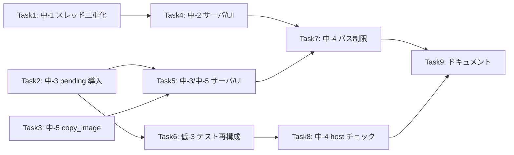

# Issue #58: 実装タスク一覧（PR #57 レビュー指摘の修正）

## 優先順位・依存関係



**実装順序（推奨）**: Task 1 → Task 2 → Task 3 → Task 4 → Task 5 → Task 6 → Task 7 → Task 8 → Task 9

コミットは各 Task 末尾に `fix #58: <説明>`（Task 9 のみ `docs #58: <説明>`）。
※ ユーザー方針により**自動コミットしない**。コミットは実装・検証後にグループを確認してから実行する。

> 注: 既存 `tests/test_watch_controller.py` / `tests/test_web.py` への追記は通常の追跡対象（gitignore 影響なし）。
> 新規 `tests/test_args.py` は作成後に `git status --short tests/test_args.py` で `??`（通常 add）か
> `path ignored`（`git add -f`）を確認する。
>
> 注: `black .` 実行時、Python 3.11 では「Python 3.11 cannot parse code formatted for Python 3.12+」警告が
> 出る場合があるが失敗ではない。`uv run black .` のまま進める。

---

## Task 1: [中-1] watch の停止→再開で監視スレッドが二重化する問題

**優先度: 高** — 停止が効かない状態の解消

### Step 1: 失敗テストを書く

`tests/test_watch_controller.py` の「watch スレッド」セクション（`test_watch_loop_calls_scan_repeatedly` の後）に追記:

```python
def test_stop_restart_no_duplicate_thread(tmp_path):
    """[中-1] 停止→再開で監視スレッドが二重化しない"""
    entered = threading.Event()
    release = threading.Event()

    def slow_scan(*args, **kwargs):
        entered.set()
        release.wait(timeout=10)

    ctl = _make_ctl(tmp_path, scan_fn=slow_scan, poll_interval=0.1)
    ctl.start_watch()
    old = ctl._thread
    assert entered.wait(timeout=5)
    # スキャン中に停止 → join timeout で戻るが、生存中の _thread は保持される
    ctl.stop_watch()
    assert ctl.watch_on is True
    # 生存中に再開しても新スレッドは作られない（二重化防止）
    ctl.start_watch()
    assert ctl._thread is old
    # スキャン完了 → 専用 stop Event により旧スレッドが自己終了する
    release.set()
    old.join(timeout=5)
    assert not old.is_alive()
    assert ctl.watch_on is False
    # 再開できる（新スレッド 1 本だけ）
    ctl.start_watch()
    assert ctl._thread is not old
    assert ctl.watch_on is True
    alive = [t for t in threading.enumerate() if t.name == "web-watcher" and t.is_alive()]
    assert len(alive) == 1
    ctl.stop_watch()
```

### Step 2: 失敗を確認

```bash
uv run pytest tests/test_watch_controller.py -q
```

期待出力: `1 failed, 25 passed`（`ctl.stop_watch()` 後に `watch_on` が False になり最初の `assert ctl.watch_on is True` で失敗）。

### Step 3: 実装（最小）

`app/services/watch_controller.py` の `start_watch` / `stop_watch` / `_watch_loop` を次の実装に置き換える:

```python
    def start_watch(self) -> None:
        """ポーリング監視スレッドを開始する。DB 未選択は ValueError。

        [中-1] スレッドごとに専用の stop Event を生成する。旧スレッドの
        停止要求（stop_event）は clear しないため、停止→再開で二重化しない。
        旧スレッドが生存中（stop_watch が join timeout した直後）は
        watch_on が True のためここに到達しない（二重起動の防止）。
        """
        if not self.has_db:
            raise ValueError("データベースを選択してください")
        if self.watch_on:
            return
        self._stop_event = threading.Event()
        self._thread = threading.Thread(target=self._watch_loop, name="web-watcher", daemon=True)
        self._thread.start()
        LOG.info("watch started (poll_interval=%d)", self.poll_interval)

    def stop_watch(self) -> None:
        """監視スレッドを停止する。

        [中-1] スキャン中で join timeout した場合は、生存中の _thread を
        保持する（watch_on が True のまま）。停止要求は専用 Event に出して
        あるため、スキャン完了後にスレッドは自己終了する。
        """
        self._stop_event.set()
        if self._thread is not None:
            self._thread.join(timeout=self.poll_interval + 5)
            if not self._thread.is_alive():
                self._thread = None
        LOG.info("watch stopped")
```

`_watch_loop` は開始時点の Event を捕捉する:

```python
    def _watch_loop(self) -> None:
        stop_event = self._stop_event  # 開始時点の専用 Event を捕捉（再開で差し替えられても影響しない）
        while not stop_event.is_set():
            self._run_scan()
            stop_event.wait(self.poll_interval)
```

### Step 4: 成功を確認

```bash
uv run pytest tests/test_watch_controller.py -q
```

期待出力: `26 passed`

### Step 5: コミット

```bash
git add app/services/watch_controller.py tests/test_watch_controller.py
git commit -m "fix #58: [中-1] watch 停止→再開のスレッド二重化を防止"
```

---

## Task 2: [中-3] 処理待ち（pending）状態の導入 — コントローラ

**優先度: 高** — サーバ/UI ガード（Task 5）と [低-3]（Task 6）の前提

### Step 1: 失敗テストを書く

`tests/test_watch_controller.py` に追記（「状態」セクションの前あたりに「処理待ち状態」セクションとして）:

```python
# --- [中-3] 処理待ち状態 ---


def test_copy_image_sets_pending(tmp_path):
    """[中-3] 画像コピー直後は処理待ち（pending）状態になる"""
    ctl = _make_ctl(tmp_path, scan_fn=lambda *a, **k: 0)
    ctl.copy_image("IMG_001.jpg", b"fake-jpeg-bytes")
    assert ctl.pending_process is True
    assert ctl.get_status()["pending"] is True


def test_scan_clears_pending_when_structured_generated(tmp_path):
    """[中-3] structured_data 生成後は pending が解除される"""
    def fake_scan(*args, **kwargs):
        input_dir = Path(args[0])
        output_dir = Path(args[2])
        output_dir.mkdir(parents=True, exist_ok=True)
        for p in input_dir.iterdir():
            if p.suffix.lower() in {".jpg", ".jpeg", ".png"}:
                out = output_dir / f"{p.stem}_123-structured_data.json"
                if not out.exists():
                    out.write_text('{"name": "山田 太郎"}', encoding="utf-8")
        return 1

    ctl = _make_ctl(tmp_path, scan_fn=fake_scan)
    ctl.copy_image("IMG_001.jpg", b"fake-jpeg-bytes")
    assert ctl.pending_process is True
    ctl._run_scan()
    assert ctl.pending_process is False
    assert (ctl.output_dir / "IMG_001_123-structured_data.json").exists()


def test_pending_cleared_when_image_moved_to_failed(tmp_path):
    """[中-3] 処理待ち画像が failed_dir へ退避済みなら pending が解除される"""
    ctl = _make_ctl(tmp_path, scan_fn=lambda *a, **k: 0)
    ctl.copy_image("IMG_001.jpg", b"fake-jpeg-bytes")
    ctl.failed_dir.mkdir(parents=True, exist_ok=True)
    (ctl.failed_dir / "IMG_001.jpg").write_bytes(b"fake-jpeg-bytes")
    ctl._run_scan()
    assert ctl.pending_process is False


def test_pending_stays_until_consumed(tmp_path):
    """[中-3] スキャンが画像を処理しなかった場合は pending が維持される"""
    ctl = _make_ctl(tmp_path, scan_fn=lambda *a, **k: 0)
    ctl.copy_image("IMG_001.jpg", b"fake-jpeg-bytes")
    ctl._run_scan()
    assert ctl.pending_process is True
```

既存 `test_get_status_shape` の期待キー集合に `"pending"` を追加:

```python
    assert set(s) == {
        "watch_on",
        "is_processing",
        "pending",
        "input_dir",
        "db_path",
        "has_db",
        "preprocess_mode",
        "poll_interval",
        "last_error",
        "structured_count",
    }
```

### Step 2: 失敗を確認

```bash
uv run pytest tests/test_watch_controller.py -q
```

期待出力: `5 failed, 25 passed`（pending 系 4 件 + `test_get_status_shape` 1 件が失敗）。

### Step 3: 実装（最小）

`app/services/watch_controller.py`:

1. `__init__` の `self._is_processing = False` の直後に追加:

```python
        self._pending_process = False
        self._pending_image: str | None = None
```

2. `is_processing` プロパティの直後に追加:

```python
    @property
    def pending_process(self) -> bool:
        """処理待ち（画像コピー後〜 structured 生成完了まで）かどうか。"""
        return self._pending_process
```

3. `copy_image` に pending 設定を追加（**Task 3 でさらに同名チェックを追加する**）:

```python
    def copy_image(self, filename: str, content: bytes) -> Path:
        """アップロード画像を input_dir へコピーする（案C: コピーのみ・即時処理しない）。

        [中-3] コピー直後〜 structured 生成完了までを「処理待ち」状態として保持し、
        スキャン 1 サイクルで消費されたら解除する。
        """
        name = Path(filename).name
        if Path(name).suffix.lower() not in watcher.IMAGE_EXT:
            raise ValueError("画像ファイルのみ指定できます")
        self.input_dir.mkdir(parents=True, exist_ok=True)
        dest = self.input_dir / name
        dest.write_bytes(content)
        self._pending_image = name
        self._pending_process = True
        LOG.info("Copied uploaded image to %s", dest)
        return dest
```

4. `_run_scan` の finally に `_clear_pending_if_consumed()` を追加し、ヘルパーを新設:

```python
        finally:
            self._is_processing = False
            self._scan_lock.release()
            self._clear_pending_if_consumed()

    def _clear_pending_if_consumed(self) -> None:
        """処理待ち画像が処理済み（出力 JSON 生成 or failed 退避）なら pending を解除する。

        [中-3] 読込不能画像（raw が生成されない）でも failed/ への退避があれば解除し、
        画像指定が永久ロックされないようにする（既存の問題 1 との相互作用対策）。
        """
        if not self._pending_process or self._pending_image is None:
            return
        stem = Path(self._pending_image).stem
        consumed = (
            list(self.output_dir.glob(f"{stem}_*-raw_data.json"))
            or list(self.output_dir.glob(f"{stem}_*-structured_data.json"))
            or (self.failed_dir / self._pending_image).exists()
        )
        if consumed:
            LOG.info("Pending image processed: %s", self._pending_image)
            self._pending_image = None
            self._pending_process = False
```

5. `get_status` の `"is_processing": self.is_processing,` の直後に追加:

```python
            "pending": self.pending_process,
```

### Step 4: 成功を確認

```bash
uv run pytest tests/test_watch_controller.py -q
```

期待出力: `30 passed`

### Step 5: コミット

```bash
git add app/services/watch_controller.py tests/test_watch_controller.py
git commit -m "fix #58: [中-3] 画像コピー後の処理待ち状態（pending）を導入"
```

---

## Task 3: [中-5] copy_image が同名の既存画像を無確認で上書きする問題

**優先度: 高** — 元画像の損失防止

### Step 1: 失敗テストを書く

`tests/test_watch_controller.py` の「画像コピー」セクションに追記:

```python
def test_copy_image_rejects_existing_same_name(tmp_path):
    """[中-5] 同名の既存画像は上書きされず FileExistsError になる"""
    ctl = _make_ctl(tmp_path, scan_fn=lambda *a, **k: 0)
    ctl.copy_image("IMG_001.jpg", b"first-bytes")
    with pytest.raises(FileExistsError):
        ctl.copy_image("IMG_001.jpg", b"second-bytes")
    # 元画像は失われない
    assert (ctl.input_dir / "IMG_001.jpg").read_bytes() == b"first-bytes"
```

### Step 2: 失敗を確認

```bash
uv run pytest tests/test_watch_controller.py -q
```

期待出力: `1 failed, 30 passed`（現在の実装は上書きするため `FileExistsError` が起きず失敗）。

### Step 3: 実装（最小）

`copy_image` の書き込み前に同名チェックを追加:

```python
        self.input_dir.mkdir(parents=True, exist_ok=True)
        dest = self.input_dir / name
        if dest.exists():
            # [中-5] 同名の既存画像は無確認で上書きしない（連番は再処理による重複登録を招くため不可）
            raise FileExistsError(f"同名のファイルが既に存在します: {name}")
        dest.write_bytes(content)
        self._pending_image = name
        self._pending_process = True
```

### Step 4: 成功を確認

```bash
uv run pytest tests/test_watch_controller.py -q
```

期待出力: `31 passed`

### Step 5: コミット

```bash
git add app/services/watch_controller.py tests/test_watch_controller.py
git commit -m "fix #58: [中-5] 同名画像の無確認上書きを防止"
```

---

## Task 4: [中-2] 処理中でも DB を差し替えられる問題 — サーバ/UI

**優先度: 高** — 書き込み先 DB の競合防止

### Step 1: 失敗テストを書く

`tests/test_web.py` の「Issue #56: Web UI からの watch・設定操作」セクション（`test_config_db_upload_keeps_existing_db` の後）に追記:

```python
def test_config_db_upload_409_while_processing(web_client, web_ctl, tmp_path):
    """[中-2] 処理中の DB 差し替えアップロードは 409"""
    src = tmp_path / "swap.sqlite3"
    run_migrations(src, SCHEMA_PATH)
    web_ctl._is_processing = True
    try:
        resp = web_client.post(
            "/config",
            files={"db_file": ("swap.db", src.read_bytes(), "application/octet-stream")},
            follow_redirects=False,
        )
    finally:
        web_ctl._is_processing = False
    assert resp.status_code == 409
    assert not (web_ctl.data_dir / "swap.db").exists()


def test_db_file_input_disabled_while_processing(web_client, web_ctl):
    """[中-2] 処理中は db-file-input が disabled になる"""
    web_ctl._is_processing = True
    try:
        page = web_client.get("/")
        m = re.search(r'<input id="db-file-input"[^>]*>', page.text)
        assert m is not None, "db-file-input タグが見つからない"
        assert "disabled" in m.group(0)
    finally:
        web_ctl._is_processing = False
```

### Step 2: 失敗を確認

```bash
uv run pytest tests/test_web.py -q
```

期待出力: `2 failed, 55 passed`（現在は 409 ではなく 303/保存、disabled なし）。

### Step 3: 実装（最小）

`app/web/server.py` の `post_config` の `db_file` 分岐にガードを追加:

```python
        db_file = form.get("db_file")
        if db_file is not None and getattr(db_file, "filename", ""):
            # [中-2] 処理中の DB 差し替えは拒否（書き込み先 DB が途中で変わるため）
            if controller.is_processing:
                raise HTTPException(status_code=409, detail="処理中です。完了までお待ちください")
            try:
                controller.save_db_upload(await db_file.read(), db_file.filename)
            except ValueError as e:
                raise HTTPException(status_code=400, detail=str(e))
            except Exception:
                raise HTTPException(status_code=400, detail="データベースファイルを開けませんでした")
```

`app/web/templates/index.html`:

1. 初期描画の DB input に disabled を追加:

```html
        <div style="margin-bottom:8px;">
            <label>データベース:
                <input id="db-file-input" type="file" name="db_file" accept=".db,.sqlite,.sqlite3"
                       disabled>
            </label>
```

2. `applyStatus` に db-file-input の disabled 制御を追加（画像 input の制御の直後）:

```js
            const dbInput = document.getElementById('db-file-input');
            if (dbInput) { dbInput.disabled = s.is_processing; }
```

### Step 4: 成功を確認

```bash
uv run pytest tests/test_web.py -q
```

期待出力: `57 passed`

### Step 5: コミット

```bash
git add app/web/server.py app/web/templates/index.html tests/test_web.py
git commit -m "fix #58: [中-2] 処理中の DB 差し替えを 409 で拒否"
```

---

## Task 5: [中-3][中-5] /images のガードと UI — サーバ/UI

**優先度: 高** — 完了条件「画像コピー後〜 structured_data 完成まで画像指定が無効」

### Step 1: 失敗テストを書く

`tests/test_web.py` に追記（`test_upload_image_copies_to_input_dir` の後）:

```python
def test_images_409_while_pending(web_client, web_ctl):
    """[中-3] 処理待ち中の画像アップロードは 409（仕様上の拒否）"""
    web_ctl._pending_process = True
    try:
        resp = web_client.post(
            "/images",
            files={"image": ("IMG_009.jpg", b"fake-jpeg-bytes", "image/jpeg")},
            follow_redirects=False,
        )
    finally:
        web_ctl._pending_process = False
    assert resp.status_code == 409


def test_image_input_disabled_while_pending(web_client, web_ctl):
    """[中-3] 処理待ち中は image-input が disabled になる"""
    web_ctl._pending_process = True
    try:
        page = web_client.get("/")
        m = re.search(r'<input id="image-input"[^>]*>', page.text)
        assert m is not None, "image-input タグが見つからない"
        assert "disabled" in m.group(0)
    finally:
        web_ctl._pending_process = False


def test_upload_image_409_on_duplicate_name(web_client, web_ctl):
    """[中-5] 同名画像の再アップロードは 409 で上書きされない"""
    r1 = web_client.post(
        "/images",
        files={"image": ("IMG_004.jpg", b"first-bytes", "image/jpeg")},
        follow_redirects=False,
    )
    assert r1.status_code == 303
    # 1 回目のコピーで pending になるため、スキャンで消費させてから再アップロードする
    web_ctl._run_scan()
    assert web_ctl.pending_process is False
    r2 = web_client.post(
        "/images",
        files={"image": ("IMG_004.jpg", b"second-bytes", "image/jpeg")},
        follow_redirects=False,
    )
    assert r2.status_code == 409
    assert "同名" in r2.json()["detail"]
    assert (web_ctl.input_dir / "IMG_004.jpg").read_bytes() == b"first-bytes"
```

### Step 2: 失敗を確認

```bash
uv run pytest tests/test_web.py -q
```

期待出力: `3 failed, 57 passed`。

### Step 3: 実装（最小）

`app/web/server.py` の `upload_image` を置き換え:

```python
    @app.post("/images")
    async def upload_image(request: Request):
        """画像を指定フォルダへコピーする（案C: コピーのみ。処理は watch のポーリングが行う）"""
        if not controller.has_db:
            raise HTTPException(status_code=400, detail="データベースを選択してください")
        # [中-3] 処理中または処理待ち（コピー後〜 structured 生成完了）は 409
        if controller.is_processing or controller.pending_process:
            raise HTTPException(status_code=409, detail="処理中です。完了までお待ちください")
        form = await request.form()
        image = form.get("image")
        if image is None or not getattr(image, "filename", ""):
            raise HTTPException(status_code=400, detail="画像ファイルを選択してください")
        content = await image.read()
        try:
            controller.copy_image(image.filename, content)
        except FileExistsError as e:
            # [中-5] 同名の既存画像は上書きせず 409
            raise HTTPException(status_code=409, detail=str(e))
        except ValueError as e:
            raise HTTPException(status_code=400, detail=str(e))
        # 案C（コピーのみ・即時処理しない）を維持しつつ、ポーリング監視を即始動させることで
        # 「読み込む＝処理開始」という期待に応える（未 ON 時のみ・DB 未選択は手前で 400）
        if not controller.watch_on:
            try:
                controller.start_watch()
            except ValueError:
                pass
        return RedirectResponse(url="/", status_code=303)
```

`app/web/templates/index.html`:

1. 初期描画の画像 input / button に pending を追加:

```html
            <label>画像指定:
                <input id="image-input" type="file" name="image" accept="image/*"
                       disabled>
            </label>
            <button id="image-submit" type="button" disabled>読み込む</button>
```

2. `applyStatus` の画像 input / button 制御を更新:

```js
            const imgInput = document.getElementById('image-input');
            const imgBtn = document.getElementById('image-submit');
            if (imgInput) { imgInput.disabled = s.is_processing || s.pending; }
            if (imgBtn) { imgBtn.disabled = s.is_processing || s.pending; }
```

### Step 4: 成功を確認

```bash
uv run pytest tests/test_web.py -q
```

期待出力: `60 passed`

### Step 5: コミット

```bash
git add app/web/server.py app/web/templates/index.html tests/test_web.py
git commit -m "fix #58: [中-3][中-5] /images の処理待ち・同名上書きを 409 で拒否"
```

---

## Task 6: [低-3] 409 リトライでテストのフレークを隠している問題

**優先度: 中** — 中-3 実装後のテスト品質改善

### Step 1: テストを再構成する

`tests/test_web.py` の `test_watch_picks_up_uploaded_image` を丸ごと置き換え（409 リトライループを除去し、状態遷移を直接検証）:

```python
def test_watch_picks_up_uploaded_image(web_client, web_ctl):
    """[低-3] リトライなし: アップロード → ポーリング処理 → structured 生成で pending 解除"""
    web_client.post("/watch/start", follow_redirects=False)
    # 初回スキャン完了（アイドル）まで待つ — スキャン中の POST は仕様上の 409
    for _ in range(50):
        if not web_client.get("/api/status").json()["is_processing"]:
            break
        time.sleep(0.1)
    # 409 リトライループなしの 1 回 POST
    resp = web_client.post(
        "/images",
        files={"image": ("IMG_002.jpg", b"fake-jpeg-bytes", "image/jpeg")},
        follow_redirects=False,
    )
    assert resp.status_code == 303
    # ポーリングが拾って structured_data.json を生成するまで待つ（完了で pending 解除）
    out_dir = web_ctl.output_dir
    deadline = 0
    s = None
    while deadline < 100:
        s = web_client.get("/api/status").json()
        if s["structured_count"] > 0 and not s["pending"]:
            break
        time.sleep(0.1)
        deadline += 1
    assert s is not None and s["structured_count"] > 0, "structured_data.json が生成されない"
    assert s["pending"] is False
    page = web_client.get("/")
    assert "IMG_002" in page.text  # 一覧にリンクが追加されている
    web_client.post("/watch/stop", follow_redirects=False)
```

※ 旧テストは `out_dir` 変数を使用していたが、新実装では `web_ctl.output_dir` を直接使うため
`out_dir` 変数は不要になった（残しても未使用になるだけなので削除する）。

### Step 2: 成功を確認

```bash
uv run pytest tests/test_web.py -q
```

期待出力: `60 passed`（再構成のみ。リトライループが無いことを diff で確認）。

### Step 3: コミット

```bash
git add tests/test_web.py
git commit -m "fix #58: [低-3] 409 リトライを除去し状態遷移を直接検証"
```

---

## Task 7: [中-4] 入力パスの許可ルート制限（input_dir）

**優先度: 中** — 任意パス操作の防止（Q2 決定: 案A ホーム配下限定）

### Step 1: 失敗テストを書く

`tests/test_watch_controller.py` の「設定: input_dir」セクション:

1. 既存 `test_set_input_dir_creates_directory` をホーム差し替え版に更新（ホーム外の tmp_path を使うと新ガードで 400 になるため）:

```python
def test_set_input_dir_creates_directory(tmp_path, monkeypatch):
    """存在しない input_dir を指定すると mkdir され、状態が更新される"""
    home = tmp_path / "home"
    home.mkdir()
    monkeypatch.setattr(Path, "home", classmethod(lambda cls: home))
    ctl = WatchController(output_dir=str(tmp_path / "output"))
    target = home / "nested" / "receipts"
    result = ctl.set_input_dir(str(target))
    assert target.is_dir()
    assert ctl.input_dir == target
    assert result == target
```

2. 新規テストを追加:

```python
def test_set_input_dir_rejects_outside_home(tmp_path, monkeypatch):
    """[中-4] 許可ルート（ホーム）外の input_dir は ValueError"""
    home = tmp_path / "home"
    home.mkdir()
    monkeypatch.setattr(Path, "home", classmethod(lambda cls: home))
    ctl = WatchController(output_dir=str(tmp_path / "output"))
    with pytest.raises(ValueError, match="ホーム"):
        ctl.set_input_dir(str(tmp_path / "outside"))
    assert ctl.input_dir != tmp_path / "outside"
```

`tests/test_web.py`:

3. 既存 `test_config_updates_input_dir_and_mode` をホーム差し替え版に更新:

```python
def test_config_updates_input_dir_and_mode(web_client, tmp_path, monkeypatch):
    """POST /config で input_dir / preprocess_mode が反映される"""
    home = tmp_path / "home"
    home.mkdir()
    monkeypatch.setattr(Path, "home", classmethod(lambda cls: home))
    new_dir = home / "another"
    resp = web_client.post(
        "/config",
        data={"input_dir": str(new_dir), "preprocess_mode": "clahe"},
        follow_redirects=False,
    )
    assert resp.status_code == 303
    assert resp.headers["location"] == "/"
    page = web_client.get("/")
    assert str(new_dir) in page.text
    assert 'value="clahe" selected' in page.text
```

4. 新規テストを追加:

```python
def test_config_rejects_path_outside_home(web_client, tmp_path, monkeypatch):
    """[中-4] ホーム外の input_dir は 400"""
    home = tmp_path / "home"
    home.mkdir()
    monkeypatch.setattr(Path, "home", classmethod(lambda cls: home))
    resp = web_client.post(
        "/config",
        data={"input_dir": str(tmp_path / "outside")},
        follow_redirects=False,
    )
    assert resp.status_code == 400
```

### Step 2: 失敗を確認

```bash
uv run pytest tests/test_watch_controller.py tests/test_web.py -q
```

期待出力: `2 failed, 91 passed`（`test_set_input_dir_rejects_outside_home` と `test_config_rejects_path_outside_home` が失敗。更新した既存テスト 2 件はホーム配下のため通る）。

### Step 3: 実装（最小）

`app/services/watch_controller.py` の `set_input_dir` を置き換え:

```python
    def set_input_dir(self, path: str | Path) -> Path:
        """input_dir を更新し、存在しなければ作成する。

        [中-4] 認証のない変更系エンドポイントの任意パス操作を防ぐため、
        絶対パスかつユーザーのホームディレクトリ配下のみ許可する。
        """
        p = Path(path).expanduser()
        if not p.is_absolute():
            raise ValueError("絶対パスを指定してください")
        home = Path.home()
        if not p.resolve().is_relative_to(home):
            raise ValueError("ホームディレクトリ配下のパスのみ指定できます")
        p.mkdir(parents=True, exist_ok=True)
        self.input_dir = p
        LOG.info("input_dir -> %s", p)
        return p
```

`app/web/server.py` の `post_config` の input_dir 分岐を更新（ValueError → 400）:

```python
        input_dir = form.get("input_dir")
        if input_dir:
            try:
                controller.set_input_dir(str(input_dir))
            except ValueError as e:
                raise HTTPException(status_code=400, detail=str(e))
```

### Step 4: 成功を確認

```bash
uv run pytest tests/test_watch_controller.py tests/test_web.py -q
```

期待出力: `93 passed`

### Step 5: コミット

```bash
git add app/services/watch_controller.py app/web/server.py tests/test_watch_controller.py tests/test_web.py
git commit -m "fix #58: [中-4] input_dir をホームディレクトリ配下に限定"
```

---

## Task 8: [中-4] 非 loopback 起動の拒否（host チェック）

**優先度: 中** — 認証のないエンドポイントの曝露防止（Q1 決定: 案A 起動拒否）

### Step 1: 失敗テストを書く

**新規**: `tests/test_args.py`

```python
"""Tests for app.args (Issue #58 [中-4])."""

from app.args import is_loopback_host


def test_is_loopback_host_accepts_loopback():
    assert is_loopback_host("127.0.0.1")
    assert is_loopback_host("localhost")
    assert is_loopback_host("::1")


def test_is_loopback_host_rejects_non_loopback():
    assert not is_loopback_host("0.0.0.0")
    assert not is_loopback_host("192.168.1.10")
    assert not is_loopback_host("mypc")
```

### Step 2: 失敗を確認

```bash
uv run pytest tests/test_args.py -q
```

期待出力: 収集エラー（`ImportError: cannot import name 'is_loopback_host'`）か `2 failed`。

### Step 3: 実装（最小）

`app/args.py`:

1. 冒頭の import に追加:

```python
import ipaddress
```

2. ファイル末尾に追加:

```python
def is_loopback_host(host: str) -> bool:
    """Web サーバの host がループバック（localhost / 127.0.0.1 / ::1 等）か判定する。

    [中-4] 認証のない変更系エンドポイントを LAN に曝さないための起動ガード。
    IP として解釈できないホスト名は非ループバック扱い（False）とする。
    """
    if host in ("localhost", "::1"):
        return True
    try:
        return ipaddress.ip_address(host).is_loopback
    except ValueError:
        return False
```

`main.py`:

1. ファイル先頭に `import sys` を追加。
2. 冒頭の `from app.args import setup_args, setup_directories` を `from app.args import is_loopback_host, setup_args, setup_directories` に変更。
3. serve 分岐の先頭にガードを追加:

```python
    if args.serve:
        if not is_loopback_host(args.host):
            # [中-4] 認証のない変更系エンドポイントがあるため、非 loopback 起動は拒否する
            print(
                f"エラー: ホスト {args.host} はループバックではありません。\n"
                "このアプリには認証がなく、任意パス操作・DB 差し替え・画像コピーが可能です。\n"
                "127.0.0.1 (localhost) でのみ起動してください。",
                file=sys.stderr,
            )
            return
        import uvicorn
        from app.web.server import create_app
```

### Step 4: 成功を確認

```bash
uv run pytest tests/test_args.py -q
```

期待出力: `2 passed`

手動確認:

```bash
uv run python main.py --serve --host 0.0.0.0 --port 8000
```

期待出力: `エラー: ホスト 0.0.0.0 はループバックではありません。...` が stderr に出て即終了（uvicorn は起動しない）。

```bash
uv run python main.py --serve --host 127.0.0.1 --port 8000
```

期待出力: `Starting Web UI at http://127.0.0.1:8000` で起動。Ctrl-C で終了。

### Step 5: コミット

```bash
git add app/args.py main.py tests/test_args.py
git commit -m "fix #58: [中-4] 非 loopback host での --serve 起動を拒否"
```

（`git status --short tests/test_args.py` が `path ignored` の場合は `git add -f tests/test_args.py` を使う）

---

## Task 9: ドキュメント（cli.md / spec）

**優先度: 中** — 完了条件「個人利用・LAN 公開しない運用を spec / CLI ドキュメントに明記」

### Step 1: `.hermes/rules/cli.md` の「Web UI 運用 (Issue #56)」節を更新

末尾（`- \`--serve\` 時は他の処理オプションを無視する (PR #57)` の後）に追記:

```markdown
- 起動は 127.0.0.1 (localhost) のみ。非 loopback host（`--host 0.0.0.0` 等）は認証がないため**起動拒否**される（Issue #58）
- 指定フォルダは**ホームディレクトリ配下**のみ指定可能（外部パスは 400）
- 個人利用・LAN 公開しない運用を前提とする
- 処理中は DB ファイル選択も disabled（サーバ側 409）。画像指定は処理中・処理待ち（コピー後〜生成完了）で disabled（409）
- 同名画像の再読み込みは 409（上書きしない）
```

### Step 2: `specs/command-to-webui-spec.md` を更新

- エンドポイント表:
  - `/config` のエラー列: `400 (mode, DB 不正, パス不正) / 409 (処理中 db_file)`
  - `/images` のエラー列: `400 (DB 未選択・非画像) / 409 (処理中・処理待ち・同名)`
- 状態一覧に `pending` を追加（`watch_on / is_processing / pending / input_dir / ...`）
- 決定事項表に 2 行追加:

```markdown
| 非 loopback 起動 | 起動拒否（--host 0.0.0.0 はエラーで即終了） | 認証がないため LAN 曝露を構造的に防止 |
| input_dir 制限 | ホームディレクトリ配下のみ（他は 400） | 任意パス操作の防止 |
```

- 受け入れ要件との対応に 4 行追加（中-2 の 409、中-3 の pending、中-5 の 409、中-4 の拒否）
- frontmatter の `updated:` を当日日付に更新

### Step 3: 検証

```bash
uv run pytest -q
```

期待出力: `409 passed / 0 failed`（2026-11-19 実測のフルスイートは 394 passed / 0 failed。
PR #57 本文記載の「4 failed は pre-existing」は tasks/pr_53 で解消済みのため現状は失敗なし）

### Step 4: コミット

```bash
git add .hermes/rules/cli.md specs/command-to-webui-spec.md
git commit -m "docs #58: [中-4] 非 loopback 拒否・パス制限・個人利用前提を cli.md / spec に明記"
```

---

## 最終検証（全タスク完了後）

```bash
uv run pytest -q
```

期待出力: `409 passed / 0 failed`（2026-11-19 実測のフルスイートは 394 passed / 0 failed、追加 15 件分が増える）。

```bash
uv run black --check .
```

期待出力: 整形差分なし（差分があれば `uv run black .` を実行）。

実機確認:

```bash
uv run python main.py --serve --host 127.0.0.1 --port 8000 --db-path data/db.sqlite3
# 別ターミナルで:
curl -s localhost:8000/api/status   # {"watch_on": false, "is_processing": false, "pending": false, ...}
```

## 既存の問題 1（読込不能ファイルの毎サイクル再処理）— 別 Issue 提案（本タスク一覧のスコープ外・Q3 決定: 案A 別 Issue 化）

判定: Issue #58 の 6 項目とは無関係（watcher 側の既存問題）。方針は「再試行が続く → エラーで止める（失敗ファイルを input_dir から退避）」方式（plan.md「既存の問題 1 との関連性」節参照）。

別 Issue 用の最小タスク（採番後に tasks/<issue-N>/ へ展開）:

1. `app/services/file_repository.py::move_to_failed` を `shutil.copy2` → `shutil.move` に変更（+ テスト: 元ファイルが input_dir から消える）
2. `app/services/receipt_processor.py::_sync_process` で「`process_image` が空リストを返し raw 未生成」を失敗扱いにして `move_to_failed` を呼ぶ（+ テスト: 読込不能画像が 1 サイクルで failed/ へ移動し、2 サイクル目で再処理されない）
3. `is_processing` の点滅が消えることを watch レベルで確認
