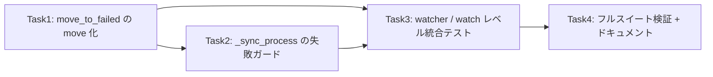

# Issue #60: 読込不能画像の毎サイクル再処理 — 実装タスク一覧

## 優先順位・依存関係



**実装順序（推奨）**: Task 1 → Task 2 → Task 3 → Task 4

コミットは各 Task 末尾に `fix #60: <説明>`（Task 4 のみ `docs #60: <説明>`）。
※ ユーザー方針により**自動コミットしない**。コミットは実装・検証後にグループを確認してから実行する。

> 注: 本 Issue は `bug/disable-read-cycle/60` ブランチ上で作業する。
> 既存テストへの追記・修正のみで新規テストファイルは作らない（gitignore 影響なし）。
>
> 注: `black .` 実行時、Python 3.11 では「Python 3.11 cannot parse code formatted for Python 3.12+」
> 警告が出る場合があるが失敗ではない。`uv run black .` のまま進める。
>
> 基準値（2026-11-20 実測）:
> - `tests/test_file_repository.py`: **14 passed**
> - `tests/test_receipt_processor.py`: **10 passed**
> - `tests/test_watcher_integration.py`: **6 passed**
> - `tests/test_watch_controller.py`: **41 passed**
> - フルスイート: **424 passed / 0 failed**

---

## Task 1: `move_to_failed()` を複製 → 移動に変更

**優先度: 高** — 例外系失敗と読込不能画像の両方で、`input_dir` に残って再処理される根本原因の解消

### Step 1: 失敗テストを書く（既存テストの文言修正）

`tests/test_file_repository.py` の `TestMoveToFailed` クラス内、`test_copies_file_to_failed_dir`
を `test_moves_file_to_failed_dir` に変更:
- 既存の `assert p.exists()`（元画像が残る）を **`assert not p.exists()`**（元画像が消える）に置き換え
- moved 先（`repo.failed_dir / "fail.jpg"`）が存在するアサーションは維持

```python
    def test_moves_file_to_failed_dir(self, repo: FileRepository, tmp_path: Path):
        p = tmp_path / "fail.jpg"
        p.write_text("data")
        repo.move_to_failed(p)
        assert (repo.failed_dir / "fail.jpg").exists()
        # original should be removed from input (move, not copy)
        assert not p.exists()
```

### Step 2: 失敗を確認

```bash
uv run pytest tests/test_file_repository.py -q
```

期待出力: `1 failed, 13 passed`（`shutil.copy2` のままなので `assert not p.exists()` で失敗）。

### Step 3: 実装

`app/services/file_repository.py::move_to_failed` の `shutil.copy2` → `shutil.move` に変更し、
ログ文言を Copied → Moved に更新:

```python
    def move_to_failed(self, p: Path) -> None:
        """失敗したファイルを失敗ディレクトリへ退避する（input から取り除く）。"""
        try:
            dest = self.failed_dir / p.name
            if dest.exists():
                dest = self.failed_dir / f"{int(time.time())}_{p.name}"
            shutil.move(str(p), str(dest))
            LOG.info("Moved failed %s -> %s", p, dest)
        except Exception:
            LOG.exception("Failed to move failed file %s", p)
```

### Step 4: 成功を確認

```bash
uv run pytest tests/test_file_repository.py -q
```

期待出力: `14 passed`（`test_handles_duplicate_name` も timestamped 名への move で従来通り成功）。

### Step 5: コミット

```bash
git add app/services/file_repository.py tests/test_file_repository.py
git commit -m "fix #60: move_to_failed を copy から move に変更し input_dir から取り除く"
```

---

## Task 2: `_sync_process()` で読込不能画像（空 `[]` + raw 未生成）を失敗扱いにする

**優先度: 高** — 読込不能画像が 1 サイクルで失敗になる核心の実装

### Step 1: 失敗テストを書く

`tests/test_receipt_processor.py` の `TestSyncProcess` クラス内（`test_returns_false_on_all_retries_exhausted`
の後）に追記:

```python
    @patch("app.ocr_pipeline.process_image", return_value=[])
    def test_returns_false_and_moves_to_failed_when_empty_result_and_no_raw(
        self, mock_process_image, processor: ReceiptProcessor, image_path: Path
    ):
        """Issue #60: OCR が空 [] を返し raw JSON 未生成（読込不能）なら失敗として failed/ へ移動"""
        processor.output_dir.mkdir(parents=True, exist_ok=True)

        result = processor._sync_process(image_path)

        assert result is False
        # raw が生成されていない（process_image は [] を返すだけで書き込まない）→ 移動される
        assert (processor.file_repository.failed_dir / image_path.name).exists()
        assert not image_path.exists()  # input から取り除かれた
        mock_process_image.assert_called_once()
```

※ 注意: process_image をモックで `return_value=[]` にしているため、実装側の判定は
`output_json_path.exists()`（このテストでは生成されない）が False であることに依存する。
モックが raw を書かないため再現できる。

### Step 2: 失敗を確認

```bash
uv run pytest tests/test_receipt_processor.py -q
```

期待出力: `1 failed, 10 passed`（現状は `return True` のため `assert result is False` で失敗）。
※ 既存 `test_preprocess_force_retries_even_when_confident` は `process_image.mock` に
`preprocess_fn` キーワードを渡す実装へ変更されるが、本テスト・既存テストとも
`processor._sync_process` の形は不変のため影響なし。

### Step 3: 実装

`app/services/receipt_processor.py::_sync_process` の `process_image()` 呼び出し直後
（`resized_path` 代入の前）にガードを追加:

```python
                structured = process_image(
                    image_path,
                    output_dir=output_dir,
                    output_json_path=output_json_path,
                    ocr=self.ocr,
                    target_short_side=self.target_short_side,
                )

                # Issue #60: 読込不能画像（OCR が空 [] を返し raw JSON 未生成）は失敗として
                # failed/ へ退避し、次のサイクルで再処理されないようにする。
                # ※ 有効な画像で OCR 結果が 0 行の場合は process_image が raw JSON を書くため、
                #    ここは「raw 未生成」のみを読込不能として扱う。
                if not structured and not output_json_path.exists():
                    LOG.warning(
                        "Image produced no OCR result and no raw JSON (unreadable); moving to failed: %s",
                        image_path,
                    )
                    self.file_repository.move_to_failed(image_path)
                    return False

                resized_path = output_dir / f"resized_gray_{image_path.name}"
```

### Step 4: 成功を確認

```bash
uv run pytest tests/test_receipt_processor.py -q
```

期待出力: `11 passed`。

### Step 5: コミット

```bash
git add app/services/receipt_processor.py tests/test_receipt_processor.py
git commit -m "fix #60: _sync_process で読込不能画像を失敗扱いにして failed/ へ退避"
```

---

## Task 3: watcher / watch レベルで再処理が止まることを確認

**優先度: 中** — 完了条件「次のサイクルで再処理されない」「is_processing が解除される」を実証

### Step 1: watcher 統合テストを追加

`tests/test_watcher_integration.py` の末尾に追記（`scan_and_process` を 2 回呼び、
1 サイクル目で failed/ へ移動し 2 サイクル目で再処理されないこと）:

```python
def test_unreadable_image_moved_to_failed_and_not_reprocessed(tmp_path):
    """Issue #60: 読込不能画像は 1 サイクルで failed/ へ移動し、次のサイクルで再処理されない"""
    input_dir = tmp_path / "input-u"
    output_dir = tmp_path / "output-u"
    processed_dir = tmp_path / "processed-u"
    failed_dir = tmp_path / "failed-u"

    input_dir.mkdir()
    # 読込不能画像: cv2.imread が読めないバイナリを .jpg として配置（resize 失敗 → []）
    bad = input_dir / "broken.jpg"
    bad.write_bytes(b"\x00\x01\x02 not a real image")

    ocr = FakeOCR()

    first = scan_and_process(
        input_dir=input_dir,
        ocr=ocr,
        output_dir=output_dir,
        processed_dir=processed_dir,
        failed_dir=failed_dir,
        retries=0,
    )
    assert first == 0  # 失敗扱い（成功数に数えない）
    assert not (input_dir / "broken.jpg").exists()   # input から取り除かれた
    assert (failed_dir / "broken.jpg").exists()      # failed/ へ退避された
    assert len(list(output_dir.glob("*-raw_data.json"))) == 0

    # 次のサイクル: 元画像が input にないため再処理されない
    second = scan_and_process(
        input_dir=input_dir,
        ocr=ocr,
        output_dir=output_dir,
        processed_dir=processed_dir,
        failed_dir=failed_dir,
        retries=0,
    )
    assert second == 0
    assert not (input_dir / "broken.jpg").exists()
    assert (failed_dir / "broken.jpg").exists()
```

### Step 2: 失敗を確認

```bash
uv run pytest tests/test_watcher_integration.py -q
```

期待出力: 現状（Task 1/2 未適用）では `1 failed, 6 passed`。Task1/2 適用後にもう一度実行し
`7 passed` になること。※ 優先順位上このテストは Task 1・2 の後に通る。検証は Step 4 で行う。

### Step 3: watch レベルのテストを追加

`tests/test_watch_controller.py` の watch セクション（`test_watch_loop_calls_scan_repeatedly`
付近）に追記。既存の `_make_ctl`（fake `scan_fn` 注入、PaddleOCR を起動しない）を使うのが
このファイルの流儀。読込不能画像の退避は**実ファイルシステムで**検証するため、`scan_fn` に
「`failed_dir` へ移動し `input_dir` から `broken.jpg` を消す」fake を渡し、`_run_scan()` 後に
`is_processing` が解除されファイルが消えることを assert する:

```python
def test_scan_evicts_unreadable_and_clears_processing(tmp_path):
    """Issue #60: _run_scan 完了で is_processing が解除され、読込不能画像が input から消える"""
    import shutil

    input_dir = tmp_path / "input"
    failed_dir = tmp_path / "failed"
    input_dir.mkdir()
    broken = input_dir / "broken.jpg"
    broken.write_bytes(b"\x00\x01\x02 not a real image")

    # fake scan: _sync_process の失敗退避（move）を再現する
    def fake_scan(in_dir, ocr, out_dir, proc_dir, fail_dir, **kwargs):
        for img in in_dir.iterdir():
            if img.name == "broken.jpg":
                fail_dir.mkdir(parents=True, exist_ok=True)
                shutil.move(str(img), str(fail_dir / img.name))

    ctl = _make_ctl(tmp_path, scan_fn=fake_scan, poll_interval=0.05)
    ctl._run_scan()

    assert ctl.is_processing is False
    assert not (input_dir / "broken.jpg").exists()   # input から取り除かれた
    assert (failed_dir / "broken.jpg").exists()      # failed/ へ退避された
    ctl.stop_watch()
```

※ watch スレッドを起動していない（`_run_scan()` を直接呼ぶ）ため、`ctl.stop_watch()` は
`watch_on` が False の間 no-op で安全。

### Step 4: 検証

```bash
uv run pytest tests/test_receipt_processor.py tests/test_watcher_integration.py tests/test_watch_controller.py -q
```

期待出力: `11 + 7 + 42 = 60 passed`（Task 2 が +1 → 11、Task 3 が watcher 統合 +1 → 7、
watch_controller +1 → 42）。

### Step 5: コミット

```bash
git add tests/test_watcher_integration.py tests/test_watch_controller.py
git commit -m "fix #60: watcher/watch レベルで読込不能画像の再処理が止まることをテストで担保"
```

---

## Task 4: フルスイート検証 + ドキュメント反映

**優先度: 中** — 回帰がないことの確認と、変更の高い挙動をルール/設計判断に記録

### Step 1: フルスイート + 整形チェック

```bash
uv run pytest -q
```

期待出力: `425 passed / 0 failed`（2026-11-20 実測 424 件 + 追加 1 件。`test_file_repository`
は文言変更のみで件数不変）。

```bash
uv run black --check .
```

期待出力: 整形差分なし（差分があれば `uv run black .` を実行）。

### Step 2: ドキュメント反映

`.hermes/rules/design-decisions.md` の「ファイル安定性チェック」に隣接する形で、読込不能画像の
停止に関する設計判断を追記（既存節と相互リンクを維持）:

```markdown
- **読込不能画像の再処理停止 (Issue #60)**: `process_image()` が空 `[]` を返し raw JSON 未生成
  （resize 失敗）の場合は `_sync_process` が失敗扱いで `move_to_failed` を呼び `False` を返す。
  `move_to_failed` は `shutil.move` で input から failed/ へ移動する（copy ではない）。有効画像で
  OCR 結果 0 行の場合は raw JSON が書かれるため失敗扱いされない。
```

`AGENTS.md` の「重要な設計判断」節の要点リストにも 1 行追記（詳細は rules へのリンク）:

```markdown
- **読込不能画像は 1 サイクルで failed/ へ移動し再処理を止める**（`_sync_process` の raw 未生成ガード）。
  詳細は `design-decisions.md`。
```

※ AGENTS.md / rules の該当行は実ファイルを読んで正確な位置・文言を合わせること。

### Step 3: コミット

```bash
git add .hermes/rules/design-decisions.md AGENTS.md
git commit -m "docs #60: 読込不能画像の再処理停止をデザイン判断に記録"
```

---

## 最終検証（全タスク完了後）

```bash
uv run pytest -q
```

期待出力: `425 passed / 0 failed`（2026-11-20 実測のフルスイートは 424 passed / 0 failed、
追加 1 件分が増える）。

```bash
uv run black --check .
```

期待出力: 整形差分なし（差分があれば `uv run black .` を実行）。

実機確認（任意、読込不能画像を input_dir に置いて watch を数秒観察）:

```bash
# input_dir に壊れた .jpg を配置して起動
uv run python main.py --input-dir ~/Downloads/receipts --db-path data/db.sqlite3 \
    --watch --poll-interval 2
# 1 サイクルで壊れた画像が failed/ へ移動し、以降のスキャンで再処理されないことを目視確認
```

## 対象外（明示）

- `move_to_processed` の呼び出し元が無く成功画像が `input_dir` に残る件（「既存の問題 2」）は
  プロダクト判断を含むため本スコープ外（plan.md の対象外節参照）。
- `is_processing` の UI 表示・pending 状態（Issue #56/#58）は変更しない。