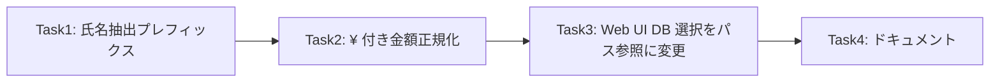

# Issue #62: 実装タスク一覧

## 優先順位・依存関係



**実装順序（推奨）**: Task 1 → Task 2 → Task 3 → Task 4

コミットは各 Task 末尾に `feat #62: <説明>`（Task 4 のみ `docs #62: <説明>`）。

> 既存テストのベースライン（計測済み 2026-11-26）:
> - `tests/test_llm_wrapper.py` → 3 passed
> - `tests/test_normalization.py` → 11 passed
> - `tests/test_watch_controller.py` → 42 passed
> - `tests/test_web.py` → 63 passed
>
> 期待数は「ベースライン + 当 Task で追加したテスト関数数（`def test_` の個数）」で計算する。
> 追加したテストの実断言 1 つひとつではなく、テスト関数単位で数える。

---

## Task 1: `extract_name_from_lines()` — 名前抽出に `氏名` プレフィックスを優先追加

**優先度: 高** — 完了条件 1 に直結。

> **設計注**: Issue 本文は「`患者` を `氏名` に変更」だが、`tasks/issue_4/ocr_sample_noisy.json` の
> `患者: 山田太郎` を `test_mock_extractor_noisy`（既存 3 件の 1 つ）が `name == 山田太郎` として
> 期待値にしている。`患者` を消すと既存テストが落ちるため、`氏名` プレフィックスを**先頭**に追加し、
> `患者` 系は**フォールバックとして残す**（後の `elif` に置く）。

### Step 1: 失敗テストを書く

`tests/test_llm_wrapper.py` の末尾に追加:

```python
def test_extract_name_uses_shimei_prefix():
    """氏名: / 氏名： のプレフィックスから名前を抽出する"""
    from app.llm_extractor import extract_name_from_lines

    assert extract_name_from_lines(["氏名: 山田太郎", "金額: 500円"]) == "山田太郎"
    assert extract_name_from_lines(["氏名：鈴木花子", "500円"]) == "鈴木花子"


def test_extract_name_keeps_kanja_fallback():
    """患者: プレフィックスは下位互換として残す（test_mock_extractor_noisy が依存）"""
    from app.llm_extractor import extract_name_from_lines

    assert extract_name_from_lines(["患者: 山田太郎", "500円"]) == "山田太郎"


def test_extract_name_still_uses_sama_branch():
    """様 サフィックス branch は変更しない（既存動作の維持）"""
    from app.llm_extractor import extract_name_from_lines

    assert extract_name_from_lines(["山田太郎様", "500円"]) == "山田太郎"
```

### Step 2: 失敗を確認

```bash
uv run pytest tests/test_llm_wrapper.py -q
```

期待出力: 2 failed（`氏名:` / `氏名：` が `患者` でしか判定されず `None` になり、`患者` 系と `様` 系は pass）。既存 3 件のうち `test_mock_extractor_noisy` は pass のまま（`患者` は残っているため）。

### Step 3: 実装（最小）

`app/llm_extractor.py` の `extract_name_from_lines()` 内（33-39 行付近）の `if` と `elif` を変更:

```python
        if line.startswith("氏名") or "氏名:" in line or "氏名：" in line:
            m2 = re.search(r"氏名[:：]?\s*(.+)", line)
            if m2:
                candidate = m2.group(1).strip()
                candidate = candidate.replace("様", "").strip()
                if 1 < len(candidate) <= 40:
                    return candidate
        if line.startswith("患者") or "患者:" in line or "患者：" in line:
```
（`patient` フォールバックは元の 3 条件‒`患者` / `患者:` / `患者：`‒をそのまま残す。`様` を取る第 1 branch（29-32 行）は触らない。）

### Step 4: 成功を確認

```bash
uv run pytest tests/test_llm_wrapper.py -q
```

期待出力: **6 passed**（3 + 追加 3）。

### Step 5: 整形

```bash
uv run black app/llm_extractor.py tests/test_llm_wrapper.py
```

### Step 6: コミット

```bash
git add app/llm_extractor.py tests/test_llm_wrapper.py
git commit -m "feat #62: extract_name_from_lines の名前抽出プレフィックスを 氏名 に変更"
```

---

## Task 2: `parse_amount()` — 先頭の `¥` / `￥` を許容

**優先度: 高** — 完了条件 2 に直結。

### Step 1: 失敗テストを書く

`tests/test_normalization.py` の末尾に追加:

```python
def test_parse_amount_yen_prefix():
    """金額の先頭にある ¥ / ￥ を許容し、既存の日本語表記は維持する"""
    assert parse_amount("¥3800") == 3800
    assert parse_amount("￥3,800") == 3800
    assert parse_amount("¥3,800円") == 3800
    assert parse_amount("¥1万") == 10000
    assert parse_amount("¥-500") is None  # 負値は記号除去より前に拒否
```

### Step 2: 失敗を確認

```bash
uv run pytest tests/test_normalization.py -q
```

期待出力: **1 failed**（`¥3800` 等が `None` を返す）。既存 11 件は pass のまま。

### Step 3: 実装（最小）

`app/normalization.py` の `parse_amount()` 内、`t = normalize_fw(str(text))`（59 行）の直後に追加:

```python
    # 先頭の通貨記号（¥ U+00A5 / ￥ U+FFE5）を除去してから数値展開する
    t = t.lstrip("¥￥")
```

（negative チェック（40 行）は `normalize_fw` より前に実行されるため、`¥-500` は lstrip 前に
`re.search(r"(?:^|[^0-9])[−\-]\s*\d", "¥-500")` がマッチして `None` を返す。既存 branch
（`円` 抽出・`万` 抽出・漢数字・プレーン数字）は記号除去後の文字列でそのまま動作。）

### Step 4: 成功を確認

```bash
uv run pytest tests/test_normalization.py -q
```

期待出力: **12 passed**（11 + 追加 1）。

### Step 5: 整形

```bash
uv run black app/normalization.py tests/test_normalization.py
```

### Step 6: コミット

```bash
git add app/normalization.py tests/test_normalization.py
git commit -m "feat #62: parse_amount が先頭の ¥ / ￥ を通貨記号として許容"
```

---

## Task 3: Web UI の DB 選択をサーバ側パス参照に変更（アップロード削除）

**優先度: 高** — 完了条件 3。案A（ユーザー回答済み）: DB 選択を「パステキスト入力 + 適用」に変更し、
既存 DB ファイルをそのまま参照（`select_db_path` で検証＋migration）する。さらに
**`create_db_path`（新規作成）** を追加し、初回起動（既存 DB なし）で空 DB を新規作成できるようにする。
`save_db_upload` / `_install_db` / `_atomic_install` を削除。

> **設計注**: 初回起動時は参照する DB ファイルが存在せず「選択」できない（ユーザー指摘 2026-11-26）。
> `select_db_path`（既存参照・存在チェック必須）と `create_db_path`（新規作成・存在チェックなし）の2系統にする。
> `_run_migrations` は `get_db_connection` が `parent.mkdir(parents=True)` するため、新規パスでも DB を自動作成する。

### Step 1: 失敗テストを書く（コントローラ）

`tests/test_watch_controller.py` の「DB アップロード保存」〜「[低-1] 直下の data/」セクション
（362 行付近〜507 行付近）に、アップロード関連の **10 テスト**（`test_save_db_upload_*` 各関数）
とヘルパー `_make_existing_db` / `_read_marker` がある。アップロード機能を削除するため、
これら **10 テストを削除**し、代わりに**パス選択・新規作成テスト 8 件**を追加する
（合計実行数は 42 − 10 + 8 = **40** になる）。

対象の 10 削除テスト（`grep '^def test_save_db_upload'` で全数確認）:
365 `test_save_db_upload_migrates_and_sets_db_path` / 380 `...sanitizes_filename` /
390 `...invalid_file_raises` / 400 `...rejects_db_without_required_tables` /
435 `...invalid_keeps_existing_db` / 447 `...valid_keeps_existing_db` /
466 `...does_not_delete_existing_db_on_failure` / 481 `...rejects_empty_filename` /
498 `...with_default_data_dir_does_not_touch_repo` / 569 `...rejected_while_scanning`

追加する新テスト（`tests/test_watch_controller.py` の画像コピーセクションより前の
`# --- DB パス選択 ---` に置く）:

```python
# --- DB パス選択（案A: 既存ファイルを参照、アップロードしない） ---


def test_select_db_path_references_existing_db(tmp_path):
    """既存の DB パスを選択すると参照され、data/ へコピーされない"""
    db = tmp_path / "existing.sqlite3"
    run_migrations(db, SCHEMA_PATH)
    ctl = _make_ctl(tmp_path, scan_fn=lambda *a, **k: 0, with_db=False)
    dest = ctl.select_db_path(db)
    assert dest == db
    assert ctl.has_db is True
    assert ctl.db_path == str(db)
    # アップロード時とは違い、data/ 直下にコピー・連番は作られない
    assert not (tmp_path / "data" / "existing.sqlite3").exists()
    assert list((tmp_path / "data").glob("*.sqlite3")) == []
    conn = sqlite3.connect(str(db))
    tables = {r[0] for r in conn.execute("SELECT name FROM sqlite_master WHERE type='table'")}
    conn.close()
    assert "receipts" in tables


def test_select_db_path_relative_path_raises(tmp_path):
    """相対パスは拒否される"""
    db = tmp_path / "existing.sqlite3"
    run_migrations(db, SCHEMA_PATH)
    ctl = _make_ctl(tmp_path, scan_fn=lambda *a, **k: 0, with_db=False)
    with pytest.raises(ValueError, match="絶対パス"):
        ctl.select_db_path("existing.sqlite3")


def test_select_db_path_missing_file_raises(tmp_path):
    """存在しないファイルは ValueError"""
    ctl = _make_ctl(tmp_path, scan_fn=lambda *a, **k: 0, with_db=False)
    missing = tmp_path / "nope.sqlite3"
    with pytest.raises(ValueError, match="存在しません"):
        ctl.select_db_path(missing)


def test_select_db_path_rejects_non_db_file(tmp_path):
    """SQLite でないファイル・必須テーブルの無い DB は拒否される"""
    ctl = _make_ctl(tmp_path, scan_fn=lambda *a, **k: 0, with_db=False)
    bad = tmp_path / "bad.txt"
    bad.write_text("not a sqlite")
    with pytest.raises(ValueError):
        ctl.select_db_path(bad)
    other = tmp_path / "other.sqlite3"
    conn = sqlite3.connect(str(other))
    conn.execute("CREATE TABLE unrelated (id INTEGER)")
    conn.commit()
    conn.close()
    with pytest.raises(ValueError, match="必須テーブル"):
        ctl.select_db_path(other)


def test_select_db_path_rejected_while_scanning(tmp_path):
    """[PR59-中3] スキャン中の DB 差し替えは拒否され db_path は変わらない"""
    entered = threading.Event()
    release = threading.Event()
    ctl = _start_slow_scan(tmp_path, entered, release)
    src = tmp_path / "src.sqlite3"
    run_migrations(src, SCHEMA_PATH)
    try:
        with pytest.raises(WatchBusyError):
            ctl.select_db_path(src)
        assert ctl.db_path == str(tmp_path / "db.sqlite3")
    finally:
        release.set()
        ctl.stop_watch()


def test_create_db_path_creates_empty_db(tmp_path):
    """存在しないパスへ空 DB を新規作成し migration 済みになる（初回起動対応）"""
    db = tmp_path / "data" / "new.sqlite3"
    ctl = _make_ctl(tmp_path, scan_fn=lambda *a, **k: 0, with_db=False)
    dest = ctl.create_db_path(db)
    assert dest == db
    assert db.exists()
    assert ctl.has_db is True
    assert ctl.db_path == str(db)
    conn = sqlite3.connect(str(db))
    tables = {r[0] for r in conn.execute("SELECT name FROM sqlite_master WHERE type='table'")}
    conn.close()
    assert {"receipts", "clinics", "templates", "corrections"} <= tables


def test_create_db_path_relative_path_raises(tmp_path):
    """新規作成も相対パスは拒否される"""
    ctl = _make_ctl(tmp_path, scan_fn=lambda *a, **k: 0, with_db=False)
    with pytest.raises(ValueError, match="絶対パス"):
        ctl.create_db_path("new.sqlite3")


def test_create_db_path_rejected_while_scanning(tmp_path):
    """[PR59-中3] スキャン中の DB 新規作成も拒否される"""
    entered = threading.Event()
    release = threading.Event()
    ctl = _start_slow_scan(tmp_path, entered, release)
    new_path = tmp_path / "data" / "new.sqlite3"
    try:
        with pytest.raises(WatchBusyError):
            ctl.create_db_path(new_path)
        assert not new_path.exists()
    finally:
        release.set()
        ctl.stop_watch()
```

`test_default_data_dir_is_isolated_from_repo_data`（`ctl.data_dir != REPO_DATA_DIR`）は
`data_dir` 引数を残すため**そのまま残す**（削除しない）。`sqlite3` / `threading` /
`WatchBusyError` / `_start_slow_scan` は既に import/定義済み。`_make_ctl` はそのまま使う。

### Step 2: 失敗を確認

```bash
uv run pytest tests/test_watch_controller.py -q
```

期待出力: **8 failed / 32 passed（計 40）**（追加した `select_db_path` / `create_db_path`
8 件が存在しない AttributeError。upload 10 件・`_make_existing_db` / `_read_marker` を消したので
実行数は 42 → 40）。

### Step 3: 実装（コントローラ）

`app/services/watch_controller.py`:
1. module 冒頭の `from uuid import uuid4`（15 行）を削除（`save_db_upload` でのみ使用のため）。
2. `_atomic_install`（52-82 行）を削除。
3. `save_db_upload`（365-416 行）と `_install_db`（447-475 行）を削除。
4. `_validate_uploaded_db` を `_validate_db_file` にリネームし、その直下に
   `select_db_path` と `create_db_path` を追加。`# -----... DB アップロード保存 ---`
   セクション見出しを `# -----... DB パス選択 / 新規作成 ---` に変更。

```python
    def select_db_path(self, path: str | Path) -> Path:
        """既存の DB パスを参照対象として固定する（案A: コピー・連番を作らない）。

        存在チェック・SQLite ヘッダ/必須テーブル検証・migration を実行し、_db_path に
        設定する。既存ファイルをそのまま使用するため data/ への保存は行わない。

        [PR59-中3] 処理中確認と DB 置換を _scan_lock 内で一連化する。

        Args:
            path: 参照する DB ファイルの絶対パス。

        Returns:
            Path: 設定された DB ファイルのパス。

        Raises:
            ValueError: 相対パス・存在しない・SQLite として不正な場合。
            WatchBusyError: スキャン処理中の場合。
        """
        p = Path(path).expanduser()
        if not p.is_absolute():
            raise ValueError("絶対パスを指定してください")
        if not p.exists():
            raise ValueError(f"ファイルが存在しません: {p}")
        if not self._scan_lock.acquire(blocking=False):
            raise WatchBusyError(BUSY_MESSAGE)
        try:
            if self._is_processing:
                raise WatchBusyError(BUSY_MESSAGE)
            self._validate_db_file(p)
            self._run_migrations(p)
            self._db_path = p
            LOG.info("db_path -> %s", p)
            return p
        finally:
            self._scan_lock.release()

    def _validate_db_file(self, path: Path) -> None:
        """DB ファイルの SQLite ヘッダと必須テーブルの存在を検証する。

        Args:
            path: 検証対象の DB ファイルパス。

        Raises:
            ValueError: SQLite ヘッダが無い、または必須テーブルが存在しない場合。
        """
        with open(path, "rb") as f:
            header = f.read(len(SQLITE_MAGIC))
        if header != SQLITE_MAGIC:
            raise ValueError("SQLite データベースファイルではありません")
        try:
            conn = sqlite3.connect(f"{path.resolve().as_uri()}?mode=ro", uri=True)
        except sqlite3.Error as e:
            raise ValueError(f"データベースを開けません: {e}") from e
        try:
            tables = {row[0] for row in conn.execute("SELECT name FROM sqlite_master WHERE type='table'")}
        except sqlite3.DatabaseError as e:
            raise ValueError(f"データベースを開けません: {e}") from e
        finally:
            conn.close()
        missing = [t for t in REQUIRED_TABLES if t not in tables]
        if missing:
            raise ValueError(f"必須テーブルがありません: {', '.join(missing)}")

    def create_db_path(self, path: str | Path) -> Path:
        """存在しないパスへ空 DB を新規作成し migration を適用して参照対象にする。

        初回起動（参照する DB が未だ無い）で新規作成するための経路（案A 補足）。
        _run_migrations は get_db_connection が parent.mkdir(parents=True) するため、
        新規パスでも DB を自動作成する。既存パスを渡しても migration は冪等なので安全。

        [PR59-中3] 処理中確認と DB 置換を _scan_lock 内で一連化する。

        Args:
            path: 作成する DB ファイルの絶対パス。

        Returns:
            Path: 作成された DB ファイルのパス。

        Raises:
            ValueError: 相対パス・スキーマ関連の失敗の場合。
            WatchBusyError: スキャン処理中の場合。
        """
        p = Path(path).expanduser()
        if not p.is_absolute():
            raise ValueError("絶対パスを指定してください")
        if not self._scan_lock.acquire(blocking=False):
            raise WatchBusyError(BUSY_MESSAGE)
        try:
            if self._is_processing:
                raise WatchBusyError(BUSY_MESSAGE)
            self._run_migrations(p)
            self._db_path = p
            LOG.info("db_path -> %s (created)", p)
            return p
        finally:
            self._scan_lock.release()
```

（`_validate_db_file` の中身は旧 `_validate_uploaded_db` と同一。リネームのみ。
`create_db_path` は `select_db_path` と違い存在チェックをしない点だけが異なる。）

### Step 4: 成功を確認

```bash
uv run pytest tests/test_watch_controller.py -q
```

期待出力: **40 passed**（32 既存 + 追加 8）。

### Step 5: 失敗結合テストを書く（server / index）

`tests/test_web.py` の末尾に追加（`temp_db` fixture・`TestClient`・`SCHEMA_PATH` は既存のものを利用）:

```python
def test_config_selects_existing_db_path_by_reference(tmp_path):
    """/config でパスを指定した DB を参照対象にし、data/ へコピーしない"""
    from app.web.server import create_app

    selected = tmp_path / "selected.sqlite3"
    run_migrations(selected, SCHEMA_PATH)
    out_dir = tmp_path / "out"
    data_dir = tmp_path / "data"
    app = create_app(output_dir=str(out_dir), data_dir=str(data_dir))
    from fastapi.testclient import TestClient

    with TestClient(app) as client:
        r = client.post("/config", data={"db_path": str(selected)})
        assert r.status_code == 303
        assert r.headers["location"] == "/"
        st = client.get("/api/status").json()
        assert st["has_db"] is True
        assert st["db_path"] == str(selected)
    # 連番コピー / data/ 配下への複製は作られない
    assert not (data_dir / "selected.sqlite3").exists()
    assert list(data_dir.glob("*")) == []


def test_config_creates_new_db_path(tmp_path):
    """/config で存在しないパスに空 DB を新規作成する（初回起動対応）"""
    from app.web.server import create_app

    new_db = tmp_path / "data" / "fresh.sqlite3"
    out_dir = tmp_path / "out"
    data_dir = tmp_path / "data"
    app = create_app(output_dir=str(out_dir), data_dir=str(data_dir))
    from fastapi.testclient import TestClient

    with TestClient(app) as client:
        r = client.post("/config", data={"db_create_path": str(new_db)})
        assert r.status_code == 303
        assert r.headers["location"] == "/"
        st = client.get("/api/status").json()
        assert st["has_db"] is True
        assert st["db_path"] == str(new_db)
    assert new_db.exists()
```

### Step 6: 失敗を確認（server）

```bash
uv run pytest tests/test_web.py -q
```

期待出力: **2 failed**（`/config` が `db_path` / `db_create_path` フィールドを無視するため
303 後に `has_db` が False）。

### Step 7: 実装（server）

`app/web/server.py` の `post_config`（298-309 行）で `db_file`（UploadFile）分岐を削除し、
`db_path`（テキスト）分岐に置換:

```python
        db_path = form.get("db_path")
        if db_path and str(db_path).strip():
            # [PR59-中3] 処理中＋DB 置換は select_db_path 内で scan lock を使って一連化
            try:
                controller.select_db_path(str(db_path).strip())
            except WatchBusyError as e:
                raise HTTPException(status_code=409, detail=str(e))
            except ValueError as e:
                raise HTTPException(status_code=400, detail=str(e))
        db_create_path = form.get("db_create_path")
        if db_create_path and str(db_create_path).strip():
            # 初回起動（既存 DB なし）用: 空 DB を新規作成して参照対象にする
            try:
                controller.create_db_path(str(db_create_path).strip())
            except WatchBusyError as e:
                raise HTTPException(status_code=409, detail=str(e))
            except ValueError as e:
                raise HTTPException(status_code=400, detail=str(e))
        return RedirectResponse(url="/", status_code=303)
```

（`UploadFile` の `await db_file.read()` / `db_file.filename` 参照が消えるため、
`post_config` 内の `form = await request.form()` はそのまま残る。インポート変更は不要。）

### Step 8: 実装（index.html）

`app/web/templates/index.html`:

1. 操作パネルの DB セクション（204-211 行）を、ファイル input からパステキスト input + 適用ボタンに変更:

```html
        <div style="margin-bottom:8px;">
            <label>データベース:
                <input id="db-path-input" type="text" value="{{ ctl.db_path or '' }}" size="50"
                       disabled>
            </label>
            <button id="db-path-apply" type="button" disabled>適用</button>
            <button id="db-path-create" type="button" disabled>新規作成</button>
            <span id="db-hint">現在: {{ ctl.db_path }}<span style="color:#c00;">未選択</span></span>
            <span style="color:#888;">（サーバ側のパスを直接入力。「適用」は既存ファイル参照、「新規作成」は空 DB 作成＝初回起動向け）</span>
        </div>
```

2. JS の pollStatus 内で参照している `db-file-input`（46-47 行）を `db-path-input` に変更:

```javascript
            const dbInput = document.getElementById('db-path-input');
            if (dbInput) { dbInput.disabled = s.is_processing; }
```

3. 旧 DB file の JS block（118-133 行）を、適用ボタン（既存参照）と新規作成ボタンの2つの
   click ハンドラに置換:

```javascript
            // データベース: パス入力 + 適用/新規作成ボタンで確定（既存参照 or 空DB作成）
            const dbApply = document.getElementById('db-path-apply');
            const dbCreate = document.getElementById('db-path-create');
            const postDbPath = async (field) => {
                const dbPath = document.getElementById('db-path-input').value;
                if (!dbPath) {
                    showError('データベースのパスを入力してください');
                    return;
                }
                try {
                    const fd = new FormData();
                    fd.append(field, dbPath);
                    await postForm('/config', fd);
                    showError('');
                    applyStatus(await fetchStatus());
                } catch (e) { showError(e.message); }
            };
            if (dbApply) {
                dbApply.addEventListener('click', () => postDbPath('db_path'));
            }
            if (dbCreate) {
                dbCreate.addEventListener('click', () => postDbPath('db_create_path'));
            }
```

### Step 9: 成功を確認（server + index）

```bash
uv run pytest tests/test_web.py -q
```

期待出力: **65 passed**（63 + 追加 2）。

結合で全体を確認:

```bash
uv run pytest tests/test_web.py tests/test_watch_controller.py -q
```

期待出力: 105 passed（65 + 40）。

### Step 10: 整形

```bash
uv run black app/services/watch_controller.py app/web/server.py tests/test_watch_controller.py tests/test_web.py
```

### Step 11: コミット

```bash
git add app/services/watch_controller.py app/web/server.py app/web/templates/index.html tests/test_watch_controller.py tests/test_web.py
git commit -m "feat #62: Web UI の DB 選択をサーバ側パス参照に変更しアップロードを削除"
```

---

## Task 4: ドキュメント

**優先度: 中** — 実装後の仕様と運用を残す。

### Step 1: spec を書く

`specs/db-select-path-spec.md` を新規作成（要旨）:

- 背景: Issue #56 の upload→data/ 連番保存が DB を増殖させる問題。
- 決定（案A）: DB 選択はサーバ側パス参照。`select_db_path`（既存参照・検証＋migration）と
  `create_db_path`（新規作成・初回起動対応）の2系統。
- 変更点: `/config` の `db_path` / `db_create_path` フィールド・`index.html` のテキスト input＋
  「適用」/「新規作成」ボタン・`save_db_upload`/`_install_db`/`_atomic_install` 削除。
- 検証結果: 各テスト pass 数、`ls -la data/` で連番コピーが増えないこと。
- 参照: `docs/adr/001_date-anchor-abandoned-topmost-maintained.md` の案 ii との関係。

### Step 2: 整形確認

```bash
uv run black --check app/ tests/
```

期待出力: 整形エラーなし。

### Step 3: コミット

```bash
git add specs/db-select-path-spec.md
git commit -m "docs #62: DB パス選択の spec を追加"
```
