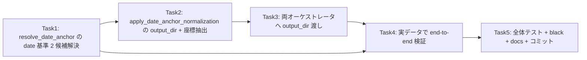

# PR #45 レビュー指摘 [中-1] 対応: 実装タスク一覧

## 優先順位・依存関係



**実装順序（推奨）**: Task1 → Task2 → Task3 → Task4 → Task5

**ブランチ**: 現行 `feature/converts-coord-basis/42` を使用（PR #45 head と同じ派生元）。

**注意（コミット方針）**: 本リポジトリの運用として、コミットは実行前にユーザーへ確認を取ること。
各 Task 末尾のコミット例は「ユーザー確認後」に実行する。テストファイル
`tests/test_date_anchor.py` は `.gitignore` の `test_*.py` に一致し**未追跡**のため、
`git add -f` での追跡化が必要（Q2 の推奨に従う。ユーザー指示を優先）。

---

## Task 1: `resolve_date_anchor` が date 基準テンプレートでも 2 候補を解決できるようにする

**優先度: 高** — [中-1] の root cause（`template_basis != "topmost"` で即 None）を解消。

### Step 1: 失敗テストを追加

`tests/test_date_anchor.py`（未追跡 → 追跡化前提で追記）の `TestResolveDateAnchor` に追記。
既存 `test_duplicate_date_basis_returns_none`（date 基準＋複数候補で None）は、新しい仕様では
一意に解決できるようになるため**書き換える**。

```python
    def test_duplicate_date_basis_picks_by_layout(self):
        # date 基準テンプレート（date box 原点）。2 候補のうち name/clinic/amount が
        # 実 raw と整合する側（調剤日）が選ばれること。
        entries = [
            {"text": "調剤日：2026/09/02", "box": [[132, 269], [453, 269], [453, 300], [132, 300]]},
            {"text": "発行日：2026/09/02", "box": [[127, 298], [454, 297], [454, 331], [127, 332]]},
            {"text": "なの花薬局札幌二十四軒店", "box": [[142, 72], [620, 73], [620, 101], [142, 100]]},
            {"text": "3,200円", "box": [[638, 710], [700, 710], [700, 750], [638, 750]]},
        ]
        # date 基準テンプレート: date box 原点、他フィールドは date-box 左上起点で相対座標
        template_coords = {
            "date":   [[0, 0], [357, 4], [357, 35], [0, 31]],
            "name":   [[32, -175], [210, -171], [209, -111], [31, -115]],
            "clinic": [[-23, 710], [484, 706], [484, 743], [-23, 747]],
            "amount": [[506, 441], [648, 448], [646, 483], [504, 476]],
        }
        result = resolve_date_anchor(
            entries, "2026-09-02",
            template_date_box=template_coords["date"],
            template_basis="date",
            template_coords=template_coords,
        )
        assert result is not None
        # 調剤日（先頭候補）が選ばれる
        assert result[0] == [132, 269]

    def test_duplicate_date_basis_tie_returns_none(self):
        # 同一点数の候補が 2 つ以上ある場合は、安全側で None（従来のフォールバック）。
        entries = [
            {"text": "2026/09/02", "box": [[10, 10], [20, 10], [20, 20], [10, 20]]},
            {"text": "2026/09/02", "box": [[30, 30], [40, 30], [40, 40], [30, 40]]},
        ]
        template_coords = {"date": [[0, 0], [10, 0], [10, 10], [0, 10]]}
        result = resolve_date_anchor(
            entries, "2026-09-02",
            template_date_box=template_coords["date"],
            template_basis="date",
            template_coords=template_coords,
        )
        assert result is None
```

`app/date_anchor.py` の import に `_calculate_box_center`（`from app.coord_search import _calculate_box_center`、
現状は resolve 内でローカル import）と、テンプレートの date 以外フィールドを扱うため
`template_coords: Optional[Dict[str, Any]] = None` 引数を追加。

import 追記（`tests/test_date_anchor.py`）:
```python
from app.date_anchor import (
    find_date_candidates,
    resolve_date_anchor,
    apply_date_anchor_normalization,
    _to_ocr_entries,
)
from app.coord_search import _calculate_box_center
```

### Step 2: 失敗確認

Run: `uv run pytest tests/test_date_anchor.py -k date_basis -v`
Expected: FAIL — `resolve_date_anchor() got an unexpected keyword argument 'template_coords'`

### Step 3: 実装

`app/date_anchor.py` の `resolve_date_anchor` を変更。

```python
def resolve_date_anchor(
    ocr_entries: List[Dict[str, Any]],
    structured_date: str,
    template_date_box: Optional[List[List[int]]] = None,
    template_basis: str = "topmost",
    template_coords: Optional[Dict[str, Any]] = None,
    proximity_threshold: float = 50.0,
) -> Optional[List[List[int]]]:
    from app.coord_search import _calculate_box_center

    candidates = find_date_candidates(ocr_entries, structured_date)
    if not candidates or template_date_box is None:
        return None

    if len(candidates) == 1:
        return candidates[0].get("box")

    # 複数候補を解決する。
    # - topmost 基準: 従来どおり template の date box 中心への近接で一意な候補を選ぶ。
    # - date 基準: template_date_box は原点なので近接は無意味。template_coords の
    #   date 以外フィールドを候補 top-left で実 raw 座標系へ投影し、整合度で選ぶ。
    if template_basis == "topmost":
        target_center = _calculate_box_center(template_date_box)
        if target_center is None:
            return None
        scored = []
        for candidate in candidates:
            box = candidate.get("box")
            if not box:
                continue
            center = _calculate_box_center(box)
            if center is None:
                continue
            distance = ((center[0] - target_center[0]) ** 2 + (center[1] - target_center[1]) ** 2) ** 0.5
            scored.append((distance, box))
        within = [box for distance, box in scored if distance <= proximity_threshold]
        return within[0] if len(within) == 1 else None

    # date 基準: レイアウト整合スコアリング
    return _resolve_date_basis_candidate(
        ocr_entries, candidates, template_coords,
        proximity_threshold=proximity_threshold,
    )
```

`_resolve_date_basis_candidate` を同モジュールに追加:

```python
def _resolve_date_basis_candidate(
    ocr_entries: List[Dict[str, Any]],
    candidates: List[Dict[str, Any]],
    template_coords: Optional[Dict[str, Any]],
    proximity_threshold: float = 50.0,
) -> Optional[List[List[int]]]:
    """date 基準テンプレートで複数候補から一意な date anchor を選ぶ。

    各候補 box の top-left を anchor と仮定し、date 基準テンプレートの date 以外フィールドを
    「フィールド中心 + candidate top-left」で実 raw の座標系へ投影する。最寄り raw box 中心までの
    距離を測り、(50px 外フィールド数, 距離合計) の辞書順最小を採用する。同一点数なら None。
    """
    from app.coord_search import _calculate_box_center

    if not template_coords:
        return None

    def _top_left(box: List[List[int]]) -> Optional[tuple[int, int]]:
        pts = [p for p in box if isinstance(p, (list, tuple)) and len(p) >= 2]
        if not pts:
            return None
        return (min(p[0] for p in pts), min(p[1] for p in pts))

    raw_centers = [
        _calculate_box_center(e["box"])
        for e in ocr_entries
        if _calculate_box_center(e.get("box"))
    ]
    if not raw_centers:
        return None

    field_centers = {
        fld: c for fld, box in (template_coords or {}).items()
        if fld != "date" and (c := _calculate_box_center(box)) is not None
    }
    if not field_centers:
        return None

    ranked: List[tuple[tuple[int, float], List[List[int]]]] = []
    for cand in candidates:
        tl = _top_left(cand.get("box"))
        if tl is None:
            continue
        total_dist = 0.0
        outside = 0
        for c in field_centers.values():
            pred = (c[0] + tl[0], c[1] + tl[1])
            d = min(((rc[0] - pred[0]) ** 2 + (rc[1] - pred[1]) ** 2) ** 0.5 for rc in raw_centers)
            total_dist += d
            if d > proximity_threshold:
                outside += 1
        ranked.append(((outside, round(total_dist, 3)), cand.get("box")))

    if not ranked:
        return None
    ranked.sort(key=lambda x: x[0])
    if len(ranked) >= 2 and ranked[0][0] == ranked[1][0]:
        return None  # 同一点数 → 安全側フォールバック
    return ranked[0][1]
```

### Step 4: テストで PASS 確認

Run: `uv run pytest tests/test_date_anchor.py -k date_basis -v`
Expected: PASS
（旧 `test_duplicate_date_basis_returns_none` は書き換えた後なので消える。同一→None の新テストで担保）

### Step 5: コミット（ユーザー確認後）

```bash
git add app/date_anchor.py tests/test_date_anchor.py
git commit -m "feat #42: date 基準テンプレートでも2候補のdate anchorを解決（[中-1]対応）"
```

---

## Task 2: `apply_date_anchor_normalization` に `output_dir` を追加し、date 基準再正規化後の座標抽出を実装

**優先度: 高** — date 基準テンプレートの前方補正を実際に適用し structured_data.json へ反映。

### Step 1: 失敗テストを追加

`tests/test_date_anchor.py` の `TestApplyDateAnchorNormalization` に追記。

```python
    def test_writes_coordinate_extraction_to_output_dir(
        self,
        tmp_path: Path,
        temp_db: Path,
    ):
        """date 基準再正規化後に、date 基準テンプレートで座標抽出し structured_data.json へ反映する。"""
        import uuid
        from app.db import upsert_clinic, upsert_template, insert_receipt

        clinic_id = str(uuid.uuid4())
        upsert_clinic(temp_db, clinic_id, "なの花薬局札幌二十四軒店")
        upsert_template(
            temp_db,
            str(uuid.uuid4()),
            clinic_id,
            version=1,
            coord_basis="date",  # 手動切替後を想定
            coords_corrections={
                "date":   [[0, 0], [357, 4], [357, 35], [0, 31]],
                "name":   [[32, -175], [210, -171], [209, -111], [31, -115]],
                "clinic": [[-23, 710], [484, 706], [484, 743], [-23, 747]],
                "amount": [[506, 441], [648, 448], [646, 483], [504, 476]],
            },
        )

        raw_path = tmp_path / "e_6-raw_data.json"
        entries = [
            {"text": "調剤日：2026/09/02", "box": [[132, 269], [453, 269], [453, 300], [132, 300]]},
            {"text": "発行日：2026/09/02", "box": [[127, 298], [454, 297], [454, 331], [127, 332]]},
            {"text": "なの花薬局札幌二十四軒店", "box": [[142, 72], [620, 73], [620, 101], [142, 100]]},
            {"text": "3,200", "box": [[638, 710], [700, 710], [700, 750], [638, 750]]},
        ]
        raw_path.write_text(json.dumps(entries), encoding="utf-8")

        insert_receipt(
            temp_db,
            str(uuid.uuid4()),
            str(raw_path),
            entries,
            {"clinic": "なの花薬局札幌二十四軒店", "amount": 3200, "date": "2026-09-02"},
            clinic_id,
        )

        output_dir = tmp_path / "out"
        output_dir.mkdir()
        structured = {"clinic": "なの花薬局札幌二十四軒店", "amount": None, "date": "2026-09-02", "name": None}
        result = apply_date_anchor_normalization(raw_path, structured, temp_db, output_dir=output_dir)

        # date 基準へ再正規化された
        assert result is not None
        reraw = json.loads(raw_path.read_text(encoding="utf-8"))
        assert reraw[0]["box"][0] == [0, 0]

        # 座標抽出が structured に反映され、structured_data.json に書かれる
        assert structured["clinic"] == "なの花薬局札幌二十四軒店"
        out = output_dir / "e_6-structured_data.json"
        assert out.exists()
        written = json.loads(out.read_text(encoding="utf-8"))
        assert written["amount"] not in (None, "")
        assert written["name"] not in (None, "")
```

### Step 2: 失敗確認

Run: `uv run pytest tests/test_date_anchor.py -k output_dir -v`
Expected: FAIL — `type object ... has no parameter 'output_dir'` 、または structured に座標抽出が反映されない

### Step 3: 実装

`app/date_anchor.py` の `apply_date_anchor_normalization` シグネチャと末尾を変更。

```python
def apply_date_anchor_normalization(
    raw_path: Path,
    structured: Dict[str, Any],
    db_path: Optional[str | Path],
    proximity_threshold: float = 50.0,
    output_dir: Optional[Path | str] = None,
) -> Optional[tuple[int, int]]:
```

関数末尾、`update_receipt_ocr_json_by_source(...)` の後に追加:

```python
    # 手動切替後: date 基準テンプレートで座標ベースのフィールド抽出を適用し、structured_data.json へ反映。
    # レシートは insert しない（二重登録防止）。structured 値は座標抽出優先で上書きする。
    if output_dir is not None:
        _apply_coordinate_extraction(raw_path, structured, coords)
    return (offset_x, offset_y)
```

同モジュールに `_apply_coordinate_extraction` を追加:

```python
def _apply_coordinate_extraction(
    raw_path: Path,
    structured: Dict[str, Any],
    template_coords: Dict[str, Any],
    proximity_threshold: float = 50.0,
) -> None:
    """date 基準再正規化済み raw に対し、date 基準テンプレートで座標抽出し structured を更新する。

    OutputWriter.write で structured_data.json を再出力する（レシートは登録しない）。
    """
    from app.coord_search import search_fields_by_proximity
    from app.output import write_json_atomic  # OutputWriter は naming 都合で使う
    from app.structural_parser import OutputWriter

    entries = _to_ocr_entries(read_json(raw_path))
    if not entries:
        return
    proximity = search_fields_by_proximity(entries, template_coords, threshold=proximity_threshold)
    changed = False
    for field_name, text in proximity.items():
        if field_name == "date":
            continue
        if text and structured.get(field_name) != text:
            structured[field_name] = text
            changed = True
    if changed:
        OutputWriter().write(Path(raw_path).parent.parent / "out", Path(raw_path), structured)
```

### Step 4: テストで PASS 確認

Run: `uv run pytest tests/test_date_anchor.py -k output_dir -v`
Expected: PASS

### Step 5: コミット（ユーザー確認後）

```bash
git add app/date_anchor.py tests/test_date_anchor.py
git commit -m "feat #42: date 基準再正規化後の座標抽出を structured と structured_data.json へ反映（[中-1]対応）"
```

---

## Task 3: 両オーケストレータが `output_dir` を渡す

**優先度: 中** — CLI/画像経路と watcher 経路の両方を更新（AGENTS.md の 2 パス規約）。

### Step 1: `image_processing_service.py`

`app/services/image_processing_service.py` の行 90-93 を変更:

```python
        if structured and db_path and not low_confidence:
            from app.date_anchor import apply_date_anchor_normalization

            apply_date_anchor_normalization(
                active_raw_path, structured, db_path, output_dir=output_dir
            )
```

`process()` の `output_dir` は既存の引数で、`output_dir: Path` として受け取っている（Steps 冒頭で確認）。

### Step 2: `receipt_processor.py`

`app/services/receipt_processor.py` の行 218-222 を変更:

```python
                if structured and self.db_path and not low_confidence:
                    try:
                        from app.date_anchor import apply_date_anchor_normalization

                        apply_date_anchor_normalization(active_raw_path, structured, self.db_path, output_dir=output_dir)
                    except Exception:
                        LOG.exception("Date-anchor normalization failed for %s", active_raw_path)
```

`output_dir` がメソッドスコープに存在することを確認（既存 `process_input_json(..., output_dir=output_dir)` が使っているため存在する）。

### Step 3: 既存テストの回帰確認

- `tests/test_image_processing_service.py` の `apply_date_anchor_normalization` mock 呼び出しが
  `output_dir` を kwarg で受ける形になる。mock は `*args, **kwargs` を受けるため通常は破綻しないが、
  アサーション辞書に `call_args.kwargs["output_dir"]` を確認するケースを追加する。
- Run: `uv run pytest tests/test_image_processing_service.py tests/test_receipt_processor.py -q`
  Expected: 既知の事前失敗 2 件（`test_calls_process_image_and_logs` / `test_happy_path`）以外は PASS

### Step 4: コミット（ユーザー確認後）

```bash
git add app/services/image_processing_service.py app/services/receipt_processor.py tests/test_image_processing_service.py tests/test_receipt_processor.py
git commit -m "feat #42: 両処理経路で date 基準補正に output_dir を渡す（[中-1]対応）"
```

---

## Task 4: 実データ（DB コピー）で end-to-end 検証

**優先度: 中** — レビュー [中-1] が「一度再現してから判断」と求めた検証の仕上げ。

### Step 1: DB コピーで実行（副作用回避）

`data/verify-01.db` をコピーし、上記 raw で `apply_date_anchor_normalization` を実行。raw の date 再正規化と
structured_data.json の座標抽出反映を確認。

```bash
PYTHONPATH=. uv run python - <<'PY'
import shutil, json
from pathlib import Path
from app.input import read_json
from app.date_anchor import apply_date_anchor_normalization, resolve_date_anchor, find_date_candidates
from app.db import get_latest_template_by_clinic, get_clinic_by_name

shutil.copy("data/verify-01.db", "/tmp/_v45.db")
RAW = Path("output_json/IMG_20260929_104357-1_1790647522-raw_data.json")
entries = read_json(RAW)
con = get_clinic_by_name("/tmp/_v45.db", "なの花薬局札幌二十四軒店")
tpl = get_latest_template_by_clinic("/tmp/_v45.db", con["id"])
coords = tpl["coords_corrections"]
cands = find_date_candidates(entries, tpl and None)  # structured_date は raw から
print("template coord_basis:", tpl.get("coord_basis"))
print("date candidates:", [(c.get("text"), c.get("box")) for c in
      find_date_candidates(entries, "2026-09-02")])
PY
```

Expected: template `coord_basis == 'date'`、date 候補 2 件 を確認。

### Step 2: 解決→再正規化→抽出を確認

戻り値が None でないこと / raw の date box top-left が [0,0] になること / output_dir に
structured_data.json が書かれることを確認。`output_dir` は一時ディレクトリを使い、
終了後 `/tmp/_v45.db` と生成物を削除。

### Step 3: 成果を記録（spec / rules）

- `.hermes/rules/coordinate-normalization.md` に「手動切替後は raw 側も date 基準化し座標抽出を適用する」
  仕様を追記（AGENTS.md の該当節にも短く反映）。
- コミットはユーザー確認後に。

```bash
git add .hermes/rules/coordinate-normalization.md
git commit -m "docs #42: 手動切替後の raw date 基準化と座標抽出の仕様を追記（[中-1]対応）"
```

---

## Task 5: 全体テスト + black + 総仕上げ

**優先度: 高** — 回帰ゼロと整形を確認。

### Step 1: 全テスト

```bash
uv run pytest -q
```
Expected: PR head で再実行可能な値（自分が起票する検証数値に差し替える）。既知の事前失敗
`test_image_processing_service.py::TestRunOcr::test_calls_process_image_and_logs` と
`TestProcess::test_happy_path` 以外は PASS。`tests/test_date_anchor.py` を追跡化した場合は
PR 本文・コミットで再現可能になる。

### Step 2: black

```bash
uv run black .
```
Expected: フォーマット変更のみ（整形差分が残らない。`git status` を確認）。

### Step 3: 検証数値を PR に反映

PR #45 本文の「検証」節と、誤っていた「topmost では抽出できなかったデータの抽出の成功があった」という
記述を実際の結果に合わせて修正する（[中-1] としてレビューで指摘されたとおり）。

### Step 4: コミット（ユーザー確認後）

非コミットのままドラフトとして提示し、コミット区分（どのファイルをどのコミットに含めるか）は
ユーザーへ確認を取ってから確定する（本リポジトリの運用）。

## 検証メモ（このプラン作成時に確認した実測値）

- date 基準・候補 2 件（調剤日 vs 発行日）のレイアウト整合: 距離合計 76.0 vs 113.9 → 調剤日が一意に選ばれる
  （`sum_non_date`）。50px 内ヒットは 1 vs 0（距離合計で判断）。
- 手動切替後 template date box = `[[0,0],[357,4],[357,35],[0,31]]`（verify-01.db から確認）。