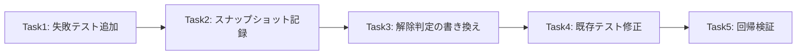

# PR #59 レビュー指摘 [中]#1: 実装タスク一覧

> 対象: `.github/reports/pr-59-review.md` の指摘事項 [中]#1
> 詳細設計: 同ディレクトリの `plan.md` を参照

## 優先順位・依存関係



**実装順序（推奨）**: Task 1 → Task 2 → Task 3 → Task 4 → Task 5

コミットは各 Task 末尾に `fix #59: <説明>`。
※ ユーザー方針により**自動コミットしない**。コミットは実装・検証後にグループを確認してから実行する。

---

## Task 1: 失敗テストを追加する（再アップロードで誤解除されるケース）

**優先度: 高** — レビュー指摘の再現テスト

### Step 1: テストを追加

`tests/test_watch_controller.py` の「[中-3] 処理待ち状態」セクション
（`test_pending_stays_until_consumed` の後）に追記:

```python
def test_pending_not_cleared_by_old_output(tmp_path):
    """[PR59-中1] 過去の同名出力が残っていても、新しい画像が未処理なら pending は解除されない"""
    ctl = _make_ctl(tmp_path, scan_fn=lambda *a, **k: 0)
    # 過去のアップロードで生成された出力（旧 mtime）を事前作成
    ctl.output_dir.mkdir(parents=True, exist_ok=True)
    (ctl.output_dir / "IMG_001_9999999999-structured_data.json").write_text(
        '{"name": "過去"}', encoding="utf-8"
    )
    ctl.copy_image("IMG_001.jpg", b"fake-jpeg-bytes")
    assert ctl.pending_process is True
    ctl._run_scan()  # スキャンは何も処理しない
    assert ctl.pending_process is True  # 過去出力では解除されない


def test_pending_not_cleared_by_old_failed_copy(tmp_path):
    """[PR59-中1] 過去の failed コピー（mtime 不一致）では pending は解除されない"""
    ctl = _make_ctl(tmp_path, scan_fn=lambda *a, **k: 0)
    ctl.failed_dir.mkdir(parents=True, exist_ok=True)
    # 過去の失敗退避（mtime が古い）を事前作成
    old = ctl.failed_dir / "IMG_001.jpg"
    old.write_bytes(b"old-failed-bytes")
    os.utime(old, (1_000_000_000, 1_000_000_000))  # 2001 年相当の旧 mtime
    ctl.copy_image("IMG_001.jpg", b"fake-jpeg-bytes")
    ctl._run_scan()
    assert ctl.pending_process is True
```

### Step 2: 失敗を確認

```bash
uv run pytest tests/test_watch_controller.py -q
```

期待出力: `2 failed, N passed`（現行の glob 判定が過去出力/過去 failed を拾って解除してしまうため失敗）。

---

## Task 2: `copy_image()` で mtime+size スナップショットを記録する

**優先度: 高** — 解除判定の基準となる状態の追加

### Step 1: `__init__` にスナップショット項目を追加

`app/services/watch_controller.py` の `__init__`（L124-125 付近）:

```python
self._pending_process = False
self._pending_image: str | None = None
# [PR59-中1] コピー時スナップショット（その画像固有の成果物を特定する基準）
self._pending_mtime: int | None = None
self._pending_size: int | None = None
```

### Step 2: `copy_image()` の書き込み成功後に記録

`copy_image()` 内、`self._pending_image = name` / `self._pending_process = True` の直後:

```python
st = dest.stat()
self._pending_mtime = int(st.st_mtime)
self._pending_size = st.st_size
```

### Step 3: 検証

```bash
uv run pytest tests/test_watch_controller.py -q
```

期待: 既存テストは green（Task 1 の 2 件はまだ失敗のまま）。

---

## Task 3: `_clear_pending_if_consumed()` を mtime 完全一致ベースに書き換える

**優先度: 高** — 本指摘の核心修正

### Step 1: `_reset_pending()` と `_failed_copy_exists()` を新設

`_clear_pending_if_consumed()` の近くに追加:

```python
def _reset_pending(self) -> None:
    """pending 状態とスナップショットをまとめてクリアする。"""
    self._pending_image = None
    self._pending_process = False
    self._pending_mtime = None
    self._pending_size = None

def _failed_copy_exists(self) -> bool:
    """pending 画像の失敗退避（mtime+size 一致）が failed_dir にあるか判定する。

    move_to_failed は shutil.copy2 のため mtime が保存される。同名 failed が既に
    ある場合は {timestamp}_ プレフィクスが付くため、名前一致ではなく mtime+size で
    特定する。
    """
    if self._pending_mtime is None or self._pending_size is None:
        return False
    for f in self.failed_dir.iterdir():
        if not f.is_file():
            continue
        try:
            st = f.stat()
        except OSError:
            continue
        if int(st.st_mtime) == self._pending_mtime and st.st_size == self._pending_size:
            return True
    return False
```

### Step 2: `_clear_pending_if_consumed()` を書き換え

```python
def _clear_pending_if_consumed(self) -> None:
    """処理待ち画像が処理済み（出力 JSON 生成 or failed 退避）なら pending を解除する。

    [PR59-中1] ファイル名（stem）の glob 一致ではなく、コピー時に記録した
    mtime+size スナップショットで「その画像」の成果物を特定する。過去の同名出力や
    過去の failed コピーでは解除されない。
    """
    if not self._pending_process or self._pending_image is None:
        return
    if self._pending_mtime is None or self._pending_size is None:
        return  # スナップショット未記録（旧状態）は解除しない
    stem = Path(self._pending_image).stem
    mtime = self._pending_mtime
    consumed = (
        (self.output_dir / f"{stem}_{mtime}-raw_data.json").exists()
        or (self.output_dir / f"{stem}_{mtime}-structured_data.json").exists()
        or self._failed_copy_exists()
    )
    if consumed:
        LOG.info("Pending image processed: %s", self._pending_image)
        self._reset_pending()
```

### Step 3: 検証

```bash
uv run pytest tests/test_watch_controller.py -q
```

期待: Task 1 の 2 件を含め green になる。

---

## Task 4: 既存テストを新ロジックに整合させる

**優先度: 中** — 新判定基準（mtime 完全一致）に合わせた修正

### Step 1: `test_scan_clears_pending_when_structured_generated`（L245）を修正

fake scan の出力名をハードコード `_123-` から実 mtime に変更:

```python
def fake_scan(*args, **kwargs):
    input_dir = Path(args[0])
    output_dir = Path(args[2])
    output_dir.mkdir(parents=True, exist_ok=True)
    for p in input_dir.iterdir():
        if p.suffix.lower() in {".jpg", ".jpeg", ".png"}:
            mtime = int(p.stat().st_mtime)
            out = output_dir / f"{p.stem}_{mtime}-structured_data.json"
            if not out.exists():
                out.write_text('{"name": "山田 太郎"}', encoding="utf-8")
    return 1
```

### Step 2: `test_pending_cleared_when_image_moved_to_failed`（L267）を修正

failed コピーを `write_bytes` ではなく `shutil.copy2` で作成し mtime を保存する:

```python
def test_pending_cleared_when_image_moved_to_failed(tmp_path):
    """[中-3] 処理待ち画像が failed_dir へ退避済みなら pending が解除される"""
    ctl = _make_ctl(tmp_path, scan_fn=lambda *a, **k: 0)
    ctl.copy_image("IMG_001.jpg", b"fake-jpeg-bytes")
    ctl.failed_dir.mkdir(parents=True, exist_ok=True)
    # move_to_failed は copy2 のため mtime が保存される前提で退避を再現する
    shutil.copy2(ctl.input_dir / "IMG_001.jpg", ctl.failed_dir / "IMG_001.jpg")
    ctl._run_scan()
    assert ctl.pending_process is False
```

（`shutil` の import をファイル冒頭に追加する。）

### Step 3: `test_copy_image_rejects_existing_same_name`（L448）を修正

直接代入を `_reset_pending()` に置き換える:

```python
    # [PR59-中3] pending ガードが copy_image 内へ移ったため、
    # スキャンによる消費を模擬して pending を解除してから再アップロードする
    ctl._reset_pending()
```

### Step 4: 新規テストを追加（mtime 一致での解除を検証）

「[中-3] 処理待ち状態」セクションに追記:

```python
def test_pending_cleared_by_new_output_with_matching_mtime(tmp_path):
    """[PR59-中1] コピー時 mtime と一致する出力が生成されたら pending が解除される"""
    ctl = _make_ctl(tmp_path, scan_fn=lambda *a, **k: 0)
    ctl.copy_image("IMG_001.jpg", b"fake-jpeg-bytes")
    mtime = ctl._pending_mtime
    assert mtime is not None
    ctl.output_dir.mkdir(parents=True, exist_ok=True)
    (ctl.output_dir / f"IMG_001_{mtime}-structured_data.json").write_text(
        '{"name": "山田 太郎"}', encoding="utf-8"
    )
    ctl._run_scan()
    assert ctl.pending_process is False


def test_pending_cleared_by_failed_copy_with_matching_mtime(tmp_path):
    """[PR59-中1] mtime+size 一致の failed コピーで pending が解除される"""
    ctl = _make_ctl(tmp_path, scan_fn=lambda *a, **k: 0)
    ctl.copy_image("IMG_001.jpg", b"fake-jpeg-bytes")
    ctl.failed_dir.mkdir(parents=True, exist_ok=True)
    shutil.copy2(ctl.input_dir / "IMG_001.jpg", ctl.failed_dir / "IMG_001.jpg")
    ctl._run_scan()
    assert ctl.pending_process is False
```

### Step 5: 検証

```bash
uv run pytest tests/test_watch_controller.py -q
```

期待: 全件 green。

---

## Task 5: 回帰検証とドキュメント更新

**優先度: 中**

### Step 1: 回帰テスト

```bash
# Web サーバ経由の pending 遷移（/images 409 等）
uv run pytest tests/test_web.py -q

# フルスイート
uv run pytest -q
```

期待: 全テスト green（既存 409 件 + 新規 4 件）。

### Step 2: ドキュメント更新（該当する場合のみ）

- `specs/command-to-webui-spec.md` に pending 解除条件の記述があれば、
  「stem glob 一致」→「コピー時 mtime+size スナップショット一致」に更新する。
- `.hermes/rules/design-decisions.md` に [PR59-中1] の設計判断（mtime 完全一致方式）を追記する。

### Step 3: 最終確認

```bash
uv run black .   # 整形（line-length=119）
uv run pytest -q
```

---

## 完了条件

1. 過去の同名出力 / 過去の failed コピーが残っていても、新しい画像が未処理なら pending が
   解除されない（Task 1 の 2 テストが green）。
2. コピー時 mtime と一致する出力 JSON、または mtime+size 一致の failed コピーが存在する場合のみ
   pending が解除される（Task 4 の 2 テストが green）。
3. 既存テスト（`test_watch_controller.py` / `test_web.py` / フルスイート）が全て green。
4. `get_status()` のキー集合は不変（`test_get_status_shape` が green）。
